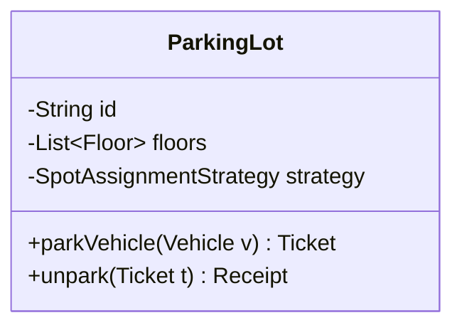
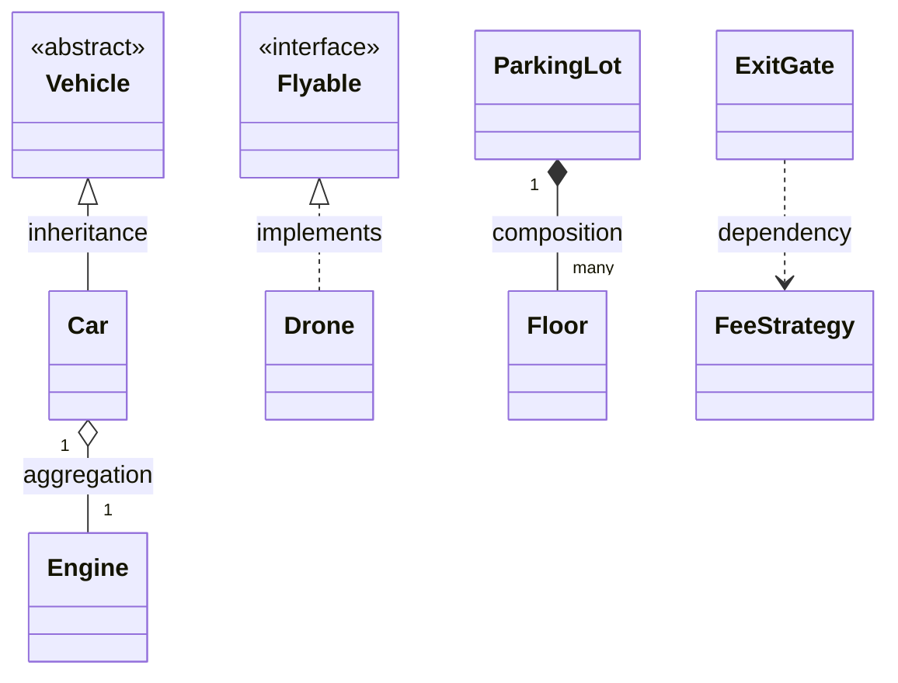
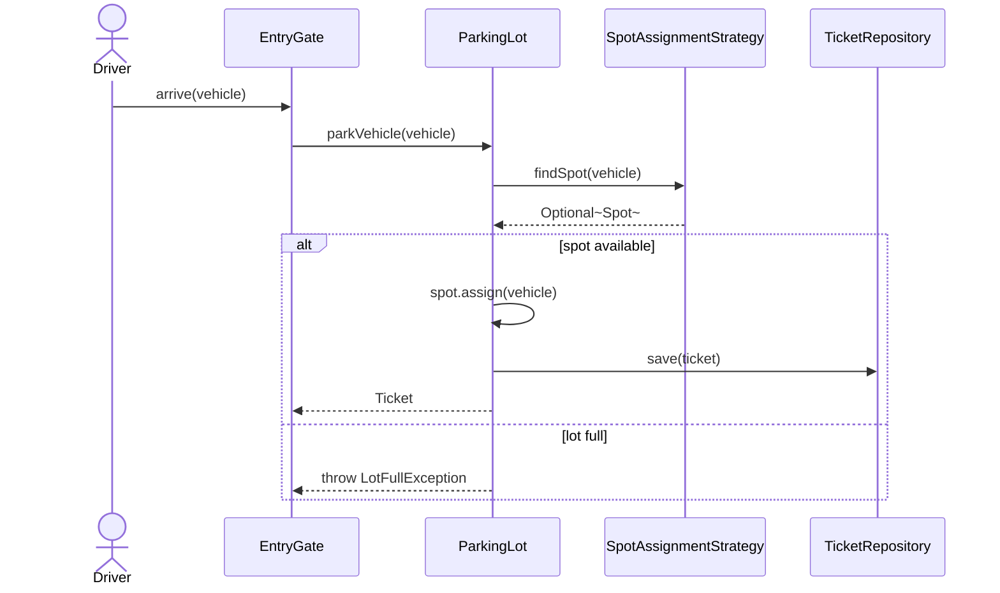
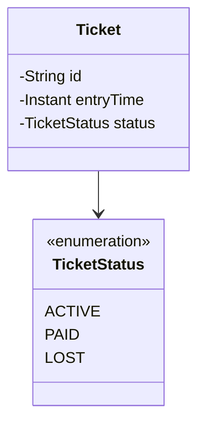

# 1.4 UML for Interviews — Class & Sequence Diagrams That Communicate

> You need ~20% of UML to ace 100% of interviews: class boxes, 5 relationship arrows, and a basic sequence diagram. The goal is *communication speed*, not standards compliance.

---

## The class box

Convention: `-` private, `+` public, `#` protected; fields on top, methods below. In an interview, **only show the members that matter for the discussion** — a 20-field box is noise.

## The five relationships that matter

| Arrow | Name | Meaning | Say it as |
|---|---|---|---|
| `<|--` | Inheritance | is-a (class) | "Car **is a** Vehicle" |
| `<|..` | Realization | implements interface | "Drone **implements** Flyable" |
| `*--` | Composition | owns; part dies with whole | "Floors **can't exist without** the lot" |
| `o--` | Aggregation | has; part outlives whole | "Engine **can be reused** elsewhere" |
| `..>` | Dependency | uses temporarily (param/local) | "ExitGate **uses** a FeeStrategy" |

**Honest truth to say if asked:** composition vs aggregation rarely changes code — both are fields. What matters is *ownership & lifecycle*: who creates it, who cleans up, can it be shared? Plain association (`-->`) is fine when you don't want to commit.

**Multiplicities:** `"1" -- "0..*"` etc. Use them where they carry a rule ("a Spot holds at most one Vehicle") and skip elsewhere.

## Sequence diagrams — for the "walk me through a flow" moment

The highest-leverage diagram in LLD interviews. When asked "what happens when a car enters?", draw this instead of talking:

Reading it aloud *is* your design narration: every arrow is a method call you're committing to. If an arrow feels awkward to name, the design is wrong — the diagram just caught a bug for free.

## Interview workflow — diagram before code

1. **Nouns → candidate classes** from the problem statement (parking lot, floor, spot, ticket, gate, vehicle).
2. **Verbs → methods/relationships** (park, unpark, calculate fee, assign).
3. Draw boxes + arrows, **talk while drawing** — get the interviewer nodding *before* writing Java.
4. Only then code — the diagram becomes your to-do list of classes.

This ordering is the single biggest process difference between candidates who pass and fail: code-first candidates get lost in refactors; diagram-first candidates walk a straight line.

## Common notation in these notes (and how to sketch fast on a whiteboard)

- Interface: box with `<<interface>>`; abstract: italics or `<<abstract>>`.
- Enum: box with `<<enumeration>>` listing values — great for states (`TicketStatus: ACTIVE, PAID, LOST`).
- On a physical whiteboard: solid arrow for is-a, diamond for has-a, dashed for uses. Nobody will grade arrowhead shapes — they grade whether relationships are *correct*.

---

## ✅ Key Takeaways
- Master exactly: class box, inheritance, realization, composition/aggregation, dependency, multiplicity — plus sequence diagrams.
- Diagram-first, code-second: nouns → classes, verbs → methods, then walk one end-to-end flow as a sequence.
- Show only decision-relevant members; a diagram is an argument, not an inventory.
- If a sequence arrow is hard to name, you found a design flaw early — cheapest possible fix.

## 💡 Tips & Tricks
- Start every case study by drawing the class diagram skeleton from memory — Part 5 chapters all include one to internalize.
- When the interviewer questions a relationship, annotate the diagram rather than defending verbally — "you're right, Ticket shouldn't own Payment; let me flip that arrow."
- Keep one flow diagrammed end-to-end rather than five flows half-done.
- Say multiplicities as business rules: "one spot, at most one vehicle — I'll enforce that in `Spot.assign()`."

## 🎯 Interview Q&A

**Q1. Composition vs aggregation — does the distinction actually matter?**
> Conceptually: composition = exclusive ownership + shared lifecycle (Floor dies with ParkingLot); aggregation = has-a with independent lifecycle (Driver has a Vehicle; the vehicle outlives the trip). In Java both are just fields, so what matters is what the distinction *implies*: who constructs the part, whether it can be shared across owners, and who's responsible for cleanup. I mention it when lifecycle is a real design question and don't split hairs otherwise.

**Q2. The interviewer asks for a class diagram of your half-coded design. What do you include?**
> The 5–8 classes that carry the design's ideas: the aggregate root, the interfaces (strategies/repositories), the entities with state machines, and the relationships with multiplicities that encode business rules. I omit getters, DTOs, and exceptions. Then I offer one sequence diagram of the core flow — that pair answers 90% of follow-ups before they're asked.

**Q3. When do you reach for a sequence diagram over a class diagram?**
> Class diagram = static structure: what exists and how it relates — I draw it once, upfront. Sequence diagram = dynamic behavior: who calls whom in what order for one scenario — I draw it per interesting flow ("book a seat", "car exits and pays"), especially when the flow crosses many objects or has branches (payment fails, lot full). If the interviewer asks "then what happens?", that's my cue to switch to sequence.

**Q4. How do you show a design pattern in UML quickly?**
> By its silhouette: Strategy = context box → interface → 2+ implementations (realization arrows); Observer = subject with a `*` association to a listener interface; Decorator = class that both implements and wraps the same interface (an arrow to itself via the interface); Factory = creator with a dashed "creates" dependency to products. Naming the silhouette while drawing ("this triangle-of-three is Strategy") transfers the idea in seconds.

**Q5. Where should associations be navigable — both ways?**
> Default to one direction: `Order → Customer` (order knows its customer) without `Customer → List<Order>` unless a use case needs it — bidirectional links double the coupling and create consistency burdens (both sides must stay in sync). When I do need reverse lookup, I often prefer a repository query (`orderRepository.findByCustomer(id)`) over an in-memory back-pointer, and say so.
