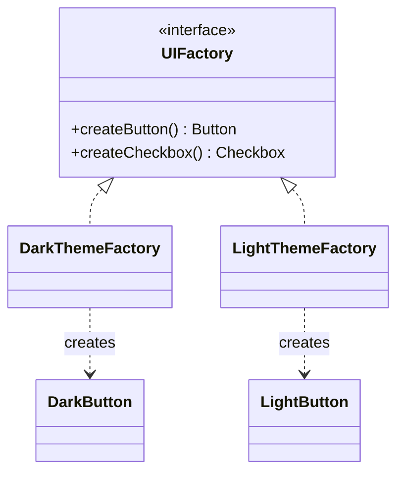

# 2.1 Creational Patterns — Singleton, Factory, Abstract Factory, Builder, Prototype

> Creational patterns answer one question: **who calls `new`, and how do we stop that decision from leaking everywhere?** In interviews you'll actually use three: Factory Method, Builder, and (carefully) Singleton.

---

## Singleton — one instance, globally reachable

**Use in interviews:** `ParkingLot`, `VendingMachine`, ID generators, config. **But** always add: *"in production I'd prefer a DI container managing one instance — Singleton hardcodes a global and hurts testability."* That caveat is half the marks.

```java
// The recommended version: enum — serialization-safe, reflection-safe, thread-safe by JVM guarantee
public enum IdGenerator {
    INSTANCE;
    private final AtomicLong counter = new AtomicLong();
    public long nextId() { return counter.incrementAndGet(); }
}

// The version they ask you to write: lazy + thread-safe (double-checked locking)
public class ParkingLot {
    private static volatile ParkingLot instance;          // volatile is NOT optional
    private ParkingLot() {}
    public static ParkingLot getInstance() {
        if (instance == null) {                           // fast path: no lock
            synchronized (ParkingLot.class) {
                if (instance == null) instance = new ParkingLot();  // second check inside lock
            }
        }
        return instance;
    }
}

// The clever version: holder idiom — lazy, thread-safe, no locks (JVM class-init guarantees)
public class Config {
    private Config() {}
    private static class Holder { static final Config INSTANCE = new Config(); }
    public static Config getInstance() { return Holder.INSTANCE; }
}
```

**Guaranteed follow-ups:** Why `volatile`? (Prevents reordered publication — another thread could see a non-null but half-constructed object.) Why check twice? (First check skips locking after init; second closes the race between two threads passing the first check.)

## Factory Method — centralize the `new`

**Problem:** `new Car()` / `new Bike()` scattered through the code = shotgun surgery when construction changes.

```java
public class VehicleFactory {
    public static Vehicle create(VehicleType type, String plate) {
        return switch (type) {
            case CAR   -> new Car(plate);
            case BIKE  -> new Bike(plate);
            case TRUCK -> new Truck(plate);
        };  // exhaustive over enum — compiler forces update on new type
    }
}
```

The one `switch` your design is allowed: creation knowledge lives in exactly one place. Everything downstream works with the `Vehicle` abstraction (OCP everywhere else).

**Classic (GoF) form** — subclasses decide the product; useful with Template Method:

```java
abstract class NotificationService {
    protected abstract Notifier createNotifier();          // factory method — the hook
    public void notify(User u, String msg) { createNotifier().send(u, msg); }  // template
}
class EmailNotificationService extends NotificationService {
    protected Notifier createNotifier() { return new EmailNotifier(); }
}
```

## Abstract Factory — families of related products

Use when products must be **consistent with each other** (all-dark widgets, all-Mac widgets).

```java
public interface UIFactory {           // one factory = one consistent family
    Button createButton();
    Checkbox createCheckbox();
}
public class DarkThemeFactory implements UIFactory {
    public Button createButton() { return new DarkButton(); }
    public Checkbox createCheckbox() { return new DarkCheckbox(); }
}
// client code is theme-blind:
UIFactory f = themeIsDark ? new DarkThemeFactory() : new LightThemeFactory();
```



**Interview line:** "Factory Method creates *one* product; Abstract Factory creates a *matched family*."

## Builder — many parameters, some optional, immutable result

**Problem:** telescoping constructors (`new Pizza(true, false, true, null, 3, ...)`) — unreadable, error-prone.

```java
public class Order {
    private final String id;                 // required
    private final List<Item> items;          // required
    private final Address address;           // optional
    private final Coupon coupon;             // optional

    private Order(Builder b) {               // private: Builder is the only door
        this.id = b.id; this.items = List.copyOf(b.items);
        this.address = b.address; this.coupon = b.coupon;
    }

    public static Builder builder(String id) { return new Builder(id); }

    public static class Builder {
        private final String id;
        private final List<Item> items = new ArrayList<>();
        private Address address; private Coupon coupon;

        Builder(String id) { this.id = Objects.requireNonNull(id); }
        public Builder addItem(Item i) { items.add(i); return this; }
        public Builder shipTo(Address a) { address = a; return this; }
        public Builder withCoupon(Coupon c) { coupon = c; return this; }
        public Order build() {
            if (items.isEmpty()) throw new IllegalStateException("order needs items");
            return new Order(this);           // validation in ONE place, result immutable
        }
    }
}
// Order o = Order.builder("o-1").addItem(pizza).shipTo(home).build();
```

Three wins to narrate: readable named steps, **cross-field validation at `build()`**, immutable product. Use for: `Order`, `User`, `HttpRequest`, `Pizza`, any 4+ param object.

## Prototype — clone instead of construct

Rare in interviews; know the idea: when construction is expensive or you need many near-copies, copy an existing instance (`copy()` method returning a deep copy). Java tip: prefer **copy constructors** over `Cloneable` (broken by design — say why: no constructor call, shallow by default, checked exception).

```java
public GameState copy() {                    // deep copy for game-tree exploration / undo
    return new GameState(board.copy(), new ArrayList<>(moves), currentPlayer);
}
```

---

## Choosing quickly

| Situation in the problem | Pattern |
|---|---|
| "There must be exactly one lot / machine / logger" | Singleton (+ DI caveat) |
| Creating variants of one abstraction from a type/enum | Factory Method |
| Consistent families (themes, cloud providers, DB dialects) | Abstract Factory |
| 4+ constructor params, optionals, want immutability | Builder |
| Undo/redo, snapshots, expensive construction | Prototype (copy constructor) |

## ✅ Key Takeaways
- Factory = the one allowed `switch`; everything after construction is abstraction-only.
- Builder = readability + one validation point + immutability; know the static-inner-class form cold.
- Singleton: enum or holder idiom preferred; DCL needs `volatile`; always mention the DI alternative.
- Abstract Factory = families; Prototype = copy constructors, not `Cloneable`.

## 💡 Tips & Tricks
- In machine coding, write the factory the moment you have 2+ subtypes — retrofitting later wastes minutes.
- Records don't need builders under ~4 params — say "record is enough here" to show calibration.
- If you write DCL, preempt with "volatile prevents seeing a half-constructed instance" before they ask.
- Never Singleton entities (Ticket, Order) — only true process-wide services. Singletons holding mutable state need thread-safety (Part 3).

## 🎯 Interview Q&A

**Q1. Why is Singleton called an anti-pattern, and when is it still right?**
> Costs: hidden global dependency (call sites don't declare they use it), hard to substitute in tests, carries mutable global state, and complicates concurrency. Still right for: genuinely process-wide, stateless-or-thread-safe services — config, metrics, ID generation — ideally with the *container* enforcing single-instance rather than the class itself. In interviews I implement it when the domain says "the system has one X," and note I'd inject it rather than call `getInstance()` deep in the code.

**Q2. Walk through why double-checked locking is broken without `volatile`.**
> `instance = new ParkingLot()` is three steps: allocate, run constructor, publish reference — and the compiler/CPU may reorder publish before construct. Thread B can then pass the outer null-check and use a half-initialized object. `volatile` inserts the barrier making publication happen-after construction. Alternatives that avoid the subtlety entirely: holder idiom (class-init lock does it) or enum.

**Q3. Factory Method vs Abstract Factory vs simple static factory?**
> Static factory: one method mapping input → concrete product; my default in interviews. GoF Factory Method: creation deferred to *subclasses* via an abstract hook — used when a framework/template owns the flow but not the product. Abstract Factory: an interface producing a *family* of related products that must match (dark button + dark checkbox). Escalate only as the problem demands: most interview problems need just the static factory.

**Q4. Doesn't the factory's `switch` violate Open/Closed?**
> Technically yes — and that's the accepted trade: I concentrate the violation in one cohesive place so the other 95% of the code is closed. Java's exhaustive `switch` over enums turns "forgot to update" into a compile error, which is a feature. If variants multiply or come from plugins, I upgrade to a registration map (`Map<Type, Supplier<Vehicle>>`) — then adding a type touches zero existing lines.

**Q5. When Builder vs constructor vs record?**
> ≤3 required params, no optionals → constructor or record. Optionals/defaults, cross-field validation, or step-wise assembly (test-data builders!) → Builder. Mutable JavaBean setters are the option I rule out: they allow half-initialized objects and thread-unsafe publication. Bonus senior point: Builder pairs beautifully with immutability — the builder is the only mutable phase, `build()` freezes it.
