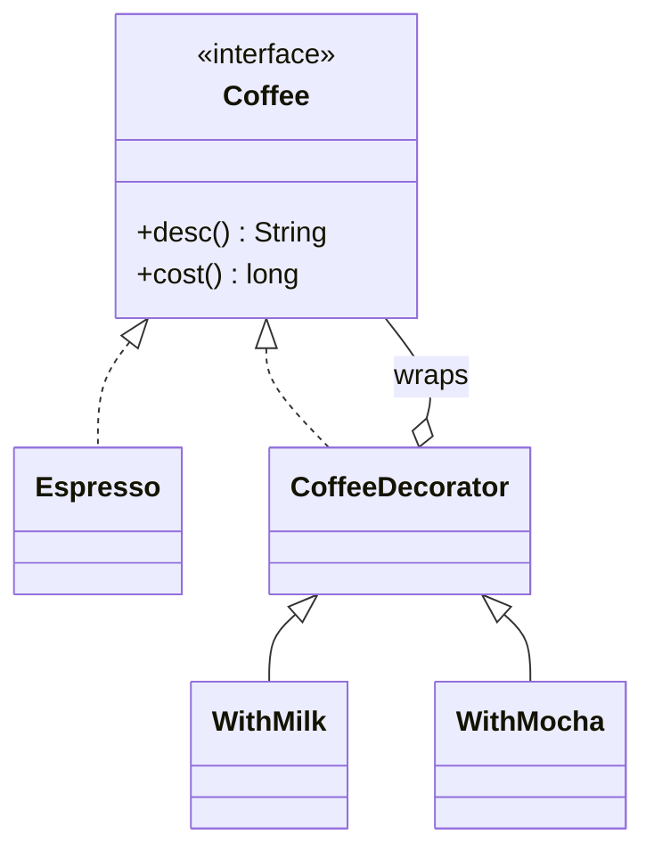

# 2.2 Structural Patterns — Adapter, Decorator, Facade, Composite, Proxy, Flyweight, Bridge

> Structural patterns are about **wiring objects together** without welding them. The interview stars: Decorator (pricing/toppings), Composite (file systems, org trees), Adapter (third-party gateways), Facade (your service layer — you already use it).

---

## Adapter — make an alien interface fit yours

**Trigger:** integrating third-party/legacy code whose interface doesn't match your abstraction (payment gateways are *the* interview example).

```java
public interface PaymentProcessor {                     // YOUR domain interface
    PaymentResult charge(Money amount, PaymentMethod m);
}

public class StripeAdapter implements PaymentProcessor {
    private final StripeClient stripe;                  // THEIR sdk
    public StripeAdapter(StripeClient s) { this.stripe = s; }

    @Override public PaymentResult charge(Money amount, PaymentMethod m) {
        StripeCharge c = stripe.createCharge(            // translate: units, models, errors
            amount.amountPaise(), amount.currency().code(), toStripeSource(m));
        return c.succeeded() ? PaymentResult.success(c.id())
                             : PaymentResult.failure(mapError(c.errorCode()));
    }
}
```

Your domain never imports `com.stripe.*` — swapping Razorpay in = one new adapter. This is DIP with a passport.

## Decorator — stack behavior at runtime

**Trigger:** combinatorial add-ons — coffee toppings, pizza extras, notification channels, streams. The decorator **is** the interface and **has** the interface:

```java
public interface Coffee { String desc(); long cost(); }

public class Espresso implements Coffee {
    public String desc() { return "Espresso"; } public long cost() { return 120; }
}

public abstract class CoffeeDecorator implements Coffee {
    protected final Coffee inner;                        // wraps another Coffee
    protected CoffeeDecorator(Coffee c) { inner = c; }
}
public class WithMilk extends CoffeeDecorator {
    public WithMilk(Coffee c) { super(c); }
    public String desc() { return inner.desc() + " + milk"; }
    public long cost() { return inner.cost() + 30; }
}

// Coffee order = new WithMilk(new WithMocha(new Espresso()));  // any combo, no class explosion
```



**The math to say:** n add-ons via subclassing = 2ⁿ classes; via decorator = n classes. Java's own `BufferedInputStream(new FileInputStream(f))` is the canonical citation.

## Facade — one simple door to a messy subsystem

**Trigger:** a use case touches 4+ subsystems; callers shouldn't choreograph them.

```java
public class OrderFacade {
    private final InventoryService inventory;
    private final PaymentProcessor payments;
    private final ShippingService shipping;
    private final NotificationService notifier;

    public OrderConfirmation placeOrder(Cart cart, PaymentMethod pm) {
        inventory.reserve(cart.items());
        PaymentResult pr = payments.charge(cart.total(), pm);
        if (!pr.ok()) { inventory.release(cart.items()); throw new PaymentFailedException(pr); }
        Shipment s = shipping.schedule(cart);
        notifier.orderPlaced(cart.customer(), s);
        return new OrderConfirmation(s.trackingId());
    }
}
```

Every `XxxService` you naturally write **is** a facade — name the pattern when you do it. Facade *simplifies* (new interface over many); Adapter *translates* (your interface over one alien).

## Composite — treat one and many uniformly

**Trigger:** tree structures — file systems, org charts, UI widgets, nested comments, menu categories.

```java
public interface FileSystemNode {
    String name(); long size();
}
public class FileNode implements FileSystemNode {                 // leaf
    private final String name; private final long bytes;
    public long size() { return bytes; }
}
public class DirectoryNode implements FileSystemNode {            // composite
    private final String name;
    private final List<FileSystemNode> children = new ArrayList<>();
    public void add(FileSystemNode n) { children.add(n); }
    public long size() { return children.stream().mapToLong(FileSystemNode::size).sum(); }  // recursion
}
```

Client asks `root.size()` and never cares if it's a file or a 10-level tree. Design question they'll poke: does `add()` belong on the interface? Putting it there = uniformity but leaves must throw (LSP hit); keeping it on `DirectoryNode` = safety but clients must type-check. **Say the trade-off, pick safety.**

## Proxy — same interface, controlled access

Same interface as the real object, but the proxy adds: lazy loading (virtual proxy), access control (protection proxy), caching, rate-limiting, or remoteness (RPC stubs).

```java
public class CachingProductProxy implements ProductCatalog {
    private final ProductCatalog real;                     // same interface — drop-in
    private final Map<String, Product> cache = new ConcurrentHashMap<>();
    public Product byId(String id) {
        return cache.computeIfAbsent(id, real::byId);
    }
}
```

**Proxy vs Decorator (favorite question):** same shape, different intent — decorator *adds behavior the client wants*, proxy *controls access the client doesn't see* (and often manages the real object's lifecycle). Spring AOP/`@Transactional` = dynamic proxies; Hibernate lazy-loading = virtual proxies.

## Flyweight — share the heavy immutable part

**Trigger:** millions of objects with repeated intrinsic state. Split: **intrinsic** (shared, immutable — glyph shape, tree texture, chess piece type) vs **extrinsic** (per-instance — position).

```java
// Chess needs 32 pieces on the board but only 12 distinct piece-type objects ever.
public enum PieceType { /* KING, QUEEN ... with movement rules */ }   // flyweights
record PlacedPiece(PieceType type, Color color, Square at) {}          // extrinsic: position
```

Java citation: `Integer.valueOf(-128..127)` returns cached instances; `String` interning. Mention memory math ("1M cache entries sharing 100 metadata objects") and move on.

## Bridge — two independent axes of variation

**Trigger:** a hierarchy multiplying across two dimensions (`Shape × RenderApi`, `Notification × Channel`). Split into abstraction + implementor and compose:

```java
public abstract class Notification {              // axis 1: kind of message
    protected final MessageSender sender;          // bridge to axis 2: channel
    protected Notification(MessageSender s) { sender = s; }
    public abstract void send(User u);
}
public interface MessageSender { void deliver(String to, String body); }  // email/sms/push
// UrgentNotification × SmsSender, DigestNotification × EmailSender — n+m classes, not n×m
```

Bridge is "composition over inheritance" formalized. If you catch yourself naming a class `EmailUrgentNotification`, say "two axes — I'll bridge them."

---

## Choosing quickly

| Smell in the problem | Pattern |
|---|---|
| Third-party SDK's interface ≠ yours | Adapter |
| Optional add-ons stack in any combination | Decorator |
| One use case orchestrates many subsystems | Facade |
| Tree / part-whole, uniform operations | Composite |
| Control/loading/caching around a real object | Proxy |
| Millions of similar objects, memory pressure | Flyweight |
| Class names concatenating two dimensions | Bridge |

## ✅ Key Takeaways
- Adapter translates, Facade simplifies, Proxy controls, Decorator enriches — same wrapping shape, four intents. Interviewers test *intent*, not shape.
- Decorator kills 2ⁿ subclass explosions; Composite makes recursion disappear behind an interface.
- Flyweight = share immutable intrinsic state; Bridge = split two independently-varying axes.

## 💡 Tips & Tricks
- Cite the JDK: streams (Decorator), `Collections.unmodifiableList` (Proxy), `Integer.valueOf` (Flyweight), NIO `Files` (Facade) — one citation each = instant depth signal.
- In pricing problems (coffee/pizza), *start* with Decorator; it's the expected answer and unlocks the follow-ups.
- When wrapping anything, keep the wrapper implementing the same interface — that's what makes all four wrap-patterns composable.

## 🎯 Interview Q&A

**Q1. Decorator vs inheritance for coffee add-ons — quantify the win.**
> With inheritance, every combination is a class: 5 toppings → 2⁵ = 32 classes, and "double milk" is impossible. With Decorator: 1 base + 5 decorators = 6 classes, combinations composed at runtime, duplicates allowed, order visible in construction. Cost: many small objects and stack-like debugging — acceptable price, and the same trade the JDK made for streams.

**Q2. Proxy and Decorator look identical in UML. How do you tell them apart in a codebase?**
> Ask what the wrapper knows and why it exists. Decorator: client composes it deliberately to *add* visible behavior; wrappers stack; the wrapped object is handed in. Proxy: client usually doesn't know it's there; it *controls* access (lazy-init, auth, caching, remote) and often creates/owns the real subject itself; typically one layer. Rule of thumb: found in business code composing features → decorator; found at infrastructure boundaries → proxy.

**Q3. Design an in-memory file system's size calculation. Which pattern and why?**
> Composite. `FileSystemNode` interface with `size()`; `File` leaf returns bytes; `Directory` holds `List<FileSystemNode>` and sums recursively. Uniformity means `du`-style logic is one polymorphic call — no instanceof, no separate traversal code. I'd keep `add/remove` on `Directory` only (type safety over uniformity) and note the LSP reasoning. Full build-out in Ch 5.13.

**Q4. Where does Adapter sit in a clean architecture?**
> At the boundary, pointing inward: the domain defines the port (`PaymentProcessor`), adapters in the infrastructure layer implement it by translating models, units, and error taxonomies of each vendor. Domain code has zero vendor imports; vendor swap = new adapter + config change. This is the hexagonal "ports and adapters" naming — the pattern and the architecture are the same idea at two scales.

**Q5. When is Flyweight actually worth it?**
> When profiling (or arithmetic) shows object count × intrinsic-state size matters: text editors (a glyph object per character is absurd), game boards, map tiles, connection metadata. Preconditions: the shared state must be immutable, and identity must not matter (`==` comparisons break). If those don't hold — or the count is thousands, not millions — it's premature optimization; modern JVMs are fine with thousands of small objects, and I'd say so.
