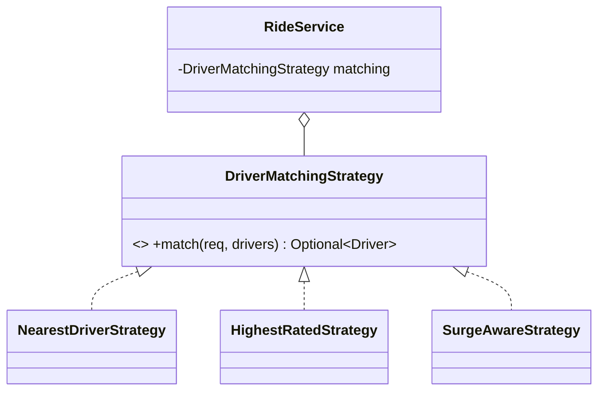
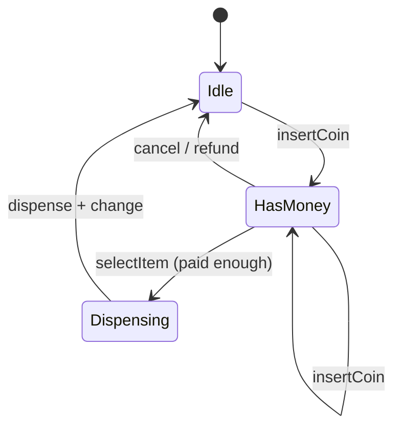

# 2.3 Behavioral Patterns I — Strategy, Observer, Command, State

> These four carry more interview weight than all other patterns combined. **Strategy** appears in nearly every case study; **State** owns vending machines and elevators; **Observer** owns notifications; **Command** owns undo and schedulers.

---

## Strategy — swap the algorithm

**Trigger words in the problem:** "different ways to…", "pricing rules", "matching logic", "payment methods", "eviction policy".

```java
public interface DriverMatchingStrategy {
    Optional<Driver> match(RideRequest req, List<Driver> available);
}
public class NearestDriverStrategy implements DriverMatchingStrategy { ... }
public class HighestRatedStrategy implements DriverMatchingStrategy { ... }

public class RideService {
    private final DriverMatchingStrategy matching;                 // injected → swappable
    public RideService(DriverMatchingStrategy m) { matching = m; }
}
```



Modern Java note: a strategy with one method can be a lambda — `FeeStrategy hourly = d -> d.toHours() * 20;`. Say it; still name the interface (the *name* is the documentation).

**Strategy is your OCP answer** to every "what if a new X rule comes?" follow-up. Selection lives in a factory/map: `Map<PlanType, FeeStrategy>`.

## Observer — one event, many reactions, zero coupling

**Trigger:** "notify", "when X happens, Y and Z should…", price alerts, seat availability, game move → UI/logger/bot.

```java
public interface OrderListener { void onOrderPlaced(Order o); }

public class OrderService {
    private final List<OrderListener> listeners = new CopyOnWriteArrayList<>();  // safe iteration
    public void register(OrderListener l) { listeners.add(l); }

    public void place(Order o) {
        repo.save(o);                                              // core logic first
        for (OrderListener l : listeners) {
            try { l.onOrderPlaced(o); }                            // one bad listener
            catch (Exception e) { log.warn("listener failed", e); } // must not break the rest
        }
    }
}
// InventoryUpdater, EmailConfirmation, AnalyticsTracker — each a listener; adding one touches nothing
```

**Design points that score:** publisher knows only the interface; exceptions isolated per listener; `CopyOnWriteArrayList` so listeners can (un)register during notification; mention sync vs async delivery ("for slow listeners I'd hand events to an executor — that's the road to pub-sub, Ch 5.12").

## Command — reify an action into an object

**Trigger:** undo/redo, task queues/schedulers, transactional macros, hotkey remapping, text editors.

```java
public interface Command { void execute(); void undo(); }

public class InsertTextCommand implements Command {
    private final Document doc; private final int pos; private final String text;
    public void execute() { doc.insert(pos, text); }
    public void undo()    { doc.delete(pos, text.length()); }
}

public class CommandInvoker {                                  // history = undo/redo for free
    private final Deque<Command> undoStack = new ArrayDeque<>();
    private final Deque<Command> redoStack = new ArrayDeque<>();
    public void run(Command c) { c.execute(); undoStack.push(c); redoStack.clear(); }
    public void undo() { if (!undoStack.isEmpty()) { Command c = undoStack.pop(); c.undo(); redoStack.push(c); } }
    public void redo() { if (!redoStack.isEmpty()) { Command c = redoStack.pop(); c.execute(); undoStack.push(c); } }
}
```

The insight to narrate: **once an action is an object, you can store, queue, log, replay, and invert it.** Invoker knows nothing about documents — only `Command`. `Runnable` is Command without undo.

## State — behavior that changes with internal state

**Trigger:** the entity's *response to the same event* depends on its mode — vending machine, elevator, order lifecycle, ATM, media player, Tic-Tac-Toe turn handling.

```java
public interface MachineState {
    MachineState insertCoin(VendingMachine m, long amount);
    MachineState selectItem(VendingMachine m, String code);
    MachineState dispense(VendingMachine m);
}

public class IdleState implements MachineState {
    public MachineState insertCoin(VendingMachine m, long amt) {
        m.addBalance(amt);
        return new HasMoneyState();                       // transition = return next state
    }
    public MachineState selectItem(VendingMachine m, String c) {
        m.display("Insert coin first"); return this;      // invalid event: explicit, not crash
    }
    public MachineState dispense(VendingMachine m) { m.display("Nothing to dispense"); return this; }
}

public class VendingMachine {
    private MachineState state = new IdleState();
    public void insertCoin(long amt) { state = state.insertCoin(this, amt); }  // delegate everything
    public void selectItem(String c) { state = state.selectItem(this, c); }
}
```



**Why not an enum + switch?** For 2–3 states with trivial transitions, enum+switch is fine — say so. State pattern wins when each state has real behavior: no `if(state==X && event==Y)` matrix, invalid transitions are impossible to forget (every state must answer every event), and adding a state = adding a class.

**State vs Strategy (asked constantly):** identical class structure. Strategy: *client* picks the algorithm, variants don't know each other, rarely changes mid-flight. State: *the object itself* transitions between states, states know their successors, changes constantly at runtime.

---

## ✅ Key Takeaways
- Strategy = pluggable algorithm chosen from outside; the universal OCP answer.
- Observer = decoupled fan-out; isolate listener failures; know the async upgrade path.
- Command = action as object → queues, logs, undo/redo via two stacks.
- State = event handling delegated to a state object returning the next state; draw the state diagram first.

## 💡 Tips & Tricks
- Before coding a state machine, **draw the state diagram and get a nod** — coding transitions from an agreed picture is mechanical.
- In Observer, firing listeners *after* persisting is a correctness point — say it ("no emails for orders that failed to save").
- Undo needs commands to capture *inverse data* (deleted text, previous value) at execute-time — mention this; it's the trap in undo questions.
- If you hear "the same button does different things depending on…" — that's State, verbatim.

## 🎯 Interview Q&A

**Q1. State vs Strategy — same UML, so what's actually different?**
> Intent and lifecycle. Strategy: interchangeable algorithms for one task; chosen by the client/config; strategies are peers unaware of each other; typically fixed for the object's lifetime. State: modes of one object where behavior *and allowed events* differ; the current state decides the next state (they know each other); transitions happen constantly, driven from inside. Quick test: who changes the implementation at runtime? Outside → Strategy. The object itself → State.

**Q2. Your Observer publisher must not miss events, and a listener is slow. Options?**
> Separate delivery from computation: publisher appends to a queue per listener and returns; a worker drains each queue (this is exactly a mini pub-sub broker). Slow listener then delays only itself; backpressure = bounded queue + policy (block producer / drop oldest / drop listener with alert). If in-process and simple must stay: executor per listener or a shared pool with per-listener ordering keys. And I'd note "no missed events across restarts" needs persistence — the Outbox idea from HLD.

**Q3. Implement undo for a text editor. Why Command over Memento?**
> Command stores *deltas* (inverse operations): `InsertText.undo()` deletes the inserted range — O(op) memory, natural redo, and an audit log for free. Memento snapshots *whole state* — O(document) per step, but trivially correct even when operations aren't invertible. Real editors mix: commands for typing, periodic snapshots as checkpoints (bounding replay cost). I'd default to Command with the two-stack invoker and mention snapshot checkpoints as the scaling valve.

**Q4. How does the State pattern prevent illegal transitions, versus a status enum?**
> With an enum, every handler must remember to check `if (status == PAID)` — forgetting one check silently allows `ship()` on an unpaid order. With State, `UnpaidState` simply has a `ship()` that raises/ignores by *design*: the compiler forces every state to answer every event, so the full event×state matrix is enumerated — nothing falls through. The state diagram becomes executable documentation.

**Q5. Where would you use Strategy + Factory together?**
> Whenever the strategy is picked from data: `PaymentMethod` enum → `PaymentStrategyFactory.for(method)` returns UPI/Card/Wallet strategy from a pre-built map. The factory is the single place that knows all variants; consumers see only the interface; adding a variant = one class + one map entry. This combo answers "how does the right algorithm get chosen?" — the question Strategy alone leaves open.
