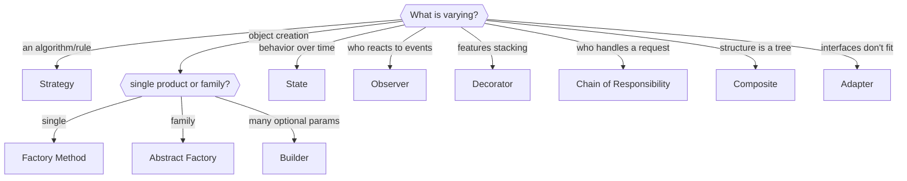

# 2.5 Choosing the Right Pattern — The Problem → Pattern Map

> Patterns are answers; interviews give you problems. This chapter is the reverse index: hear the requirement, recognize the shape, name the pattern *with a reason*. Never say a pattern name without the reason.

---

## The master map

| You hear… | Shape of the problem | Pattern | One-line justification to say |
|---|---|---|---|
| "different pricing / matching / eviction rules" | algorithm varies | **Strategy** | "new rules shouldn't edit tested code" |
| "notify users / update scoreboard when X happens" | one event, many reactions | **Observer** | "publisher shouldn't know its consumers" |
| "the machine behaves differently once coin inserted" | mode-dependent behavior | **State** | "no if-matrix; illegal events impossible" |
| "undo / redo / schedule / replay actions" | actions need to be values | **Command** | "an action object can be stored & inverted" |
| "toppings / add-ons / optional features stack" | combinatorial add-ons | **Decorator** | "n classes instead of 2ⁿ" |
| "folders contain files or folders" | tree, uniform ops | **Composite** | "clients treat one and many the same" |
| "integrate Stripe/Razorpay/legacy API" | alien interface | **Adapter** | "domain stays vendor-free" |
| "one call should orchestrate 5 subsystems" | complexity behind a door | **Facade** | "callers get a use-case API" |
| "log levels / approval levels / cash denominations" | pipeline of handlers | **Chain of Responsibility** | "pipeline is config, not code" |
| "exactly one lot / logger / config" | single instance | **Singleton** | "one instance, but I'd DI it" |
| "create the right subclass from a type" | creation varies | **Factory** | "one place knows the concretes" |
| "object with 6 optional fields, immutable" | complex construction | **Builder** | "named steps + validate once + immutable" |
| "same workflow, steps differ per subtype" | skeleton + blanks | **Template Method** | "the sequence is the invariant" |
| "control access / cache / lazy-load the real thing" | stand-in object | **Proxy** | "client can't tell; access is governed" |
| "millions of similar objects" | memory from duplication | **Flyweight** | "share the immutable part" |
| "chat members / widgets all inter-talking" | n² links | **Mediator** | "n links to a hub instead" |
| "class names = Axis1×Axis2 combinations" | two dimensions multiply | **Bridge** | "n+m classes, not n×m" |

## Recognition flowchart

## Pattern combos that win case studies

Real designs are pattern *sentences*, not single words:

- **Parking Lot** = Singleton lot + **Strategy** (spot assignment, fee) + **Factory** (vehicles) + Observer (display boards).
- **Vending Machine / ATM** = **State** (machine modes) + CoR (cash denominations) + Singleton.
- **Elevator** = **State** (moving/idle/door) + **Strategy** (scheduling: nearest-car, LOOK) + Observer (floor displays).
- **BookMyShow** = **Factory** + **Strategy** (pricing) + Observer (seat release) + explicit locking (Part 3).
- **Logger** = **Chain of Responsibility** + Singleton + **Strategy** (formatters/appenders).
- **Splitwise** = **Strategy** (equal/exact/percent splits) + Factory + Observer (balance notifications).
- **Chess** = **Factory** (pieces) + **Strategy** (per-piece movement) + Command (moves → undo) + Memento (board snapshots).
- **Uber** = **Strategy** (matching, pricing) + **State** (trip lifecycle) + Observer (location updates).
- **Text editor** = **Command** (+ Memento checkpoints) + Flyweight (glyphs) + Composite (document tree).

Notice the frequency table: Strategy ~everywhere, State in anything machine-like, Observer wherever something must be *told*. That's your prior.

## The anti-checklist — when NOT to pattern

- **Two variants, no third in sight** → an `if` is honest. Patterns pay rent when variation is real.
- **Pattern before problem** ("let me add Observer in case…") → YAGNI violation, reads as cargo cult.
- **Singleton as global grab-bag** → hidden coupling; inject instead.
- **Visitor on an evolving hierarchy** → every new type breaks every visitor.
- **Decorator for one fixed add-on** → just a field.
- The tell interviewers watch for: can you produce the **reason** on demand? "Strategy, because the problem statement promises new fee rules" ✓. "Strategy, because it's best practice" ✗.

## How to *say* patterns in the interview

1. **Recognize aloud:** "Pricing varies by plan — that's a Strategy seam."
2. **Justify with the change axis:** "so future rules are add-a-class, not edit-the-service."
3. **Show the seam in code:** interface + injection point (implementations can stay stubbed).
4. **Concede the cost:** "more classes; if rules never multiply this was overhead — I think the requirement justifies it."

That 4-beat rhythm — recognize, justify, seam, cost — is what "uses patterns judiciously" means on the rubric.

---

## ✅ Key Takeaways
- Map requirement *shapes* to patterns; the reason is mandatory, the name is optional.
- Real designs are combos: Strategy + State + Factory covers most of Part 5.
- Under-patterning a stated variation loses points; over-patterning an unstated one loses more.
- Rhythm: recognize → justify → seam → cost.

## 💡 Tips & Tricks
- Memorize the combo list above — it doubles as a table of contents for Part 5.
- When stuck, ask "what did the interviewer say will change?" — the answer names your pattern.
- If you can't decide between two patterns in 30 seconds, pick the simpler one and state the upgrade path.

## 🎯 Interview Q&A

**Q1. Interviewer: "Why did you use a pattern here at all?"**
> Because the requirement encodes a change axis: you said fee rules differ per vehicle and will grow. The Strategy seam makes that growth additive — new class, no edits to tested code — and it cost one interface. If that requirement disappeared, I'd delete the interface: patterns are responses to variation, not decoration.

**Q2. "Which pattern is most overused, in your opinion?"**
> Singleton — it's really a global variable with ceremony: hidden dependencies, test pollution via shared state, and a concurrency hazard when it holds mutable data. Second place: Factory layers wrapping a constructor that has exactly one implementation. My rule: a pattern must be *pulled in* by a requirement I can quote; otherwise it's résumé-driven design.

**Q3. "Design X" has three patterns applicable. How do you present that?**
> Lead with the one solving the stated pain, mention the others as seams. For a notification system: Observer is the spine (decoupled fan-out); Strategy sits inside each channel for formatting; Factory picks channels from user prefs. Presenting them as *layers with jobs* — spine, variation point, creation point — shows architecture, not pattern bingo.

**Q4. "Can you solve it without any patterns?"**
> Yes, and I'd start there: concrete classes, direct calls, an if per variation. The patterns emerge as refactors when variation shows up — that's actually their definition: named refactoring targets. What I won't do is *hide* structure to seem simple: if the if-ladder on type already exists in three methods, extracting Strategy is the simpler design, pattern name or not.

**Q5. "How do patterns relate to SOLID?"**
> Patterns are SOLID's standard solutions. OCP → Strategy/Decorator/Template (extend without editing). DIP → Adapter/Factory (depend on abstractions, translate at edges). SRP → Facade/Mediator (separate orchestration from work). LSP discipline shows up in State/Composite contracts; ISP shapes the small interfaces patterns depend on. If I forget every pattern name but honor SOLID, I'll reinvent them — patterns are just the shared vocabulary for the shapes SOLID produces.
