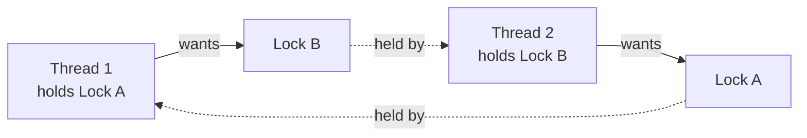

# 3.1 Java Concurrency Essentials — Threads, Locks, Visibility, Executors

> "Is your design thread-safe?" is the sharpest follow-up in LLD interviews. This chapter gives you the vocabulary and tools; Ch 3.3 turns them into interview moves.

---

## The two problems (name them precisely)

1. **Atomicity / race conditions:** `count++` is read-modify-write; two threads interleave and one update is lost. Check-then-act (`if (spot.isFree()) spot.assign(v)`) races the same way.
2. **Visibility / ordering:** without synchronization, one thread's write may *never* be seen by another (CPU caches, compiler reordering). A `boolean running` flag without `volatile` can loop forever.

Both are fixed by establishing **happens-before** edges: `synchronized`, `volatile`, `Lock`, atomics, thread start/join, and concurrent-collection operations all create them. Using the term "happens-before" correctly is a senior signal.

## synchronized — the default tool

```java
public class SpotInventory {
    private final Map<SpotId, Spot> spots = new HashMap<>();
    private final Object lock = new Object();               // private lock object > locking 'this'

    public Optional<Spot> reserve(VehicleType t) {
        synchronized (lock) {                               // atomicity + visibility together
            return spots.values().stream()
                .filter(s -> s.fits(t) && s.isFree())
                .findFirst()
                .map(s -> { s.assign(); return s; });       // check-then-act INSIDE the lock
        }
    }
}
```

- Reentrant (a thread can re-acquire its own monitor).
- **Lock the check and the act together** — the classic interview bug is synchronizing them separately.
- Prefer a private final lock object: locking `this` lets outside code interfere with your locking protocol.

## volatile — visibility only, not atomicity

```java
private volatile boolean shutdownRequested;      // ✓ flag: one writer, many readers
private volatile int count;                       // ✗ count++ still races (read-modify-write)
```

Use for: flags, publish-once references (the DCL singleton). If more than one thread *writes based on the old value* → you need atomics or locks.

## Atomics — lock-free counters and CAS

```java
private final AtomicLong ticketSeq = new AtomicLong();
public String nextTicketId() { return "T-" + ticketSeq.incrementAndGet(); }

// CAS loop — the idiom behind all atomics:
public boolean tryReserve(AtomicReference<SpotState> state) {
    SpotState cur = state.get();
    return cur == FREE && state.compareAndSet(FREE, HELD);   // succeeds only if unchanged
}
```

`compareAndSet` = "set only if still what I read" — optimistic concurrency in one instruction. Say "CAS" when explaining `AtomicInteger`, `LongAdder` (better under heavy contention), and lock-free structures.

## ReentrantLock — when synchronized isn't enough

```java
private final ReentrantLock lock = new ReentrantLock();     // (true) = fair mode, FIFO

public boolean parkWithTimeout(Vehicle v) throws InterruptedException {
    if (!lock.tryLock(2, TimeUnit.SECONDS)) return false;   // can't do this with synchronized
    try {
        return doPark(v);
    } finally {
        lock.unlock();                                       // ALWAYS in finally
    }
}
```

Choose over `synchronized` for: `tryLock` / timeouts (deadlock avoidance), fairness, multiple `Condition`s per lock, lock across non-block-structured code. Also know **`ReadWriteLock`**: many concurrent readers, exclusive writer — ideal for read-heavy caches/inventories. (**`StampedLock`** exists for optimistic reads — name-drop only.)

## wait/notify & Condition — waiting for state, not spinning

```java
// bounded buffer, Condition version (Ch 3.3 has the full producer-consumer)
lock.lock();
try {
    while (queue.size() == capacity)      // WHILE, never if — spurious wakeups + recheck
        notFull.await();
    queue.add(item);
    notEmpty.signal();
} finally { lock.unlock(); }
```

The three rules they probe: hold the lock while waiting/signaling; **wait in a while-loop**; prefer `signal`-with-distinct-conditions over `notifyAll`-storms. Then say: "in real code I'd use `BlockingQueue` and delete all of this" (Ch 3.2).

## Executors — never raw `new Thread()` in a design

```java
ExecutorService pool = Executors.newFixedThreadPool(8);          // CPU-bound: ≈ cores
ScheduledExecutorService timer = Executors.newScheduledThreadPool(1);  // timeouts, sweepers

Future<Receipt> f = pool.submit(() -> exitService.process(ticket));
timer.scheduleAtFixedRate(this::releaseExpiredHolds, 1, 1, TimeUnit.MINUTES);
```

Design-conversation points: thread pools bound resource use and reuse threads; `CompletableFuture` for composing async steps; **virtual threads (Java 21)** — "with Loom I'd give each request its own virtual thread and keep the code blocking-style" is a great modern aside. Always shut pools down (`shutdown()` + `awaitTermination`).

## Deadlock — the four conditions and the one fix you must know



Needs all four: mutual exclusion, hold-and-wait, no preemption, circular wait. **Standard fix: global lock ordering** — always acquire locks in a canonical order (e.g., by account ID):

```java
public void transfer(Account a, Account b, long amt) {
    Account first = a.id().compareTo(b.id()) < 0 ? a : b;    // order by ID
    Account second = first == a ? b : a;
    synchronized (first) { synchronized (second) { doTransfer(a, b, amt); } }
}
```

Alternatives to mention: `tryLock` with timeout + retry (breaks hold-and-wait), coarser single lock, or redesign to avoid multi-lock operations.

---

## ✅ Key Takeaways
- Two failure modes: lost updates (atomicity) and stale reads (visibility); every fix creates happens-before edges.
- `synchronized` on a private lock covers 90%; `ReentrantLock` buys tryLock/fairness/conditions; atomics buy lock-free counters via CAS.
- `volatile` = visibility flag only. `while`-loop around every `await/wait`.
- Executors over raw threads; deadlock's cure is lock ordering.

## 💡 Tips & Tricks
- The moment you write a shared mutable field in an interview, say where its lock is. Narrating lock ownership per field is exactly what "thread-safe design" means.
- "I'll take a coarse lock first for correctness, then show how to shrink it" — locks in the right order of concerns.
- Immutable objects (Part 1) and confinement ("only this thread touches it") are thread-safety *without* locks — claim them explicitly when they apply.
- Know cold: why DCL needs volatile; why `wait` needs while; why `HashMap` under concurrency is corruption, not just staleness.

## 🎯 Interview Q&A

**Q1. What exactly does `synchronized` guarantee?**
> Mutual exclusion on the monitor — one thread in any guarded section per lock object — plus a memory contract: entering re-reads (acquire), exiting flushes (release), so everything thread A did before unlocking happens-before what B sees after locking. Both halves matter: without the visibility half, mutual exclusion would still let B read stale values afterward.

**Q2. `synchronized` vs `ReentrantLock` — how do you choose?**
> Default `synchronized`: less code, impossible to forget unlock, JVM-optimized (biased/adaptive locking). Upgrade when I need a capability: `tryLock(timeout)` for deadlock-resistant multi-lock code, fair queuing, multiple Conditions on one lock (bounded buffer's notFull/notEmpty), or interruptible waits. In interviews I say the default aloud and upgrade with a stated reason.

**Q3. Why is `count++` broken even with `volatile`, and what fixes it?**
> `volatile` makes the read see the latest value and the write visible — but `++` is still three steps, and two threads can read the same value and both write back +1: one increment lost. Fixes: `AtomicLong.incrementAndGet()` (CAS retry loop, lock-free), `LongAdder` under high contention (striped cells), or `synchronized` if the increment is part of a larger invariant that must be atomic as a whole.

**Q4. Two threads deadlock in your parking system. Diagnose and fix.**
> Suspect any place acquiring two locks: e.g., transfer-between-floors locking floorA then floorB while another thread does the reverse. Confirm via thread dump (`jstack` shows the cycle). Fixes in preference order: restructure so one lock suffices (lock the lot, not floors, if contention allows); global ordering (lock lower floor-id first); `tryLock` both with timeout, release and retry on failure. And prevention: keep lock scopes tiny and never call foreign/unknown code while holding a lock.

**Q5. When are virtual threads relevant to an LLD answer?**
> When my design has blocking I/O per request/task — payment calls, DB reads — and the interviewer pushes on "10K concurrent bookings." Platform threads cap at thousands (1MB-ish stacks, scheduler load); virtual threads are cheap fibers multiplexed onto carriers, so thread-per-request stays valid at 100K+ with simple blocking code — no reactive rewrite. Caveats worth saying: they don't speed up CPU-bound work, and `synchronized` blocks that pin carriers (pre-24) should become ReentrantLock.
