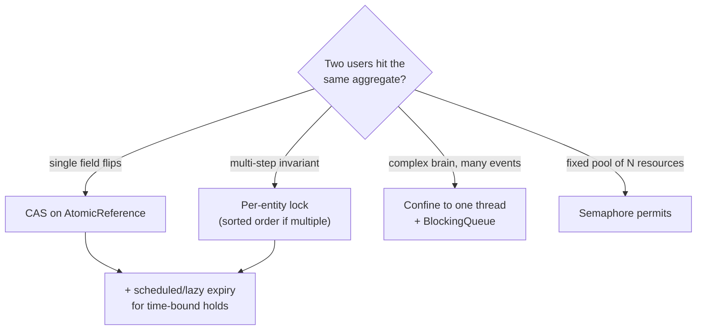

# 3.3 Thread-Safe LLD — The Concurrency Moves Interviews Actually Test

> Every LLD interview has a concurrency moment: "what if two users book the same seat?" This chapter is the playbook — five moves that answer 95% of those follow-ups, plus the classic implement-from-scratch exercises.

---

## Move 0 — The triage script (say this first)

When concurrency comes up, don't dive into locks. Triage aloud:

1. **"What's shared and mutable?"** — immutable objects and thread-confined state need nothing.
2. **"What's the invariant?"** — "a seat has ≤1 booking", "balance ≥ 0", "spot count matches assignments".
3. **"What's the smallest scope that protects it?"** — entity-level lock beats service-level lock.

This 3-question script *is* the senior answer; the mechanism you pick after it is almost secondary.

## Move 1 — Make it immutable (no locks at all)

`Money`, `Position`, `RouteSegment`, config — model as records, share freely. Mutation = replace the reference:

```java
private final AtomicReference<PricingConfig> config = new AtomicReference<>(initial);
public void updateConfig(PricingConfig next) { config.set(next); }   // readers never see a torn config
```

## Move 2 — Per-entity locking (the seat-booking answer)

```java
public class Seat {
    private final String id;
    private SeatStatus status = AVAILABLE;
    private String heldBy;

    public synchronized boolean tryHold(String userId, Instant until) {  // lock on THE SEAT
        if (status != AVAILABLE) return false;
        status = HELD; heldBy = userId; holdExpiry = until;
        return true;
    }
    public synchronized void confirm(String userId) {
        if (status != HELD || !heldBy.equals(userId)) throw new IllegalStateException("hold lost");
        status = BOOKED;
    }
}
```

Contention only per seat — two users fighting for A1 don't slow row Z. **Multi-seat booking** (the follow-up): acquire seat locks **in sorted ID order** to prevent deadlock, or `tryLock` all-or-release-all:

```java
public boolean holdAll(List<Seat> seats, String user) {
    seats.sort(comparing(Seat::id));                       // global order = no deadlock
    List<Seat> held = new ArrayList<>();
    for (Seat s : seats) {
        if (!s.tryHold(user, expiry())) { held.forEach(h -> h.release(user)); return false; }
        held.add(s);
    }
    return true;                                           // all-or-nothing
}
```

## Move 3 — CAS / atomic state transition (optimistic)

For single-field state machines, skip locks entirely:

```java
private final AtomicReference<SpotState> state = new AtomicReference<>(FREE);
public boolean tryOccupy() { return state.compareAndSet(FREE, OCCUPIED); }  // exactly one winner
```

Optimistic vs pessimistic — the trade to narrate: CAS wins under low contention (no blocking, no lock overhead); locks win when the critical section is multi-step or contention is fierce (CAS retry storms). Databases mirror this: version-column optimistic locking vs `SELECT FOR UPDATE` — bridging to the DB layer is a bonus point.

## Move 4 — Confine and queue (the actor move)

Instead of locking shared state, give it an owner thread; everyone else sends messages:

```java
// Elevator: one thread owns the state machine; requests arrive via queue
BlockingQueue<FloorRequest> requests = new LinkedBlockingQueue<>();
void controlLoop() {                                  // single thread → zero locks on elevator state
    while (running) {
        FloorRequest r = requests.poll(100, MILLISECONDS);
        if (r != null) planStops(r);
        step();                                       // move one floor, open doors, etc.
    }
}
```

Perfect for elevators, game engines, matching engines, and any "brain" with complex invariants. Sentence: "I'll confine the scheduler state to one thread and make gates/callers producers — correctness by architecture, not by locks."

## Move 5 — Time-based cleanup (holds that expire)

Holds/reservations must expire or abandoned carts freeze inventory forever:

```java
scheduler.scheduleAtFixedRate(() ->
    seats.values().stream().filter(Seat::holdExpired).forEach(Seat::releaseExpired),
    5, 5, TimeUnit.SECONDS);
// or: DelayQueue<SeatHold> — a dedicated thread takes expired holds and releases them
```

Also handle expiry *lazily* at read time (`isAvailable()` checks expiry) so correctness doesn't depend on sweeper timing.

---

## Classic exercise 1 — Producer-consumer from scratch (know cold)

```java
public class BoundedBuffer<T> {
    private final Queue<T> q = new ArrayDeque<>();
    private final int capacity;
    private final ReentrantLock lock = new ReentrantLock();
    private final Condition notFull = lock.newCondition();
    private final Condition notEmpty = lock.newCondition();

    public BoundedBuffer(int capacity) { this.capacity = capacity; }

    public void put(T item) throws InterruptedException {
        lock.lock();
        try {
            while (q.size() == capacity) notFull.await();   // while: recheck after wakeup
            q.add(item);
            notEmpty.signal();
        } finally { lock.unlock(); }
    }

    public T take() throws InterruptedException {
        lock.lock();
        try {
            while (q.isEmpty()) notEmpty.await();
            T item = q.poll();
            notFull.signal();
            return item;
        } finally { lock.unlock(); }
    }
}
```

Why two conditions: `notifyAll` on one monitor wakes producers *and* consumers (thundering herd); distinct conditions wake exactly the right party.

## Classic exercise 2 — Thread-safe counter/ledger with invariant

```java
public class Wallet {
    private long balance;                                   // guarded by 'this'
    public synchronized void transferTo(Wallet other, long amt) { /* see Ch 3.1 lock ordering! */ }
    public synchronized boolean tryDebit(long amt) {
        if (amt > balance) return false;                    // invariant check + mutation, one lock
        balance -= amt; return true;
    }
}
```

## Classic exercise 3 — Rate limiter, thread-safe (full design: Ch 5.11)

Token bucket where refill+consume must be atomic → `synchronized` on the bucket, or an atomic-state CAS loop.



---

## ✅ Key Takeaways
- Triage first: shared? invariant? smallest scope? — then pick: immutable → CAS → per-entity lock → confinement, coarsening only when forced.
- Multi-entity operations: sorted lock order or tryLock-all-or-release — never nested locks in arbitrary order.
- Holds expire: sweeper + lazy check. Producer-consumer with two Conditions is a must-memorize.
- "Correctness by architecture" (confinement/queues) usually beats "correctness by locking."

## 💡 Tips & Tricks
- The phrase "the lock lives on the entity, so contention is per-seat, not per-show" instantly upgrades your answer.
- Pre-empt the double-booking question — raise it yourself while designing: "two threads may reach here; tryHold is synchronized so exactly one wins."
- If asked to *prove* safety, walk two threads through the interleaving line by line — that demonstration is worth more than the code.
- Know the escalation path across scales: JVM lock → DB optimistic/pessimistic lock → distributed lock (Redis) — one sentence each, and say the single-JVM assumption out loud.

## 🎯 Interview Q&A

**Q1. Two users click "book seat A1" at the same instant. Walk me through exactly why your code books it once.**
> Both threads call `seat.tryHold(user, expiry)`, which is synchronized on that Seat instance. The JVM admits one — say thread A — which sees AVAILABLE, sets HELD/heldBy=A, returns true. B enters only after A exits; the monitor's happens-before guarantees B sees status=HELD, so B returns false and gets "seat unavailable." The invariant holds because the check and the write are inside one critical section on the same lock the state belongs to.

**Q2. Your seat-level locks work on one JVM. What breaks with two app servers?**
> JVM monitors don't span processes — each server would happily hold the same seat. The invariant must move to a shared arbiter: the database (optimistic: `UPDATE seats SET status='HELD', version=v+1 WHERE id=? AND version=v` — 0 rows updated = lost race; or pessimistic `SELECT FOR UPDATE`), or a distributed lock/atomic op in Redis (`SET seat:A1 user NX PX 300000`). In-JVM locks remain as a cheap first filter, but the source of truth decides. Flagging this boundary unprompted is exactly what senior candidates do.

**Q3. Why is a `while` loop around `await()` mandatory?**
> Three reasons. Spurious wakeups: the JVM may wake a waiter with no signal. Stolen wakeups: between signal and reacquiring the lock, another thread may consume the state (queue slot filled again). Shared conditions: `notifyAll`/broadcast wakes threads whose predicate is still false. The while re-checks the predicate under the lock before proceeding — `if` turns all three into corruption (add to a full buffer).

**Q4. Lock-free vs locked — how do you decide in an interview?**
> Structure first, contention second. Single-variable transition (FREE→OCCUPIED, counter) → CAS/atomics: non-blocking, no deadlock, fastest at low contention. Multi-field invariant that must change together (status + holder + expiry) → lock; a CAS can't cover three writes atomically (unless I bundle state in one immutable object behind an AtomicReference — worth mentioning). Under extreme contention CAS retry-storms, so hot multi-writer counters → LongAdder, hot complex state → lock or confinement. And I only optimize past a plain lock when the interviewer signals scale matters.

**Q5. How do you *test* thread-safety in a machine-coding round?**
> A stress test with a latch-released thundering herd: N threads await one CountDownLatch, all call `bookSeat("A1")`, then assert exactly one success and the final state is booked-once. Plus an invariant sweep under mixed load (park/unpark hammering: free+occupied always equals capacity). It can't prove absence of races, but it catches the naive check-then-act instantly, and writing it shows I know *what* property to assert — atomicity of the decision, integrity of the invariant.
