# 4.1 The Machine Coding Playbook — 90 Minutes to Working, Clean Code

> Machine coding (Flipkart, Swiggy, Uber, Razorpay style): 90–120 minutes, a problem statement, and one demand — **working code that's demo-able and extensible**. Most failures are process failures, not knowledge failures. This is the process.

---

## The time budget (90-minute round)

```mermaid
gantt
    dateFormat mm
    axisFormat %M
    section Plan
    Read twice + clarify + scope     :00, 8m
    Entities & interfaces on paper   :08, 7m
    section Build
    Skeleton — models, enums, repos  :15, 15m
    Core flow 1 (the must-work path) :30, 20m
    Core flow 2 + edge cases         :50, 15m
    section Prove
    Demo runner / tests              :65, 15m
    Refactor + walkthrough prep      :80, 10m
```



**The one rule above all: a working core flow beats a complete skeleton of everything.** Interviewers extend working code; they can't evaluate ambitions.

## Phase 1 — Scope like a professional (first 8 minutes)

Read the statement **twice**. Then say the four sentences:

1. *"Here's what I understand the core flows to be: X, Y, Z — confirm?"*
2. *"For 90 minutes I'll prioritize X and Y fully working; Z I'll stub behind an interface."*
3. *"I'll build in-memory storage behind repository interfaces — no DB, no UI, driven by a main/test runner?"*
4. *"Any requirement you specifically want to see handled — concurrency? persistence?"*

Writing requirements as a checklist in a comment block keeps you honest and shows the interviewer a live scoreboard:

```java
/* REQUIREMENTS
 * [x] add expense, equal split        [x] show balances
 * [ ] percent split (stub ready)      [ ] simplify debts (stretch)
 */
```

## Phase 2 — Design on paper (7 minutes, no IDE)

- Nouns → entities; verbs → services/methods (Ch 1.4).
- Mark the **one or two variation axes** the statement hints at → those get interfaces (Strategy).
- Decide package layout now:

```
com.example.splitwise
├── model/        // Entities & value objects: User, Group, Expense, Money
├── repository/   // InMemoryExpenseRepository implements ExpenseRepository
├── service/      // ExpenseService, BalanceService — business logic
├── strategy/     // SplitStrategy: Equal, Exact, Percent
├── exception/    // Domain exceptions
└── App.java      // demo runner wiring everything (the composition root)
```

This layout *is* an evaluation criterion — "well-structured code" literally means they can predict where things live.

## Phase 3 — Build in the right order

1. **Enums + value objects first** (2–5 min): `Money`, statuses, types — zero dependencies, everything uses them.
2. **Entities with invariants**: constructors validate; no setters unless needed.
3. **Repository interfaces + in-memory impls** (5 min): `Map<Id, T>` inside; unlocks services and tests.

```java
public interface TicketRepository {
    void save(Ticket t);
    Optional<Ticket> byId(String id);
}
public class InMemoryTicketRepository implements TicketRepository {
    private final Map<String, Ticket> store = new ConcurrentHashMap<>();
    public void save(Ticket t) { store.put(t.id(), t); }
    public Optional<Ticket> byId(String id) { return Optional.ofNullable(store.get(id)); }
}
```

4. **The core service flow end-to-end** — resist perfecting; get `park() → Ticket` running.
5. **Demo runner immediately after flow 1** — from now on you re-run after every change (a poor man's test suite).
6. Then flow 2, edge cases, and the strategy variants.

## Phase 4 — Edge cases & errors (what separates good from great)

Domain exceptions, not return-nulls, not generic RuntimeException:

```java
public class SeatUnavailableException extends RuntimeException {
    public SeatUnavailableException(String seatId) { super("Seat already booked: " + seatId); }
}
```

Standard edge checklist (run it against any problem): invalid input · not found · duplicate action (park same car twice, pay same bill twice — **idempotency**) · capacity full · thing expired · operation on wrong state (cancel a completed order). Handling *duplicate action* explicitly is rare among candidates and heavily noticed.

## Phase 5 — Prove it works

A `main` that tells the problem's story beats silent tests in an interview demo:

```java
public static void main(String[] args) {
    ParkingLot lot = ParkingLot.init(2 /*floors*/, 10 /*spots each*/);
    Ticket t1 = lot.park(new Car("KA-01-1234"));
    System.out.println("Parked: " + t1);
    Receipt r = lot.unpark(t1.id());                 // happy path
    System.out.println("Fee: " + r.fee());
    try { lot.unpark(t1.id()); }                     // edge: double exit
    catch (TicketNotActiveException e) { System.out.println("OK: " + e.getMessage()); }
}
```

If JUnit is available, 3–5 tests on the money paths (fee calculation, split math, double-booking) — pure-logic classes are the best test targets per minute. Say: *"repositories are interfaces precisely so these tests need no infra."*

## The walkthrough (last 5 minutes — rehearse the shape)

1. Requirements coverage: "flows X, Y done; Z stubbed here."
2. One-breath architecture: "models → repositories → services; variation behind these two strategies."
3. A live demo run.
4. **Self-review:** "with more time: split BalanceService, add tests for percent-split rounding, per-group locking." Naming your own debts preempts the criticism and reads as senior.

---

## ✅ Key Takeaways
- Budget: ~15 plan / ~50 build / ~25 prove-and-polish. Working core flow first, always.
- Standard package layout + repository interfaces + composition root = "well-structured" by definition.
- Build order: enums/VOs → entities → repos → one full flow → demo runner → the rest.
- Domain exceptions + idempotency handling + a story-telling main = the visible quality signals.

## 💡 Tips & Tricks
- Type fast on boilerplate, slow on invariants — reviewers skim getters but read `tryHold()` letter by letter.
- Stuck 5+ minutes on design? Choose the simpler option, add `// TODO: revisit if <condition>`, move on — momentum outscores elegance.
- Never gold-plate flow 1 while flow 2 is missing; two working flows at 7/10 polish beat one at 10/10.
- Keep a rehearsed personal template: Money class, repository pattern, exception base, demo-main shape. Muscle memory buys you 15 minutes.

## 🎯 Interview Q&A

**Q1. What do machine-coding evaluators actually score?**
> Roughly in order: (1) does the core flow *run correctly*, including edge cases; (2) readability/structure — naming, packages, small methods; (3) extensibility — are the stated variation axes behind interfaces; (4) OO modeling — invariants in entities, not smeared in services; (5) demo/test quality. Cleverness and framework knowledge score near zero. That ranking dictates the time budget: correctness first, structure as you go, patterns only where variation is stated.

**Q2. In-memory storage — how do you keep it credible?**
> Behind an interface: services depend on `TicketRepository`, and `InMemoryTicketRepository` is one implementation — so "add a real DB" is a new class, not a rewrite. I keep repository methods query-shaped (`findActiveByVehicle`) rather than leaking `Map` semantics, use ConcurrentHashMap so the concurrency story holds, and say the sentence: "persistence is a port; today's adapter is a map."

**Q3. You're running out of time with a feature half-done. What do you do?**
> Cut to a clean seam, not mid-function: make the completed part demo-able, stub the remainder behind its interface with a clear exception (`UnsupportedOperationException("percent split — interface ready, see PercentSplitStrategy")`), and update the requirements checklist. Then in the walkthrough I *lead* with the cut and its restoration path. An honest, well-shaped 80% consistently outscores a broken 100%.

**Q4. Should you write tests in a machine coding round?**
> A demo-main is non-negotiable — it's how the interviewer sees it work. Formal tests: yes if the round expects them or logic is math-heavy (splits, fees, rounding) — 3–5 focused JUnit tests on pure logic classes are cheap because my repos are injectable fakes. What I avoid: mocking frameworks, exhaustive suites, and testing getters — the ROI question is always "which test catches the bug the interviewer will probe?" That's fees, splits, and double-actions.

**Q5. How do you handle an interviewer changing requirements at minute 60?**
> That's the test of the seams, and I say so cheerfully. Route the change: new variant of an existing axis → new strategy class, minutes ("weekend pricing" = new FeeStrategy). New axis → add the interface now, implement the one variant needed, note the old code path preserved. Genuinely breaking change → negotiate scope: "I can restructure X in the remaining time, or stub it and explain the design — which is more useful to you?" The worst response is silently absorbing it into if-statements.
