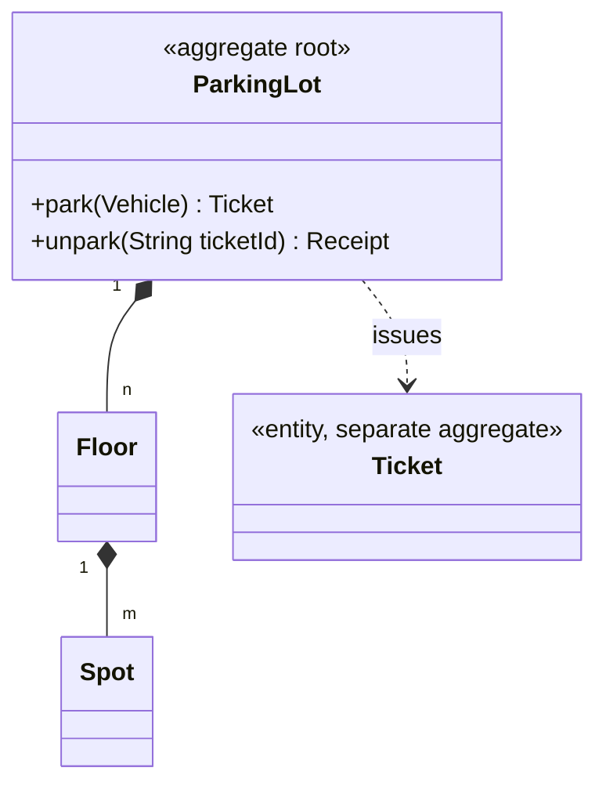

# 4.3 Object Modeling — Entities, Value Objects, Repositories & IDs

> Before patterns, before concurrency, an interviewer watches one thing: **can you turn a messy problem statement into the right objects?** This chapter is the modeling method — lightweight DDD, interview-sized.

---

## The two kinds of objects (decide for every noun)

| | **Entity** | **Value Object** |
|---|---|---|
| Identity | Has an ID; identity persists through change | *Is* its attributes; no ID |
| Equality | By ID | By value (`equals` on all fields) |
| Mutability | Mutable state machine (status, balance) | **Immutable** — "change" = new instance |
| Examples | `User`, `Order`, `Ticket`, `Seat`, `Trip` | `Money`, `Address`, `Position`, `TimeRange`, `SeatId` |
| Java shape | class, private fields, behavior methods | `record` |

**Why the split matters:** value objects are free of lifecycle/concurrency/persistence questions — every noun you push into the VO column simplifies the design. Say: *"Money, Position, TimeRange — I'll model these as immutable records; only Order and Seat carry identity and state."*

```java
public record TimeRange(Instant start, Instant end) {
    public TimeRange {                                       // compact constructor = validation
        if (!start.isBefore(end)) throw new IllegalArgumentException("start must precede end");
    }
    public boolean overlaps(TimeRange other) {
        return start.isBefore(other.end) && other.start.isBefore(end);
    }   // behavior on the VO — this one method IS the meeting-scheduler kata
}
```

## Modeling method — nouns, verbs, invariants, states

1. **Nouns** → candidate objects; sort each into entity / VO / *attribute of another* (many nouns don't deserve classes — "license plate" is a String field, maybe a tiny VO, not an entity).
2. **Verbs** → behavior; attach each verb to the object *whose data it uses* (tell-don't-ask). `calculateFee` uses ticket times + rates → `FeePolicy.feeFor(ticket)`, not a method on `ParkingLot`.
3. **Invariants** → constructor/method guards on whichever object owns them ("splits sum to total" lives in `Expense`).
4. **States** → if an entity has a lifecycle, draw it *now* and encode legal transitions:

```java
public enum OrderStatus { CREATED, PAID, SHIPPED, DELIVERED, CANCELLED;
    private static final Map<OrderStatus, Set<OrderStatus>> LEGAL = Map.of(
        CREATED, Set.of(PAID, CANCELLED),
        PAID, Set.of(SHIPPED, CANCELLED),
        SHIPPED, Set.of(DELIVERED));
    public boolean canGoTo(OrderStatus next) { return LEGAL.getOrDefault(this, Set.of()).contains(next); }
}
// entity: public void transitionTo(OrderStatus next) {
//     if (!status.canGoTo(next)) throw new IllegalTransitionException(status, next); ... }
```

An explicit transition table (vs scattered ifs) is one of the highest-value 10-line blocks you can write in any interview.

## Aggregates — who is allowed to touch whom

An **aggregate** = a cluster of objects treated as one consistency unit, entered only through its **root**. `ParkingLot → Floors → Spots`: outsiders call `lot.park(vehicle)`, never `floor3.spot12.assign()` directly.



Payoffs to narrate: invariants ("free-spot count matches assignments") have **one enforcement point**; the root is the natural lock scope (Ch 3.3); the API surface shrinks. Keep aggregates small — `Ticket` is its *own* aggregate referenced by ID, not owned by the lot, so ticket history doesn't bloat the lot's consistency boundary.

## Repositories — collections you pretend are infinite

One repository **per aggregate root** (a `SpotRepository` is a smell — spots come with the lot). Interface speaks the domain; implementation is a map today, a DB tomorrow:

```java
public interface BookingRepository {
    void save(Booking b);
    Optional<Booking> byId(BookingId id);
    List<Booking> activeForShow(ShowId show);      // query methods, domain-named
}
```

Keep queries *needed by your flows* only — don't speculatively build `findAllByEverySortOrder`.

## IDs — small decisions that show polish

```java
public record BookingId(String value) {
    public static BookingId newId() { return new BookingId("B-" + UUID.randomUUID()); }
}
```

- Typed IDs (`BookingId`, not `String`) make `cancel(userId, bookingId)` un-swappable — cheap compile-time safety; mention it even if you use raw Strings under time pressure.
- Generation: `UUID` for uniqueness-without-coordination; `AtomicLong` sequence for readable demo output; never DB-auto-increment semantics in an in-memory round.
- Never expose mutable internal collections as the "ID space" — hand out IDs, resolve via repository.

## Worked mini-example — modeling "Library Management" in 4 minutes

Nouns: library, book, **copy** (the crucial catch: `Book` = title/ISBN metadata — a VO-ish catalog entry; `BookCopy` = the physical entity with a barcode and LOAN state), member, loan, fine.
- Entities: `BookCopy(status: AVAILABLE/LOANED/LOST)`, `Member`, `Loan(dueDate, returnedAt)`.
- VOs: `Isbn`, `Money`, `LoanPeriod`.
- Aggregate roots: `Member` (owns active loans count invariant ≤ 5), `BookCopy`; `Loan` links them by ID.
- Verbs: `library.checkout(member, copy) → Loan` (facade/service orchestrating both roots), `loan.returnBook(clock) → Optional<Fine>`.

The Book-vs-BookCopy split is the archetype of a modeling insight: **when one noun hides two lifecycles, split it.** (Same move: `Show` vs `Seat` vs `Booking` in BookMyShow; `Movie` vs `Screening`.)

---

## ✅ Key Takeaways
- Every noun: entity (ID + lifecycle), value object (immutable record), or mere field. Push hard toward VO.
- Attach verbs to the data they use; encode invariants in constructors and a transition table.
- Aggregate root = single entry point + consistency + lock scope; one repository per root.
- Watch for one-noun-two-lifecycles (Book/BookCopy) — spotting it is a hire signal by itself.

## 💡 Tips & Tricks
- Narrate the sorting: "ticket — entity; money — value object; license plate — just a field." Interviewers hear method, not guessing.
- If two entities keep needing each other's internals, you've drawn the aggregate boundary wrong — merge or introduce a service.
- The transition-table enum takes 3 minutes and preempts every "can a cancelled order ship?" question.
- Reference other aggregates **by ID** (`Loan` holds `MemberId`), not object references — it prevents the everything-touches-everything object graph.

## 🎯 Interview Q&A

**Q1. Entity vs value object — why does the distinction change your code?**
> Identity changes equality (ID vs all-fields), mutability (state machine vs immutable), and infrastructure (entities need repositories, locks, lifecycle; VOs need nothing). Concretely: making `Money` a record deletes defensive-copy bugs, makes it a safe map key, and thread-safe for free; making `Seat` an entity gives its status transitions one home I can lock. Misclassifying — a mutable Money, or an ID-less Seat compared by position — creates exactly the double-booking and lost-update bugs interviews probe for.

**Q2. How do you decide aggregate boundaries?**
> By invariants that must be transactionally true: whatever must be consistent *together* lives under one root. "Free spots = capacity − assignments" spans floors and spots → they share the ParkingLot root. "Ticket paid-ness" doesn't affect that count → Ticket is its own aggregate, referenced by ID. Then I sanity-check size: a giant root serializes everything behind one lock (Ch 3.3), so anything not needed for the invariant gets pushed out. Boundaries = invariants first, contention second.

**Q3. Where does logic go when it spans two aggregates?**
> A domain service: `CheckoutService.checkout(member, copy)` orchestrates `member.canBorrow()` and `copy.loan()` and creates the `Loan`. Neither entity should reach into the other (coupling, and no natural lock order); the service sequences the calls, owns cross-aggregate rules ("max 5 loans"), and handles partial failure (copy loaned but member at limit → release). Entities keep their own invariants; services keep the choreography — that's the whole layering.

**Q4. Why one repository per aggregate root rather than per class?**
> Because the root is the consistency unit: loading/saving spots independently of their lot invites invariant-breaking writes from the side. Per-root repositories keep every mutation flowing through root methods that enforce the rules. It also shrinks the persistence surface (fewer interfaces, coherent transactions later) and matches how you'd actually store it — the lot document/row owns its spots. A repository per class is how anemic designs leak: it hands out scalpel access to internals.

**Q5. Your Book/BookCopy split — how do you find such splits under time pressure?**
> Two probes. Lifecycle probe: ask of each noun "can two instances of this differ in state while being 'the same thing'?" — two copies of the same ISBN, one loaned one lost → split. Counting probe: if a requirement counts something ("3 copies available") that another requirement treats as one ("the book's author"), there are two concepts. The same probes generate Show/Seat/Booking, Flight/FlightInstance, Product/SKU/InventoryItem. When a design feels tangled, it's very often one noun doing two jobs.
