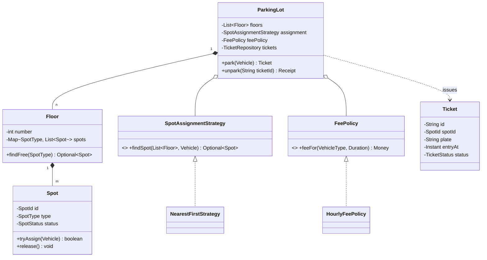

# 5.1 Design a Parking Lot

> The "hello world" of LLD — asked everywhere because in 45 minutes it exercises modeling, enums, Strategy, Singleton, concurrency, and extensibility. Master this walkthrough as your **template for every other problem**.

---

## Step 1 — Clarify requirements (4 min)

**Say:** *"Let me confirm scope: multiple floors; spot sizes for bike/car/truck; entry issues a ticket, exit computes a fee; multiple entry/exit gates operating concurrently. Do you want display boards and payment integration, or park/unpark with fees as the core?"*

**Functional:** park → ticket; unpark → fee + receipt; spot sizing rules (bike fits any spot? truck needs large); query availability per floor.
**Non-functional (yes, LLD has them):** thread-safe against concurrent gates; fee rules will change (hint: Strategy); extensible to EV spots, reservations. **Out of scope (say it):** payments processing, license-plate recognition, persistence.

## Step 2 — Entities & relationships (3 min)

Nouns → `ParkingLot` (aggregate root), `Floor`, `Spot` (entity, state), `Vehicle` (VO-ish input), `Ticket` (entity, own aggregate), `Gate`. Verbs → `park`, `unpark`, `assignSpot`, `calculateFee`.
Sorting: `VehicleType`, `SpotType`, `Money` — enums/VOs. `Ticket` referenced by ID, not owned by floors.

## Step 3 — Class diagram (draw before code)



**Say while drawing:** *"Two variation axes — how spots are chosen and how fees are computed — go behind interfaces. Everything enters through `ParkingLot`, which makes it my consistency and locking boundary."*

## Step 4 — Key decisions & patterns

| Decision | Choice | Why (say this) |
|---|---|---|
| Spot fitting | `SpotType` enum + `fits(VehicleType)` | bike→any, car→medium/large, truck→large: data, not if-chains |
| Assignment | **Strategy** (`NearestFirst`, `RandomEvenWear`) | stated axis of change |
| Fees | **Strategy/Policy** (`HourlyFeePolicy` + grace period) | pricing always changes |
| Vehicle creation | **Factory** from `VehicleType` | one place knows concretes |
| Lot instance | Singleton-ish via composition root | "one lot" — but injected, not `getInstance()` everywhere |
| Ticket state | `ACTIVE → PAID` enum transition | double-exit becomes impossible |

## Step 5 — Core Java (the code that matters)

```java
public enum SpotType {
    SMALL, MEDIUM, LARGE;
    public boolean fits(VehicleType v) {
        return switch (v) {
            case BIKE  -> true;
            case CAR   -> this != SMALL;
            case TRUCK -> this == LARGE;
        };
    }
}

public class Spot {
    private final SpotId id; private final SpotType type;
    private SpotStatus status = SpotStatus.FREE;

    public synchronized boolean tryAssign(Vehicle v) {          // per-spot lock: check+act atomic
        if (status != SpotStatus.FREE || !type.fits(v.type())) return false;
        status = SpotStatus.OCCUPIED;
        return true;
    }
    public synchronized void release() { status = SpotStatus.FREE; }
}

public class ParkingLot {
    private final List<Floor> floors;
    private final SpotAssignmentStrategy assignment;
    private final FeePolicy feePolicy;
    private final TicketRepository tickets;
    private final Clock clock;

    public Ticket park(Vehicle v) {
        // strategy proposes; spot's own lock disposes — loop handles races between gates
        for (int attempt = 0; attempt < 3; attempt++) {
            Optional<Spot> candidate = assignment.findSpot(floors, v);
            if (candidate.isEmpty()) throw new LotFullException(v.type());
            Spot spot = candidate.get();
            if (spot.tryAssign(v)) {                            // atomic claim
                Ticket t = Ticket.issue(spot.id(), v.plate(), clock.instant());
                tickets.save(t);
                return t;
            }                                                    // lost the race → re-ask strategy
        }
        throw new LotFullException(v.type());
    }

    public Receipt unpark(String ticketId) {
        Ticket t = tickets.byId(ticketId).orElseThrow(() -> new TicketNotFoundException(ticketId));
        t.markPaid();                                           // throws if not ACTIVE (double exit)
        Money fee = feePolicy.feeFor(t.vehicleType(), Duration.between(t.entryAt(), clock.instant()));
        spotById(t.spotId()).release();
        return new Receipt(t, fee);
    }
}

public class HourlyFeePolicy implements FeePolicy {
    private final Map<VehicleType, Money> ratePerHour;
    private final Duration grace = Duration.ofMinutes(15);
    public Money feeFor(VehicleType type, Duration stay) {
        if (stay.compareTo(grace) <= 0) return Money.zero();
        long hours = Math.max(1, (long) Math.ceil(stay.toMinutes() / 60.0));
        return ratePerHour.get(type).times(hours);
    }
}
```

## Step 6 — Concurrency (they *will* ask)

**Q: two gates, one last free spot?** Both gates' strategies may propose the same spot; `tryAssign` is synchronized on the spot, so exactly one wins; the loser loops and re-asks the strategy (which now skips the occupied spot) — optimistic retry, no global lock. **Say:** *"contention is per-spot; gates parking on different floors never wait on each other."*
Free-spot counts per floor: `AtomicInteger` decrement on assign / increment on release — display boards read it without locks (Observer pattern for live boards).

## Step 7 — Extensibility follow-ups (rehearse one-liners)

- **EV charging spots:** new `SpotType.EV_*` + `fits` logic; `ChargingSession` attached to ticket — no structural change.
- **Reservations:** `Spot` gains `RESERVED` state with `TimeRange`; assignment strategy filters by availability window.
- **Dynamic pricing:** new `FeePolicy` (surge multiplier by occupancy) — the seam pays off.
- **Multiple lots / valet / handicapped-near-elevator:** strategy per lot config; `NearElevatorStrategy` for accessible spots.
- **Persistence:** repositories already interfaces → JPA impls; the domain doesn't change.

---

## ✅ Outcome — what a complete answer includes
Scope confirmation → entity sort (root/entities/VOs) → class diagram with two strategy seams → `SpotType.fits` data-driven sizing → park flow with per-spot atomic claim + retry → fee policy with grace period → ticket state machine blocking double-exit → concurrency narration (per-spot locks, atomic counters) → two extensibility one-liners.

## 💡 Tips & Tricks
- The propose/claim/retry loop is the single most reusable trick in LLD — it reappears in seat booking, driver matching, and inventory.
- Volunteer the concurrency story *before* being asked; parking lot without thread-safety is a junior answer.
- Keep `Vehicle` dumb (type + plate). Candidates who give vehicles behavior ("vehicle.parkItself()") tangle the model.
- If time is short, skip Floor and flat-list the spots — say "floors are a grouping detail; the design is unchanged."

## 🎯 Interview Q&A

**Q1. Why is the assignment strategy separate from the spot's own locking?**
> Separation of *policy* from *safety*. The strategy is pure selection logic — testable, swappable (nearest, even-wear, accessible-first) — and holds no locks, so it can scan freely. Safety lives in `tryAssign`, the one place where check-and-act must be atomic. The retry loop stitches them: stale proposals are corrected by re-proposing, not by locking the whole scan. A strategy that locked floors while scanning would serialize all gates and still race between scan and assign.

**Q2. A truck needs two adjacent medium spots. How does the design absorb that?**
> Assignment returns a `SpotAllocation` (1..n spots) instead of one spot; a new `AdjacentPairStrategy` finds neighbors (spots keep row/index for adjacency). Claiming multiple spots = multi-lock: sort by SpotId, `tryAssign` each, release-all on any failure (all-or-nothing, no deadlock by ordering — Ch 3.3). Ticket stores the allocation. The seam absorbs the feature; only the strategy and the claim helper are new.

**Q3. Where would Observer fit here?**
> Display boards and analytics: `ParkingLot` publishes `SpotOccupied`/`SpotReleased` events; `FloorDisplayBoard` updates counts, `OccupancyAnalytics` aggregates, a future `SurgePricingPolicy` could subscribe too. Publisher knows only the listener interface; adding a consumer touches nothing. I'd fire events after state change commits, and isolate listener exceptions so a broken board can't fail parking.

**Q4. How do you test this in the round?**
> Three tests carry the grade: (1) fee math with a fixed Clock — park, advance 2h05m, assert rate×3 with grace applied; (2) double-exit — unpark twice, second throws `TicketNotActiveException`; (3) the race — N threads, one CountDownLatch, one free spot, assert exactly one ticket issued. All run without infra because repositories and Clock are injected.

**Q5. Interviewer: "Make it a paid-subscription lot with monthly passes."**
> Model a `Pass` entity (member, vehicle plates, validity `TimeRange`, allowed spot types) and resolve at entry: `park` consults a `PassRegistry`; pass-holders get a `PassTicket` (zero fee at exit) and possibly a reserved-section strategy. Fee seam handles it naturally — `FeePolicy` returns zero for pass tickets, or better, a `PassAwareFeePolicy` decorator wraps the hourly policy. Billing of the subscription itself is a separate bounded context — out of the lot's aggregate, and I'd say so.
