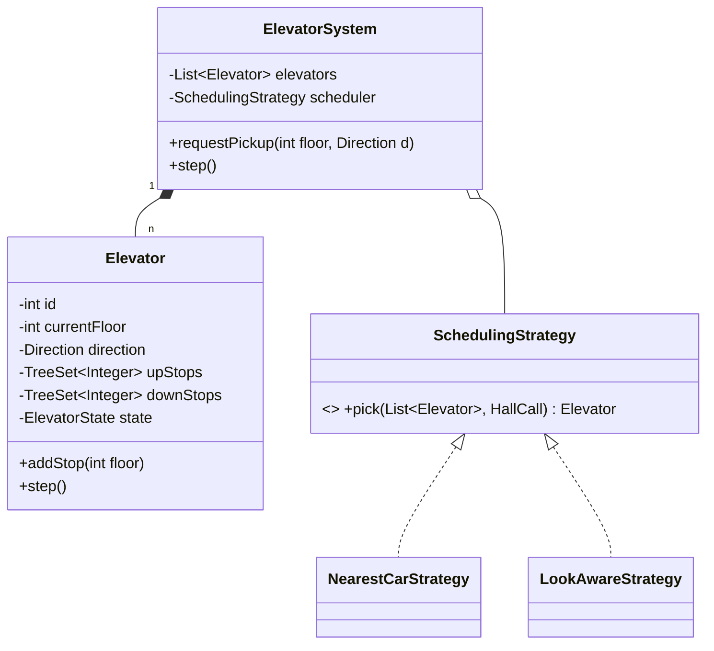
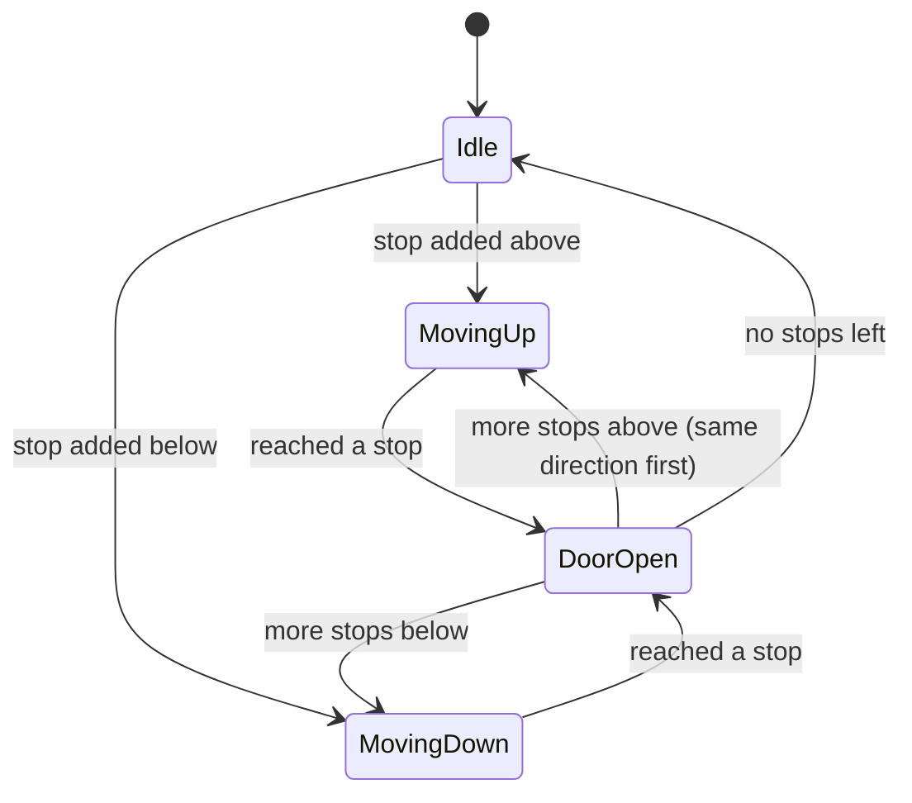

# 5.2 Design an Elevator System

> The scheduling-heavy classic. Tests: State pattern, Strategy (scheduling algorithms), the confinement concurrency model, and whether you can keep a simulation loop clean. Uber, Amazon, and Microsoft favorites.

---

## Step 1 — Clarify requirements (4 min)

**Say:** *"N elevators, M floors. Hall calls (floor + direction) and cabin calls (target floor). I'll design the controller that assigns calls and each elevator's state machine. Simulation-step time model OK? Capacity limits and door events in scope; weight sensors and maintenance mode as extensions?"*

**Functional:** request pickup (floor, direction); request destination (inside cabin); elevator serves requests in a sensible order; doors open/close; idle behavior.
**Non-functional:** no starvation (a floor can't wait forever); efficient travel (don't zigzag); thread-safe request submission from many floors at once.

## Step 2 — Entities

`ElevatorSystem` (root/controller) · `Elevator` (entity: floor, direction, door, stop-set) · `HallCall(floor, direction)` / `CabinCall(floor)` (VOs) · `SchedulingStrategy` (which elevator takes a call) · `ElevatorState` (moving/idle/door-open).

## Step 3 — Class & state diagrams





## Step 4 — The core insight: LOOK algorithm (say the name)

Real elevators run **LOOK** (the disk-scheduling algorithm): *keep moving in the current direction, stopping at requested floors, until no requests remain ahead; then reverse.* Two sorted stop-sets make it trivial:

```java
public class Elevator {
    private int currentFloor = 0;
    private Direction direction = Direction.NONE;
    private final NavigableSet<Integer> upStops = new TreeSet<>();     // floors above, ascending
    private final NavigableSet<Integer> downStops = new TreeSet<>(Comparator.reverseOrder());

    public void addStop(int floor) {
        if (floor == currentFloor) return;                             // already here → door event
        if (floor > currentFloor) upStops.add(floor); else downStops.add(floor);
        if (direction == Direction.NONE)
            direction = floor > currentFloor ? Direction.UP : Direction.DOWN;
    }

    public void step() {                                               // one tick of simulation
        NavigableSet<Integer> ahead = direction == Direction.UP ? upStops : downStops;
        if (ahead.isEmpty()) {                                         // nothing ahead → reverse or idle
            direction = !upStops.isEmpty() ? Direction.UP
                      : !downStops.isEmpty() ? Direction.DOWN : Direction.NONE;
            if (direction == Direction.NONE) return;
            ahead = direction == Direction.UP ? upStops : downStops;
        }
        currentFloor += direction == Direction.UP ? 1 : -1;            // move one floor
        if (ahead.contains(currentFloor)) {
            ahead.remove(currentFloor);
            openAndCloseDoors();                                       // emits events to observers
        }
    }
}
```

**Why not FCFS?** Serving requests in arrival order zigzags (10 → 2 → 9 → 1…) — O(N) extra travel per request; LOOK batches by direction. Saying "this is LOOK, same family as disk scheduling; SCAN goes to the ends, LOOK reverses early" is a guaranteed point.

## Step 5 — Assigning hall calls: Strategy

```java
public class NearestCarStrategy implements SchedulingStrategy {
    public Elevator pick(List<Elevator> cars, HallCall call) {
        return cars.stream()
            .min(Comparator.comparingInt(e -> cost(e, call)))
            .orElseThrow();
    }
    // cost: distance, heavily discounted if the car is already heading toward the call
    // in the call's direction; penalized if it must finish opposite-direction work first.
    private int cost(Elevator e, HallCall c) {
        int dist = Math.abs(e.currentFloor() - c.floor());
        boolean onTheWay = e.direction() == c.direction()
            && (c.direction() == Direction.UP ? e.currentFloor() <= c.floor()
                                              : e.currentFloor() >= c.floor());
        if (e.direction() == Direction.NONE) return dist;              // idle: pure distance
        return onTheWay ? dist : dist + 2 * SPAN;                      // detour penalty
    }
}
```

Alternatives to name: round-robin (simple, poor), least-loaded (by pending stops), zone-based (skyscrapers: cars own floor ranges), destination dispatch (passengers enter target *at the hall panel* — modern buildings; groups riders by destination).

## Step 6 — Concurrency: confinement, not locks

**Say:** *"Elevator state is complex and event-driven — instead of locking floor/direction/stop-sets, I confine each elevator to the controller thread and make button presses producers to a queue."* (Move 4, Ch 3.3.)

```java
public class ElevatorSystem {
    private final BlockingQueue<HallCall> calls = new LinkedBlockingQueue<>();
    public void requestPickup(int floor, Direction d) { calls.offer(new HallCall(floor, d)); }  // any thread

    void controlLoop() {                                    // single thread owns ALL elevator state
        while (running) {
            HallCall c;
            while ((c = calls.poll()) != null)              // drain new calls
                scheduler.pick(elevators, c).addStop(c.floor());
            elevators.forEach(Elevator::step);              // advance simulation one tick
            sleepTick();
        }
    }
}
```

Zero locks on elevator internals; the queue is the only synchronized structure. Starvation guard: LOOK inherently serves every floor in ≤ one full sweep; add aging to the cost function if a strategy could starve a call.

## Step 7 — Extensibility follow-ups

- **Capacity/weight:** `Elevator.isFull()` → strategy skips full cars; full car bypasses hall calls but honors cabin calls.
- **Express/zoned elevators:** strategy filters by serviceable floors (`Set<Integer> servedFloors` per car).
- **Maintenance mode:** a state that drains stops, parks, and removes the car from scheduling — State pattern earns its keep.
- **Destination dispatch:** replace HallCall with `(from, to)`; scheduler groups by destination bands.
- **Emergency (fire):** override state: all cars → ground, doors open — a mode on the *controller*, not per-car hacks.

---

## ✅ Outcome — what a complete answer includes
Requirements incl. starvation & efficiency → controller + per-car state machine (diagrammed) → LOOK with two sorted stop-sets (named!) → hall-call assignment as Strategy with a cost function → confinement concurrency (queue in, single control thread) → capacity/zoning/maintenance one-liners.

## 💡 Tips & Tricks
- Two `TreeSet`s (up/down) is the implementation detail that makes your code visibly clean — memorize it.
- "Same-direction stops first, then reverse" answers 80% of "what order are floors served?" probes.
- The simulation `step()` model sidesteps timers/threads-per-elevator — offer real-time scheduling only if asked.
- Don't model buttons/panels as classes unless asked — they're just call sources; over-modeling here burns 15 minutes.

## 🎯 Interview Q&A

**Q1. Why TreeSet for stops instead of a queue?**
> Stops must be served in *positional* order along the travel direction, not arrival order — a queue replays request history; a sorted set gives "next floor ahead" as `ceiling/floor(currentFloor)` in O(log n), automatically merges duplicate requests for the same floor, and makes reversal trivial (switch sets). Arrival order is irrelevant once you've committed to LOOK — position is the schedule.

**Q2. A passenger going down presses "up" to grab the car sooner. Does your design break?**
> No — it degrades gracefully, like real elevators. The car stops at their floor going up; they board and press a lower floor; that becomes a downStop served after the up-sweep. Cost: one wasted stop for others. Mitigations if probed: destination dispatch eliminates the lie (passengers declare targets upfront), and load sensors + repeated-no-boarding heuristics can deprioritize suspicious hall calls — but I'd flag those as real-world tuning, not core design.

**Q3. How does your single-threaded controller scale to 32 elevators × 100 floors?**
> Comfortably — the loop's work per tick is tiny (drain queue: O(calls × N) cost evaluations; step each car: O(log stops)). 32 cars is trivial CPU. If it ever weren't: shard controllers by elevator bank/zone (each bank has an independent controller thread + queue), which mirrors how buildings physically group cars. What I *don't* do is thread-per-elevator with shared state — that buys contention and races for zero gain at this scale.

**Q4. Where exactly do State and Strategy live in your design, and could you drop them?**
> Strategy = hall-call assignment (`SchedulingStrategy`) — droppable to a hardcoded nearest-car if variation weren't obvious, but the interviewer's "how would you improve pickup times?" question is *answered by the seam*. State = per-car lifecycle (idle/moving/door-open/maintenance); with only 3 happy-path states an enum+switch inside `step()` is defensible and I'd start there, upgrading to state classes when door timing, maintenance, and emergency modes make each state's behavior rich. I say the upgrade trigger aloud — that's the calibrated answer.

**Q5. How would you test the scheduler's quality, not just correctness?**
> Simulation-based metrics: generate call workloads (morning up-peak, lunch two-way, random), run K ticks, measure average/max wait, travel time, and starvation counts per strategy. Correctness asserts invariants each tick (car within bounds, doors only open at stops, every call eventually served). This turns "is nearest-car better than round-robin?" from opinion into a table — and mentioning workload-dependent results (up-peak favors zoning) shows systems maturity.
