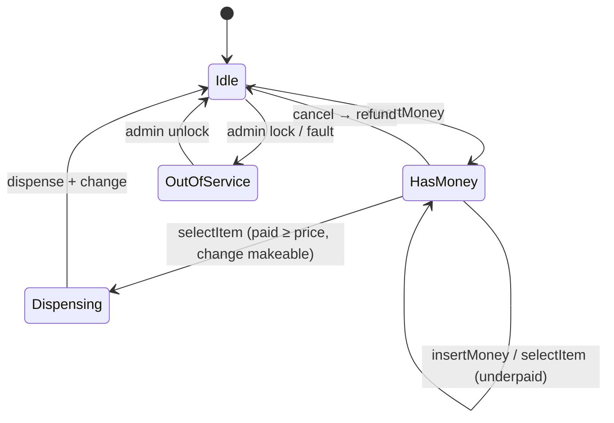
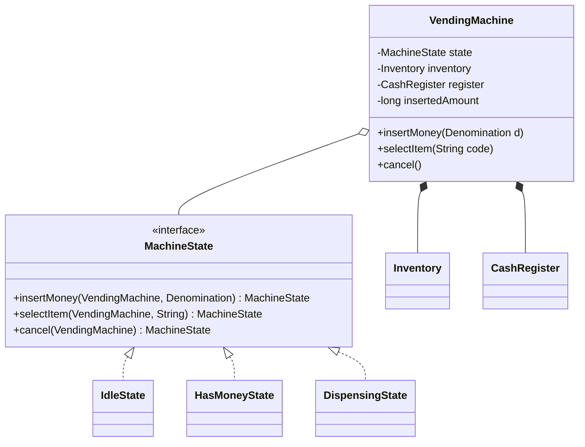

# 5.3 Design a Vending Machine

> *The* State pattern question. Also probes: money handling, inventory, and change-making (a hidden greedy/DP mini-problem). If you hear "vending machine", "ATM", or "ticket kiosk" — same skeleton.

---

## Step 1 — Clarify requirements (3 min)

**Say:** *"Machine sells items at coded slots (A1..). Flow: insert money → select item → dispense + change; cancel refunds. Accepts coins/notes of fixed denominations. Should I handle: insufficient change scenarios, restocking/admin, and concurrent access — or is this single-user-at-a-time (physical machine implies it)?"*

**Functional:** insert money (multiple insertions), select, dispense, return change, cancel/refund, restock, collect cash.
**Edge cases to list upfront:** item out of stock, insufficient payment, **machine can't make exact change**, cancel mid-flow.

## Step 2 — Entities

`VendingMachine` (root, holds current state) · `MachineState` (interface: Idle / HasMoney / Dispensing / OutOfService) · `Inventory` (slot → item + count) · `CashRegister` (denomination counts + change-making) · `Item`, `Money`, `Denomination` (VOs/enums).

## Step 3 — Diagrams





## Step 4 — State pattern (the expected core)

```java
public class HasMoneyState implements MachineState {
    @Override public MachineState insertMoney(VendingMachine m, Denomination d) {
        m.addInserted(d);
        return this;
    }
    @Override public MachineState selectItem(VendingMachine m, String code) {
        Item item = m.inventory().itemAt(code)
            .orElseThrow(() -> new InvalidSlotException(code));
        if (m.inventory().countAt(code) == 0) { m.display("Out of stock"); return this; }
        if (m.insertedAmount() < item.price()) {
            m.display("Insert " + (item.price() - m.insertedAmount()) + " more"); return this;
        }
        long changeDue = m.insertedAmount() - item.price();
        if (!m.register().canMakeChange(changeDue)) {           // ← the case juniors miss
            m.display("Exact change only"); return this;         // don't take money you can't return
        }
        return new DispensingState(code, changeDue);
    }
    @Override public MachineState cancel(VendingMachine m) {
        m.refundInserted();
        return new IdleState();
    }
}

public class VendingMachine {
    private MachineState state = new IdleState();
    public void insertMoney(Denomination d) { state = state.insertMoney(this, d); }  // pure delegation
    public void selectItem(String code)    { state = state.selectItem(this, code); }
    public void cancel()                   { state = state.cancel(this); }
}
```

**Narrate the win:** every state must answer every event → the event×state matrix is complete by construction; "select before paying" is handled in `IdleState`, not by a forgotten `if`.

## Step 5 — Change-making (the hidden algorithm)

```java
public class CashRegister {
    private final EnumMap<Denomination, Integer> stock = new EnumMap<>(Denomination.class);

    /** Greedy largest-first — correct for canonical currency systems (say this caveat!). */
    public Optional<Map<Denomination, Integer>> makeChange(long amount) {
        Map<Denomination, Integer> result = new EnumMap<>(Denomination.class);
        for (Denomination d : Denomination.largestFirst()) {
            int use = (int) Math.min(amount / d.value(), stock.getOrDefault(d, 0));
            if (use > 0) { result.put(d, use); amount -= (long) d.value() * use; }
        }
        return amount == 0 ? Optional.of(result) : Optional.empty();
    }
    public boolean canMakeChange(long amount) { return makeChange(amount).isPresent(); }
    // commit: deduct result from stock + add inserted denominations — atomically with dispense
}
```

**The caveat that scores:** greedy is optimal for canonical denominations (1/2/5/10…) but fails contrived sets *and* limited-stock cases (change 60 with {50×1, 20×3}: greedy takes 50 then dies; 20×3 works) — "for limited stock I'd fall back to DP/backtracking over denomination counts." Knowing this beats knowing the pattern.

## Step 6 — Money & atomicity of dispense

- Money as `long` paise + `Denomination` enum — never double.
- Dispense sequence: reserve item → compute change → **commit register** (add inserted, remove change) → release item → reset to Idle. On hardware failure mid-dispense → refund path + OutOfService; mention "the physical world needs a mini-saga: reserve, act, compensate."
- Concurrency: a physical machine is single-user (the UI serializes events); say it, then add "if this were a shared kiosk service, the machine object's public methods get a single lock — coarse is correct here because operations are milliseconds."

## Step 7 — Extensibility follow-ups

- **Card/UPI payments:** `PaymentMethod` strategy; HasMoney generalizes to "payment authorized" — change-making skipped for digital.
- **Dynamic pricing/combos:** `PricingPolicy` seam on item lookup.
- **Restock/admin:** `OutOfService` state + `AdminPanel` facade (`restock`, `collectCash`, `setPrice`).
- **Telemetry:** Observer on events (sold-out, cash-full) → restocking alerts.

---

## ✅ Outcome — what a complete answer includes
State diagram first → State pattern with pure-delegation machine → out-of-stock, underpayment, cancel handled per state → **change-feasibility check before dispensing** → greedy change-making with the canonical-coins caveat and limited-stock fallback → atomic commit order for dispense → digital-payments extension.

## 💡 Tips & Tricks
- Draw the state diagram and get agreement *before* any code — this problem is won at the whiteboard.
- "Exact change only" (checking `canMakeChange` **before** dispensing) is the differentiator edge case — lead with it.
- ATM variant: same states + CoR for denomination dispensing (2000→500→100) + PIN/auth state — 90% shared skeleton.
- Don't build a payment gateway; `insertMoney(Denomination)` is the whole payment API for the physical machine.

## 🎯 Interview Q&A

**Q1. Why the State pattern here instead of a status enum + switch?**
> The behavior *per event per state* is rich: `selectItem` in Idle scolds, in HasMoney it runs a 4-branch decision, in Dispensing it's ignored. An enum+switch spreads that matrix across methods where any missed cell is a silent bug; state classes force every cell to be written, transitions are return values (impossible to forget), and adding OutOfService is a new class rather than +1 branch × N switches. For 2 trivial states I'd concede the enum — here the matrix is the complexity, so State earns its classes.

**Q2. Where does the money go if dispensing fails after payment?**
> Commit order protects the user: I take nothing irreversibly until the item is released. Reserve item (decrement with ability to restore), verify change feasibility, then physically dispense; only on dispense-success does the register commit (inserted cash absorbed, change counted out). Motor jam after commit → compensations: restore item count if not dropped, refund full inserted amount, transition to OutOfService, log for reconciliation. It's a tiny saga — each step has a compensation, and I can name them.

**Q3. Greedy change fails with limited stock — show the fix.**
> Feasibility becomes a bounded coin-change: denominations with per-denomination counts. DP over amount with counts (or DFS largest-first with pruning — fine at vending scale since amounts are small): `canMake(amount, denomIndex)` tries `use = min(count, amount/value) … 0` and recurses. Exponential worst case doesn't matter for amount ≤ a few thousand paise and ≤6 denominations; correctness does: greedy would refuse sales the machine can actually serve, or worse, promise change it can't produce if unchecked.

**Q4. The interviewer swaps the problem to an ATM mid-interview. What transfers?**
> The skeleton: State machine (Idle → CardInserted → PinVerified → TransactionSelected → Dispensing), CashRegister becomes the dispenser with the same feasibility logic, and money-safety commit ordering becomes debit-account-then-dispense with compensation (reverse debit on hardware failure — and note real banks reconcile asynchronously). New pieces: auth (PIN attempts state with lockout), account service behind an interface, and CoR for denomination dispensing. I'd literally say "same skeleton, three new organs" — showing transfer is the point of the swap.

**Q5. How do you make this testable and what do you test?**
> The machine takes `Inventory` and `CashRegister` via constructor; hardware actions (motor, cash slot) behind a `Dispenser` interface faked in tests. Key tests: full happy path asserting item + exact change + state back to Idle; underpay → prompt, still HasMoney; cancel → full refund; out-of-stock; **the change trap** — stock the register so change is infeasible, assert sale refused and money refundable; and a state-matrix sweep asserting every event in every state does something defined (no exceptions leaking). The matrix sweep is cheap because states are classes — the pattern pays for its own testing.
