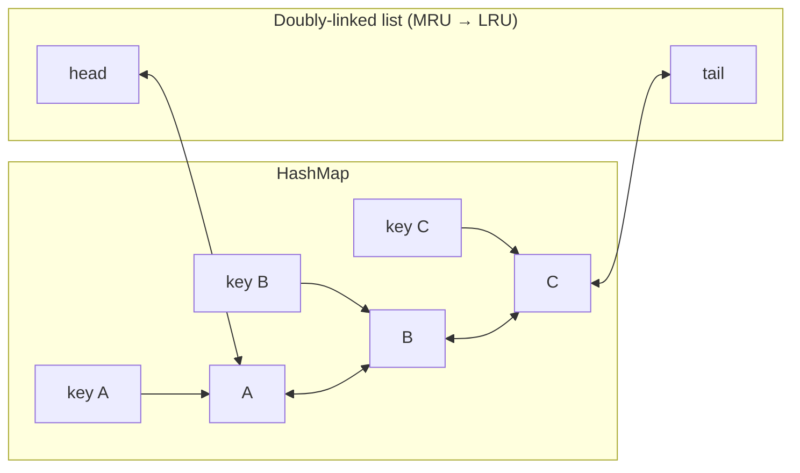

# 5.4 Design an LRU Cache

> The bridge between DSA and LLD rounds — asked in both. DSA wants the O(1) structure; LLD wants generics, eviction as Strategy, TTL, and thread-safety. This chapter covers the full ladder, because interviewers climb it.

---

## Step 1 — Clarify requirements (2 min)

**Say:** *"Fixed capacity, `get`/`put`, evict least-recently-used on overflow, both ops O(1). Then: should I make eviction pluggable (LRU/LFU/FIFO), add TTL, and make it thread-safe? That's usually the ladder — happy to climb it in that order."*

## Step 2 — The core insight

O(1) get + O(1) recency update needs two structures joined: **HashMap for lookup + doubly-linked list for order** (head = most recent, tail = victim). Map values point at list nodes so unlinking is O(1).



## Step 3 — Clean-room implementation (know this cold)

```java
public class LruCache<K, V> {
    private final int capacity;
    private final Map<K, Node<K, V>> map = new HashMap<>();
    private final Node<K, V> head = new Node<>(null, null);   // sentinels: no null checks ever
    private final Node<K, V> tail = new Node<>(null, null);

    public LruCache(int capacity) {
        if (capacity <= 0) throw new IllegalArgumentException("capacity must be positive");
        this.capacity = capacity;
        head.next = tail; tail.prev = head;
    }

    public Optional<V> get(K key) {
        Node<K, V> n = map.get(key);
        if (n == null) return Optional.empty();
        moveToFront(n);                                        // touch = recency update
        return Optional.of(n.value);
    }

    public void put(K key, V value) {
        Node<K, V> n = map.get(key);
        if (n != null) { n.value = value; moveToFront(n); return; }
        if (map.size() == capacity) {
            Node<K, V> victim = tail.prev;                     // true LRU
            unlink(victim);
            map.remove(victim.key);
        }
        Node<K, V> fresh = new Node<>(key, value);
        map.put(key, fresh);
        addAfterHead(fresh);
    }

    private void moveToFront(Node<K, V> n) { unlink(n); addAfterHead(n); }
    private void unlink(Node<K, V> n) { n.prev.next = n.next; n.next.prev = n.prev; }
    private void addAfterHead(Node<K, V> n) {
        n.next = head.next; n.prev = head;
        head.next.prev = n; head.next = n;
    }

    private static final class Node<K, V> {
        final K key; V value; Node<K, V> prev, next;
        Node(K key, V value) { this.key = key; this.value = value; }
    }
}
```

**Details graders check:** sentinel head/tail (no edge-case ifs) · victim removed from *both* structures · update-existing moves to front · generic types · `Optional` over null (or say why null-return matches Map convention).

**The shortcut to name, then not use:** `LinkedHashMap(capacity, 0.75f, true)` with `removeEldestEntry` override *is* an LRU cache — mention it ("in production I'd start here or use Caffeine"), then build clean-room since that's the ask.

## Step 4 — LLD upgrade: eviction as Strategy

```java
public interface EvictionPolicy<K> {
    void onAccess(K key);           // get/put touch
    void onInsert(K key);
    K selectVictim();
    void onRemove(K key);
}
// LruPolicy: the linked list above.  FifoPolicy: insertion queue, onAccess = no-op.
// LfuPolicy: freq map + freq→keys buckets (O(1) LFU — name it, implement only if asked).

public class Cache<K, V> {
    private final Map<K, V> store = new HashMap<>();
    private final EvictionPolicy<K> policy;                    // injected
    private final int capacity;

    public void put(K key, V value) {
        if (!store.containsKey(key) && store.size() == capacity) {
            K victim = policy.selectVictim();
            store.remove(victim); policy.onRemove(victim);
        }
        boolean fresh = store.put(key, value) == null;
        if (fresh) policy.onInsert(key); else policy.onAccess(key);
    }
}
```

**Narrate:** *"Eviction is the variation axis → Strategy. The cache owns storage + capacity; the policy owns ordering. LFU plugs in without touching tested code."* This refactor — from the fused DSA solution to the seamed LLD design — is often the *entire point* of the interview.

## Step 5 — TTL (the common second rung)

```java
private record Entry<V>(V value, long expiresAtMillis) {
    boolean expired(long now) { return now >= expiresAtMillis; }
}
public Optional<V> get(K key) {
    Entry<V> e = store.get(key);
    if (e == null) return Optional.empty();
    if (e.expired(clock.millis())) {                    // lazy expiry on read
        store.remove(key); policy.onRemove(key);
        return Optional.empty();
    }
    policy.onAccess(key);
    return Optional.of(e.value());
}
// + scheduled sweeper for memory hygiene: lazy expiry alone never frees unread keys
```

Say both halves: **lazy check for correctness, background sweep for memory** — one without the other is a known gap. Inject the `Clock`.

## Step 6 — Thread-safety (the third rung)

Ladder to climb aloud:
1. **Coarse lock** — `synchronized` on both ops: correct, simple, contended. *Start here; it's honest.*
2. **Why fine-grained is hard here:** even `get` mutates the list (recency), so a ReadWriteLock buys little — writes are everywhere. Naively CHM-for-map + lock-for-list re-introduces check-then-act races across the two structures.
3. **Real designs (name, don't build):** segment the cache (N independent shards by `hash(key) % N` — contention ÷ N, LRU becomes per-shard approximate); or Caffeine's approach — lock-free reads with recency recorded in ring buffers, replayed in batches under one striped maintenance lock (approximate LRU on purpose).

**The sentence that wins:** *"exact LRU under concurrency is inherently serialized — every op reorders one list — so production caches relax exactness (sharding or buffered recency) to buy parallelism."*

---

## ✅ Outcome — what a complete answer includes
O(1) map+DLL with sentinels → clean generic code with victim removed from both structures → `LinkedHashMap`/Caffeine name-drop → eviction extracted to Strategy (LRU/FIFO/LFU) → TTL with lazy+sweeper and injected Clock → thread-safety ladder ending at sharding/approximate-LRU insight.

## 💡 Tips & Tricks
- Practice until the DLL code flows in <10 minutes — this one is typed, not discussed.
- The three rungs (strategy, TTL, threads) are predictable — pre-plan the seams so upgrades look effortless.
- Off-by-one check they love: capacity check happens only for *new* keys — updating an existing key at capacity must not evict.
- If asked "why not just timestamps in the map + scan for oldest?" — that's O(n) eviction; the DLL *is* the sorted-by-recency structure maintained for free.

## 🎯 Interview Q&A

**Q1. Why a doubly-linked list — why not singly?**
> `moveToFront` must unlink a node given only the node itself (we arrive via the map). Unlinking needs the predecessor: singly-linked = O(n) scan to find it; doubly = `n.prev` in O(1). The prev pointer is the price of O(1) recency updates. (Trick alternative: singly-linked with "copy next node's data into me" deletion breaks because the map's node references go stale.)

**Q2. get() looks read-only. Why is it a write for concurrency purposes?**
> Recency *is* state: get unlinks and relinks the node (and even in LinkedHashMap access-order mode, mutates link fields). So two concurrent gets race on list pointers — corruption, not staleness. That's why ReadWriteLock underdelivers here and why production caches decouple the read path from ordering: record the touch in a buffer, apply ordering later. Recognizing "logical read, physical write" is the core concurrency insight of this problem.

**Q3. Sketch O(1) LFU since you named it.**
> Two maps + bucket list: `key → (value, freq)` and `freq → LinkedHashSet<keys>`, plus a `minFreq` tracker. Access: move key from bucket f to f+1 (O(1) with hashed sets), bump minFreq if its bucket emptied. Evict: any (oldest-inserted for LRU tie-break) key from the `minFreq` bucket. All O(1). The subtle parts: minFreq resets to 1 on insert, and tie-breaking within a frequency uses insertion order — LinkedHashSet gives that free.

**Q4. Cache stampede: 100 threads miss the same key simultaneously. Handle it.**
> Single-flight per key: `ConcurrentHashMap<K, CompletableFuture<V>>` — first thread `computeIfAbsent`s a future and runs the loader; the other 99 get the *same future* and wait; on completion the value moves to the cache (remove the future on failure so retries can happen). This bounds backend load to one call per key per expiry. Bonus points: mention jittered TTLs and refresh-ahead so hot keys renew before expiring — stampede prevention, not just stampede handling.

**Q5. How does this in-process design map to Redis in a real system?**
> The interfaces survive; the guarantees shift. Storage/eviction move server-side (Redis maxmemory + allkeys-lru — which is *sampled*, approximate LRU: same exactness-vs-throughput trade we discussed). My cache class becomes a client wrapper: TTL via `SET EX`, single-flight still needed app-side (or via `SET NX` lock), and new failure modes appear — network timeouts (serve-stale policy), serialization, and cache-aside consistency (invalidate-after-write, the HLD conversation). Showing the same design pressures at both scales is exactly the LLD↔HLD bridge interviewers reward.
