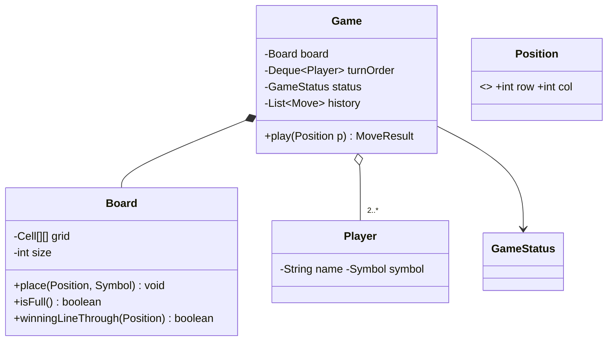

# 5.5 Design Tic-Tac-Toe & Snake-and-Ladder

> The "show me clean fundamentals" pair — common in machine coding screens. Scope is small, so graders zoom into modeling quality: turn management, win detection, board representation, and whether your design extends (N×N, new rules) without surgery.

---

## Part A — Tic-Tac-Toe

### Step 1 — Clarify (2 min)
**Say:** *"Two players, N×N board (I'll build 3×3 but keep N generic), win = full row/column/diagonal, draw when full. CLI-driven moves. Extensions to keep in mind: N×N with M-in-a-row, >2 players, undo, or an AI player?"*

### Step 2 — Model



Decisions to narrate: `Position` is a record VO; `Player` holds symbol (not the board); **turn order as a `Deque`** (poll → play → offer back) generalizes to N players free; `Game` is the aggregate root — the only public API.

### Step 3 — The code that gets read

```java
public MoveResult play(Position p) {
    if (status != GameStatus.IN_PROGRESS) throw new GameOverException(status);
    board.place(p, current().symbol());              // throws on occupied / out of bounds
    history.add(new Move(current(), p));
    if (board.winningLineThrough(p)) { status = GameStatus.WON; return MoveResult.win(current()); }
    if (board.isFull())             { status = GameStatus.DRAW; return MoveResult.draw(); }
    rotateTurn();
    return MoveResult.next(current());
}
```

**Win detection — the discussion point.** Checking all lines every move is O(N²); checking only lines *through the last move* is O(N):

```java
public boolean winningLineThrough(Position p) {
    Symbol s = cellAt(p).symbol();
    return line(r -> cellAt(new Position(p.row(), r)), s)         // row
        || line(r -> cellAt(new Position(r, p.col())), s)         // column
        || (p.row() == p.col()      && line(r -> cellAt(new Position(r, r)), s))
        || (p.row() + p.col() == size - 1 && line(r -> cellAt(new Position(r, size - 1 - r)), s));
}
```

O(1) alternative to *name*: per-player counters per row/col/diagonal — increment on move, win when any counter hits N. Trade: O(N) extra memory per player, and undo gets harder. Saying both, with when-each-wins, is the senior move.

### Step 4 — Extensibility answers (rehearsed)
- **N×N, M-in-a-row:** board already generic; win check scans M-windows through the move — still O(N).
- **Undo:** `history` + Command pattern — `Move.undo()` clears the cell, rotates turn back (this is why history exists from minute one).
- **AI player:** `Player` becomes interface — `HumanPlayer` reads input, `BotPlayer` computes (`MoveStrategy`: random → minimax). *Game loop doesn't change* — that's the point to make.

---

## Part B — Snake and Ladder

### Step 1 — Clarify (2 min)
**Say:** *"Board 1..100, dice 1..6, snakes and ladders as jumps, N players, exact-roll-to-finish or overshoot-wins? Multiple snakes can't chain from the same cell — do jumps chain (ladder → snake)? I'll assume: overshoot bounces back is out, exact finish not required, jumps don't chain — confirm."* (Asking about **chaining and exact-finish** shows you've actually played the game.)

### Step 2 — The modeling insight: snakes and ladders are one thing

```java
public record Jump(int from, int to) {
    public boolean isSnake() { return to < from; }               // only presentation cares
}
public class Board {
    private final int size;                                       // 100
    private final Map<Integer, Integer> jumps;                    // from → to, snakes AND ladders

    public int destination(int cell) { return jumps.getOrDefault(cell, cell); }
}
```

One `Map<Integer,Integer>` handles both — modeling them as separate `Snake`/`Ladder` class hierarchies is the classic over-engineering trap here. Validate at construction: no jump from cell 1 or 100, no two jumps from one cell, no self-loops.

### Step 3 — Game loop

```java
public class Game {
    private final Board board;
    private final Deque<Player> turns;
    private final Dice dice;                                      // interface! → test with loaded dice
    private final Map<Player, Integer> positions = new HashMap<>();

    public TurnResult takeTurn() {
        Player p = turns.poll();
        int roll = dice.roll();
        int target = positions.get(p) + roll;
        if (target > board.size()) target = positions.get(p);     // overshoot: stay (state the rule!)
        int landed = board.destination(target);                   // apply snake/ladder
        positions.put(p, landed);
        if (landed == board.size()) return TurnResult.won(p, roll);
        turns.offer(p);                                           // rotate only if game continues
        return TurnResult.moved(p, roll, landed);
    }
}
public interface Dice { int roll(); }                             // RandomDice / LoadedDice(fixed seq)
```

**`Dice` as an interface is the star decision** — say: *"injected dice makes every scenario deterministic in tests: I can force a snake, a ladder, an exact win."* Also handles "two dice" or "roll again on 6" via `DiceStrategy`.

### Step 4 — Extensibility answers
- **Roll-again-on-six / triple-six-penalty:** turn logic strategy (`TurnRule`), not ifs in the loop.
- **Exact-finish rule:** the one-line branch flagged during clarification — flip per config.
- **New board sizes / custom jumps:** constructor data.

---

## ✅ Outcome — what a complete answer includes
**TTT:** Game/Board/Player split with Position VO, Deque turn rotation, last-move-local O(N) win check (O(1) counters named), occupied/out-of-bounds/game-over guarded, undo & bot extensions mapped to history & Player-interface.
**S&L:** jumps unified in one map with construction-time validation, injected Dice, overshoot rule stated explicitly, rules-as-strategies for variants.

## 💡 Tips & Tricks
- These problems are graded on *polish per minute*: guard clauses, domain exceptions (`CellOccupiedException`), records, and a story-telling demo main.
- Announce the traps as you dodge them: "snakes and ladders are the same structure"; "win check only through the last move."
- The Deque-rotation trick for turns is 3 lines and handles N players, eliminations (just don't re-offer), and skip-turns.
- Never put game rules in `main` — the loop calling `game.takeTurn()` should be dumb.

## 🎯 Interview Q&A

**Q1. Where do the game rules live, and why does that placement matter?**
> Board owns *spatial* rules (valid cell, jumps, winning line); Game owns *procedural* rules (turn order, when the game ends, overshoot policy); Players own none. This split means changing dice rules never touches Board, and changing board size never touches Game. The failure mode it prevents: a `main`/UI that knows rules, which makes every variant a copy-paste of the loop.

**Q2. Make Tic-Tac-Toe support undo cheaply.**
> The `history` list is already the Command log. Undo: pop the last Move, clear its cell, set status back to IN_PROGRESS if it had ended, and rotate the turn deque backward (addFirst of the previous player). Board's counters-based win optimization would need decrements — which is exactly why I default to the last-move line-check version when undo is on the table: it's stateless, so undo is trivially correct.

**Q3. Two players submit moves simultaneously in an online version. What changes?**
> The Game aggregate becomes the serialization point: moves arrive as commands into a per-game queue processed by one worker (confinement — Ch 3.3), or `play()` is synchronized per game instance — either way, *turn validation* rejects the out-of-turn move that loses the race ("not your turn" is domain logic, not a lock artifact). Cross-server, the game state needs a single owner (sticky routing or a version-checked store with optimistic concurrency). Board-level locking is pointless — the turn rule already forbids concurrent legal moves.

**Q4. Interviewer: "Your Snake/Ladder classes… why is there just a Map?"**
> Because both are the same behavior — a forced relocation — differing only in direction, which nothing in the engine branches on. Classes earn existence through distinct behavior or invariants; here both would have one field-pair and identical `apply()`. I keep a `Jump` record for validation/display (isSnake for rendering) but the engine consumes the map. If a variant added behavior — "ladders require a fee", "snakes trigger a card" — *that's* when the hierarchy (or a `JumpEffect` strategy) appears. Modeling restraint is a feature.

**Q5. How would you drop in an unbeatable Tic-Tac-Toe bot?**
> `Player` is an interface with `Position nextMove(BoardView view)`; BotPlayer delegates to a `MoveStrategy` — minimax with alpha-beta over the board (3×3: trivial, ~5k states; memoize by board hash for N×N). Key design points: the bot receives a read-only `BoardView` (can't cheat), the Game loop is unchanged (it just asks the current player for a move), and strategies are swappable (RandomStrategy for easy mode). The absence of engine changes is the demonstration that the original seams were right.
