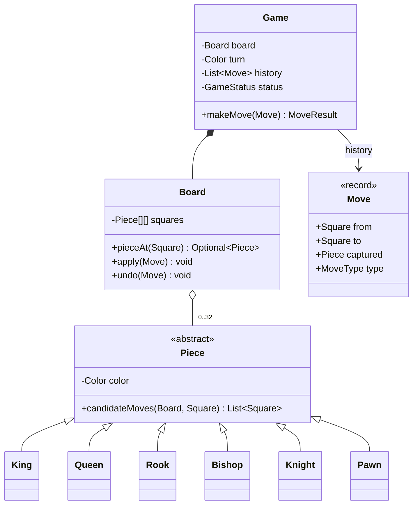

# 5.6 Design Chess

> The heavyweight modeling question. Nobody expects a full engine in 45 minutes — they expect **clean piece polymorphism, move validation layering, and honest scoping** of the hard rules (check, castling, en passant). Managing scope *is* the test.

---

## Step 1 — Clarify & scope (4 min — more than usual, on purpose)

**Say:** *"Full chess rules are deep — let me propose scope tiers: Tier 1: board, pieces, piece-legal moves, captures, turns. Tier 2: check/checkmate/stalemate. Tier 3: castling, en passant, promotion, draws. I'll design so all tiers fit, implement Tier 1 solidly, and talk through 2 and 3. Good?"*

This scoping speech is the strongest possible opening — it shows you know the domain's depth *and* how to budget.

## Step 2 — Model



Key calls to narrate: `Square` is a record VO (file, rank); `Move` records **captured piece** — that single field makes undo possible, which makes check-detection cheap (see Step 4); pieces are *stateless about position* — the board knows where pieces are, pieces know how they move. (Position-in-piece duplicates state and desyncs — a classic trap.)

## Step 3 — Piece movement: polymorphism + sliding reuse

```java
public abstract class Piece {
    protected final Color color;
    public abstract List<Square> candidateMoves(Board b, Square from);   // ignores check!

    /** Shared by rook/bishop/queen: walk rays until blocked. */
    protected List<Square> slide(Board b, Square from, List<Direction> dirs) {
        List<Square> out = new ArrayList<>();
        for (Direction d : dirs) {
            Square cur = from.plus(d);
            while (cur.onBoard()) {
                Optional<Piece> occupant = b.pieceAt(cur);
                if (occupant.isEmpty()) { out.add(cur); cur = cur.plus(d); continue; }
                if (occupant.get().color() != color) out.add(cur);        // capture, then stop
                break;
            }
        }
        return out;
    }
}
public class Rook extends Piece {
    public List<Square> candidateMoves(Board b, Square from) { return slide(b, from, Direction.ORTHOGONALS); }
}
public class Queen extends Piece {
    public List<Square> candidateMoves(Board b, Square from) { return slide(b, from, Direction.ALL_EIGHT); }
}
public class Knight extends Piece {
    public List<Square> candidateMoves(Board b, Square from) {
        return Direction.KNIGHT_JUMPS.stream().map(from::plus)
            .filter(Square::onBoard)
            .filter(sq -> b.pieceAt(sq).map(p -> p.color() != color).orElse(true))
            .toList();
    }
}
```

The `slide()` helper is the elegance moment: rook/bishop/queen become one-liners (Template-ish reuse). Pawn is the honest mess — forward-only, double-step from start, diagonal-capture-only, promotion — keep it a dedicated class and *say* it's irreducibly special.

## Step 4 — Move legality: the layered filter (the design's centerpiece)

**Say:** *"Legality has layers, and I'll keep them separate: (1) piece-shape moves from `candidateMoves`; (2) game-state filters — it's your piece, your turn; (3) the king-safety filter: a move is illegal if it leaves your king attacked. Layer 3 is expensive, so it's simulate-and-check."*

```java
public MoveResult makeMove(Move m) {
    Piece p = board.pieceAt(m.from()).orElseThrow(() -> new NoPieceException(m.from()));
    if (p.color() != turn) throw new NotYourTurnException();
    if (!p.candidateMoves(board, m.from()).contains(m.to())) throw new IllegalMoveException(m);

    board.apply(m);                                   // simulate (captured piece saved in Move)
    if (isInCheck(turn)) {                            // layer 3: king safety
        board.undo(m);
        throw new MoveLeavesKingInCheckException(m);
    }
    history.add(m);
    turn = turn.opposite();
    updateStatus();                                   // CHECK / CHECKMATE / STALEMATE / ongoing
    return MoveResult.ok(status);
}

private boolean isInCheck(Color c) {
    Square king = board.kingSquare(c);
    return board.piecesOf(c.opposite()).stream()
        .anyMatch(e -> e.piece().candidateMoves(board, e.square()).contains(king));
}
```

**Checkmate = in check ∧ no legal move exists** (try every candidate of every piece with simulate-undo; if all fail king-safety → mate). **Stalemate = not in check ∧ no legal move.** Expensive but correct — and correctness-first with named optimizations (attack maps, incremental check tracking) is the right interview posture.

## Step 5 — The special rules (talk, don't code)

- **Castling:** conditions = king+rook unmoved (track via `hasMoved` flag or scan history), squares between empty, king's path not attacked. Modeled as `MoveType.CASTLE` — `Board.apply` moves two pieces.
- **En passant:** legal only immediately after an enemy pawn's double-step — *this is why `history` exists*: last move is inspectable. `MoveType.EN_PASSANT` captures a piece not on the target square.
- **Promotion:** `MoveType.PROMOTION` carries the chosen piece; apply swaps the pawn.
- **Draws:** threefold repetition (board-state hash counts — name Zobrist hashing), fifty-move rule (counter reset on capture/pawn move).

Each special rule confirms two design choices: **rich `Move` record + move history** — say that connection explicitly.

## Step 6 — Extensions they might pull

- **Undo/replay:** `Move` already reversible → Command pattern for free; replay = fold history over a fresh board (also gives save/load: serialize the move list, not the board — smaller and audit-friendly).
- **Timers:** `ChessClock` per player, checked in `makeMove` — a Game concern, pieces untouched.
- **AI:** `Player` interface (as in 5.5); minimax needs exactly the simulate/undo machinery legality already built — point out the reuse.
- **Online play:** Game is the serialization point; moves are commands; state syncs by shipping moves (event sourcing in miniature).

---

## ✅ Outcome — what a complete answer includes
Tiered scoping speech → Board-owns-position / pieces-own-movement split → `slide()` reuse making Q/R/B one-liners → three-layer legality with simulate-undo king-safety → check/mate/stalemate definitions → special rules mapped to Move record + history → undo/AI/online as consequences of the same machinery.

## 💡 Tips & Tricks
- Never start coding all six pieces — do Rook (slide), Knight (jumps), Pawn (the mess), and say "Bishop/Queen are direction lists on slide."
- "Pieces don't know their position" prevents the most common chess-design tangle — state it early.
- The phrase "candidate moves vs legal moves" (pseudo-legal vs legal) is the domain vocabulary that signals depth.
- If time collapses, sacrifice checkmate detection, never move validation — an illegal-move-permitting chess design is a failed one.

## 🎯 Interview Q&A

**Q1. Why abstract class for Piece and not an interface + strategies?**
> Piece has shared state (color) and shared behavior (`slide`) → abstract class earns its slot. A `MoveStrategy` interface per piece type is a valid alternative — pieces become data (type+color) and movement becomes pluggable, which shines for variants (fairy chess). For standard chess the six types are closed and stable, so the hierarchy is simpler and the polymorphism direct. I'd name both and justify by change-likelihood: rules stable → hierarchy; rules moddable → strategy.

**Q2. Why simulate-and-undo for check instead of computing attacked squares?**
> Correctness-per-line-of-code. Simulate-undo reuses `candidateMoves` — one source of truth for attack logic — and handles the nasty indirect cases (pinned pieces, discovered checks) automatically, because "does any enemy piece attack the king *after* the move" is literally the definition. An attack-map is faster (engines maintain incremental bitboards) but duplicates movement knowledge and is easy to get subtly wrong in an interview. I optimize only if asked, and I can name the direction: precomputed attack tables, incremental update, Zobrist-keyed caches.

**Q3. Where does en passant's legality actually live in your design?**
> In Game-level validation consulting `history` — not in Pawn. Pawn's `candidateMoves` can't see the *time* dimension (was the double-step the immediately-previous move?); it only sees the board. So Pawn offers the diagonal as a candidate when an adjacent enemy pawn sits beside it, and the Game layer confirms the timing condition from the last move. This is a clean example of the layering: spatial rules in pieces, temporal rules in Game — same split that puts turn-checking in Game.

**Q4. How do you test chess meaningfully in limited time?**
> Scenario tests from set positions — a `Board.fromString("....")` fixture parser is the highest-ROI helper I'd write. Then: each piece's moves from a known position (knight on rim, blocked rook); captures; the king-safety filter (moving a pinned piece must throw); one checkmate (back-rank) and one stalemate position; and an undo round-trip property (apply+undo returns the exact prior state — catches the captured-piece bookkeeping). Fixture-based tests double as documentation of the rules I claim to support.

**Q5. Interviewer: "Support Fischer-random (Chess960) and a 4-player variant — what breaks?"**
> Chess960: almost nothing — starting position becomes a `BoardSetup` strategy, and castling generalizes (king/rook start squares vary) → my `MoveType.CASTLE` handling parameterizes by origin squares rather than hardcoding e1/h1. That cheapness validates the design. Four-player: bigger surgery — `Color` becomes 4-valued, `turn` a rotation, "checkmate" per-player with elimination, and the board isn't 8×8 — which is why Board size/geometry should already be data, not constants. Honest answer: Tier-1 architecture survives, the Game-status rules are rewritten — and that's the right place for variant-specific code to live anyway.
