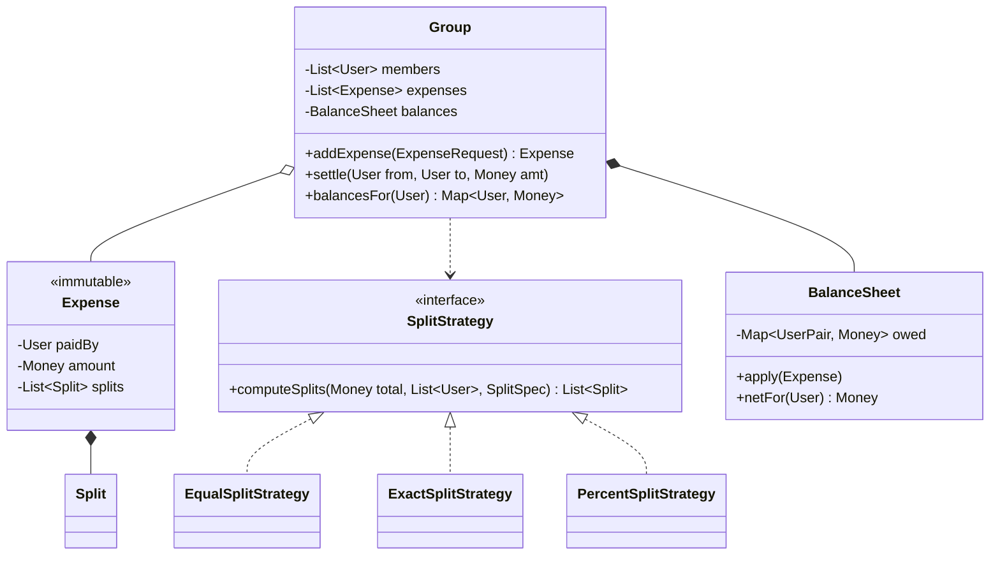

# 5.7 Design Splitwise (Expense Sharing)

> The money-math question. Tests: Strategy (split types), BigDecimal/paise discipline, the balance-sheet data structure, and the famous **debt simplification** follow-up (a greedy algorithm hiding inside an LLD round).

---

## Step 1 — Clarify requirements (3 min)

**Say:** *"Users and groups; add an expense paid by one (or more?) users, split equal/exact/percent; view balances per user and pairwise; settle up. The classic follow-up is simplify-debts — want me to design for it? Assuming single currency and single payer per expense unless you say otherwise."*

**Edge cases to name now:** splits must sum to total (validation), **rounding** (₹100 / 3 people), self-owed amounts, settling more than owed.

## Step 2 — Entities

`User` · `Group` (aggregate: members + expenses + balance sheet) · `Expense` (immutable once added: payer, amount, splits) · `Split` (VO: user + share) · `SplitStrategy` (equal/exact/percent) · `BalanceSheet` (the core structure) · `Settlement`.

## Step 3 — Class diagram



## Step 4 — Money & the rounding rule (the credibility test)

```java
public record Money(long paise) {                       // integer minor units — never double
    public Money times(int n) { return new Money(paise * n); }
    public Money minus(Money o) { return new Money(paise - o.paise); }
}

public class EqualSplitStrategy implements SplitStrategy {
    public List<Split> computeSplits(Money total, List<User> users, SplitSpec ignored) {
        long base = total.paise() / users.size();
        long remainder = total.paise() % users.size();          // ₹100/3 → 3334,3333,3333
        List<Split> splits = new ArrayList<>();
        for (int i = 0; i < users.size(); i++) {
            long share = base + (i < remainder ? 1 : 0);        // distribute extra paise deterministically
            splits.add(new Split(users.get(i), new Money(share)));
        }
        return splits;                                          // invariant: Σ shares == total, exactly
    }
}
```

**Say:** *"Money is integer paise; the remainder paise are assigned deterministically (first k users) so splits always sum exactly to the total — the invariant `Expense` re-validates at construction."* This paragraph alone separates you from most candidates.

Percent strategy: compute each share, round down, then distribute leftover paise the same way; Exact strategy: pure validation.

## Step 5 — The balance sheet (design decision to discuss)

Two options — present both, pick one:

- **(a) Pairwise map** `Map<(debtor,creditor), Money>`: preserves *who owes whom* exactly as expenses happened; settle-up is a direct decrement; auditable. O(n²) worst-case entries.
- **(b) Net-only** `Map<User, Money>` (net positive = is owed): tiny and enough for "how much am I owed?", but *loses pairwise info* — you can't say "you owe Bob ₹200", only "you owe ₹200".

**Pick (a), derive (b):** real Splitwise shows pairwise; net is a fold over pairs.

```java
public class BalanceSheet {
    private final Map<UserPair, Money> owed = new HashMap<>();   // canonical pair order + sign

    public void apply(Expense e) {
        for (Split s : e.splits()) {
            if (s.user().equals(e.paidBy())) continue;           // payer's own share: no debt
            addDebt(s.user(), e.paidBy(), s.amount());           // debtor → creditor
        }
    }
    private void addDebt(User debtor, User creditor, Money amt) {
        UserPair key = UserPair.of(debtor, creditor);            // canonical (minId, maxId)
        Money cur = owed.getOrDefault(key, Money.zero());
        owed.put(key, key.isForward(debtor) ? cur.plus(amt) : cur.minus(amt));  // opposite debts auto-net
    }
}
```

The canonical-pair trick (store one entry per pair with a signed amount) auto-nets mutual debts — A owes B 300, B owes A 100 → one entry, 200. Worth narrating.

## Step 6 — Simplify debts (the star follow-up — greedy on net balances)

*"Minimize the number of settlement transactions."* Key insight: **only net balances matter** — the pairwise graph can be discarded for settlement purposes.

```java
public List<Settlement> simplify(Map<User, Money> net) {         // Σ net == 0 always
    PriorityQueue<Entry> creditors = maxHeap();                  // most-owed first
    PriorityQueue<Entry> debtors  = maxHeap();                   // most-owing first
    net.forEach((u, m) -> { if (m.isPositive()) creditors.add(e(u,m));
                            else if (m.isNegative()) debtors.add(e(u, m.negate())); });
    List<Settlement> out = new ArrayList<>();
    while (!creditors.isEmpty()) {
        Entry c = creditors.poll(); Entry d = debtors.poll();
        Money pay = Money.min(c.amt(), d.amt());
        out.add(new Settlement(d.user(), c.user(), pay));        // debtor pays creditor
        if (c.amt().minus(pay).isPositive()) creditors.add(e(c.user(), c.amt().minus(pay)));
        if (d.amt().minus(pay).isPositive()) debtors.add(e(d.user(), d.amt().minus(pay)));
    }
    return out;                                                  // ≤ n-1 transactions
}
```

Greedy max-creditor-vs-max-debtor gives ≤ n−1 transactions. **Honesty point:** the true minimum is NP-hard (partitioning into zero-sum subsets can beat n−1); greedy is the accepted practical answer — knowing that boundary is a strong signal.

## Step 7 — Concurrency & extensions

- Two members add expenses to one group concurrently → the Group is the consistency unit: `synchronized addExpense` per group (contention is per-group, fine), or queue-confine each group. Cross-server → optimistic versioning on the group.
- **Extensions:** multi-currency (Money carries Currency; sheets per currency + FX at display), recurring expenses (scheduler + template), expense edit/delete (append a compensating expense — ledger-style, auditable — rather than mutating history; say "immutable ledger, corrections as new entries").

---

## ✅ Outcome — what a complete answer includes
Split strategies behind an interface → integer-paise Money with deterministic remainder distribution and sum-invariant validation → pairwise balance sheet with canonical-pair netting, net derived → settle-up flow → greedy debt simplification with the NP-hard honesty note → per-group consistency + immutable-ledger corrections.

## 💡 Tips & Tricks
- Rounding is where they're waiting for you. Volunteer the ₹100/3 case before they ask.
- "Expenses are immutable; edits are compensating entries" — the ledger mindset — echoes payment-system maturity and pre-answers audit questions.
- The simplify algorithm needs only net balances — stating that reduction crisply is half its marks.
- Don't build Users/auth/friends — group + expenses + balances is the whole game.

## 🎯 Interview Q&A

**Q1. Why is Expense immutable, and how do edits work then?**
> Balances are *derived* from expenses; if expenses mutate, every derived structure (pairwise sheet, nets, past settlements) silently invalidates, and concurrent edit vs settle is a nightmare. Immutable ledger: an edit appends a reversal entry plus the corrected expense — balance sheet just applies both; history remains auditable ("why do I owe this?" is answerable); settlements that happened in between stay consistent. It's the same reason banks never UPDATE a transaction row.

**Q2. Prove your equal split can't lose a paisa.**
> Shares are `base = total/n` (integer division) with the remainder `r = total mod n` distributed as +1 paisa to the first r users. Sum = n·base + r = total by the division identity — exact, not approximate. Determinism (first-r rule) matters too: recomputing the split yields identical shares, so validation `Σ splits == total` in the Expense constructor is a hard invariant, not a tolerance check. With doubles, none of these statements are even well-defined — 0.1 isn't representable.

**Q3. Walk through simplify-debts on: A +600, B −100, C −500 (net).**
> Creditors heap: {A:600}; debtors: {C:500, B:100}. Round 1: A vs C → C pays A min(600,500)=500; A reduces to 100, C done. Round 2: A vs B → B pays A 100; both done. Result: 2 transactions for 3 people (≤ n−1 ✓). Contrast the pairwise graph, which might have contained A→B, B→C, C→A chains — netting collapsed them. And Σnet=0 guarantees the heaps exhaust together, so the loop terminates cleanly.

**Q4. Where do the strategies get chosen, and how does a new split type ship?**
> `AddExpense` request carries a `SplitSpec` (type + per-type data); a `SplitStrategyFactory` maps type → strategy; Group stays strategy-blind. New type — "split by shares/weights": one `WeightedSplitStrategy` class implementing computeSplits with the same remainder discipline + one factory registration + a SplitSpec variant. Zero edits to Group, Expense, BalanceSheet — which is the OCP payoff I set up the seam for; I'd demo it by writing the weighted strategy in ~10 lines if asked.

**Q5. How does this design survive going multi-currency?**
> Money gains a Currency and refuses cross-currency arithmetic (fail-fast at the type level). Each expense is in one currency; the balance sheet keys become (pair, currency) — debts in different currencies don't net against each other (300 INR vs 5 USD has no exact sum). Display-level conversion uses an injected `ExchangeRateProvider`, clearly marked approximate; *settlement* in a different currency is an explicit user action recording the agreed rate as part of the settlement entry. The trap to avoid — and I'd say this — is netting across currencies inside the ledger: rates fluctuate, ledgers must not.
