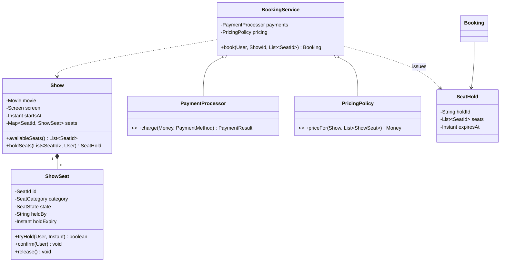
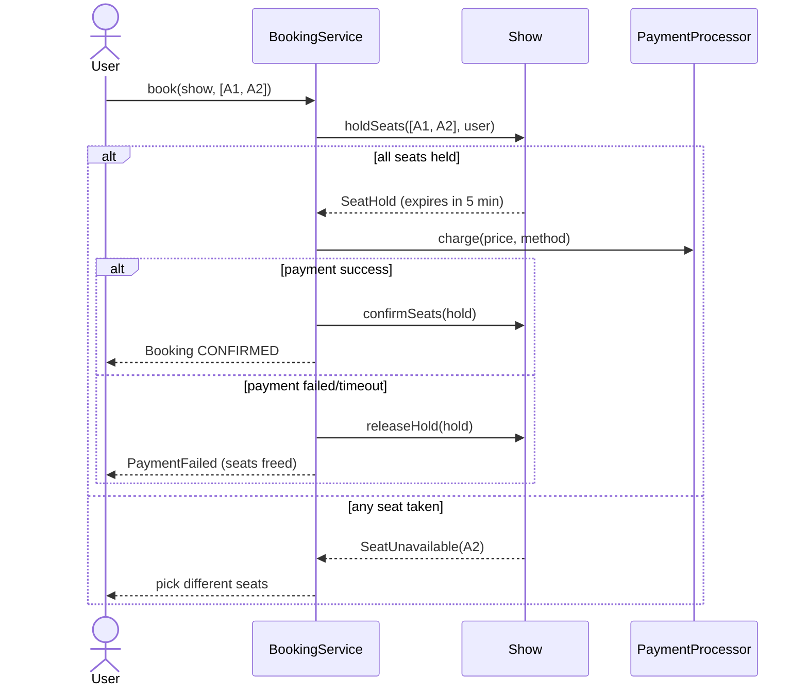

# 5.8 Design a Movie Ticket Booking System (BookMyShow)

> The concurrency showpiece. Everything funnels to one moment: **two users, one seat, same instant.** Your entire design is judged by how cleanly you handle that — plus the seat-hold lifecycle that real ticketing runs on.

---

## Step 1 — Clarify requirements (3 min)

**Say:** *"Search movies → pick a show → see the seat map → select seats → pay → confirmed ticket. Core tension is concurrent seat booking, so I'll design the hold-then-confirm flow carefully. Assume one city/theatre chain in-process; payments behind an interface. Cancellations and dynamic pricing as extensions?"*

## Step 2 — The entity insight: Movie ≠ Show ≠ Seat ≠ Booking

The modeling test is separating four lifecycles (the Book/BookCopy move, Ch 4.3):
- `Movie` — catalog metadata (VO-ish).
- `Screen` — physical room with a fixed `SeatLayout`.
- `Show` — **movie × screen × time**; the unit that owns bookable seats.
- `ShowSeat` — seat *within a show* (the thing with AVAILABLE/HELD/BOOKED state). A physical `Seat` is layout data; `ShowSeat` is inventory.
- `Booking` — user + show + seats + payment state.

## Step 3 — Class diagram



## Step 4 — The core flow: HOLD → PAY → CONFIRM (never book-then-pay)

**Say the why first:** *"Payment takes seconds-to-minutes; seats can't be both sellable and promised during that window. So: short exclusive hold (5 min) → pay → confirm; expiry auto-releases."*



## Step 5 — The concurrency core (this code wins or loses the round)

```java
public class ShowSeat {
    private SeatState state = SeatState.AVAILABLE;
    private String heldBy; private Instant holdExpiry;

    public synchronized boolean tryHold(String userId, Instant expiry, Clock clock) {
        releaseIfExpired(clock);                              // lazy expiry: correctness w/o sweeper
        if (state != SeatState.AVAILABLE) return false;
        state = SeatState.HELD; heldBy = userId; holdExpiry = expiry;
        return true;
    }
    public synchronized void confirm(String userId, Clock clock) {
        if (state != SeatState.HELD || !userId.equals(heldBy) || clock.instant().isAfter(holdExpiry))
            throw new HoldLostException();                    // pay-after-expiry loses cleanly
        state = SeatState.BOOKED;
    }
    public synchronized void releaseIfExpired(Clock c) {
        if (state == SeatState.HELD && c.instant().isAfter(holdExpiry)) { state = SeatState.AVAILABLE; heldBy = null; }
    }
}

public SeatHold holdSeats(List<SeatId> ids, String userId) {
    List<SeatId> sorted = ids.stream().sorted().toList();     // canonical order → no deadlock
    List<ShowSeat> acquired = new ArrayList<>();
    Instant expiry = clock.instant().plus(HOLD_TTL);
    for (SeatId id : sorted) {
        ShowSeat seat = seats.get(id);
        if (!seat.tryHold(userId, expiry, clock)) {
            acquired.forEach(ShowSeat::release);              // all-or-nothing
            throw new SeatUnavailableException(id);
        }
        acquired.add(seat);
    }
    return SeatHold.of(userId, sorted, expiry);
}
```

Points to narrate (all from Ch 3.3): lock lives on the seat (per-seat contention) · multi-seat = sorted order + release-on-failure · **lazy expiry inside tryHold** plus a background sweeper for the seat map display · confirm re-verifies holder *and* expiry — payment success after hold-expiry must fail safely (refund path).

## Step 6 — Payments: idempotency & the double-charge question

- `charge(idempotencyKey = holdId, ...)` — retries after timeout can't double-charge (the gateway dedupes by key).
- Payment timeout = *unknown outcome*: query gateway status; if charged but hold expired → **refund**, don't resurrect seats (someone else may hold them). State machine on Booking: `PENDING_PAYMENT → CONFIRMED | PAYMENT_FAILED | REFUND_DUE`.
- Multiple gateways → `PaymentProcessor` adapters (Ch 2.2).

## Step 7 — Extensions (one-liners ready)

- **Dynamic pricing:** `PricingPolicy` strategy (category, time-to-show, occupancy) — the seam exists.
- **Cancellation:** Booking state machine + refund policy strategy (100%/50%/0 by cutoff); seats → AVAILABLE, notify waitlist (Observer).
- **Waitlist:** per-show queue; seat-release event offers a short exclusive hold to the head.
- **Seat-map UI staleness:** display is eventually consistent; truth is enforced only at `tryHold` — say "the seat map is a hint, the hold is the contract."
- **Scale-out (multi-JVM):** the seat invariant moves to the store — DB optimistic version per ShowSeat or Redis `SET NX PX` per seat; JVM locks remain a fast first filter (Ch 3.3 Q2).

---

## ✅ Outcome — what a complete answer includes
Movie/Show/ShowSeat/Booking lifecycle split → hold-pay-confirm with TTL (sequence diagram) → per-seat synchronized tryHold + sorted multi-seat all-or-nothing → lazy expiry + sweeper → confirm re-validating holder/expiry → idempotent payments with unknown-outcome handling → pricing/cancellation/waitlist seams → single-JVM assumption stated with the DB/Redis escalation.

## 💡 Tips & Tricks
- Raise the double-booking scenario yourself, immediately — it's the interviewer's only real question and pre-empting it flips the dynamic.
- "The seat map is a hint; the hold is the contract" defuses all UI-staleness follow-ups in one sentence.
- Holds must expire *both* lazily (correctness) and via sweeper (hygiene) — naming both is a checklist item.
- Don't model theatres/cities/search — the interviewer wants the booking core; spend your minutes there.

## 🎯 Interview Q&A

**Q1. Two users click seat A1 within a millisecond. Trace exactly what happens.**
> Both threads reach `A1.tryHold`. The seat's monitor admits one — say user X: sees AVAILABLE, writes HELD/heldBy=X, returns true. Y enters after X exits, sees HELD (guaranteed visible by the monitor's happens-before), returns false; BookingService releases any seats Y already acquired and returns SeatUnavailable. X proceeds to payment with a 5-minute exclusive window. One winner, no partial holds, and the loser fails in milliseconds — before payment, which is the UX win of hold-first.

**Q2. Payment succeeded at t=5:01 but the hold expired at t=5:00. Who gets the seat?**
> Nobody gets it *by that payment*. `confirm` re-checks expiry and throws HoldLost — because the seat may already be held by someone else; resurrecting it would double-book. The charge is reversed via the refund path (Booking → REFUND_DUE, async refund by idempotency key). This is the unavoidable trade of TTL holds: rare pay-but-lose events handled by refund, versus frequent seats-stuck-forever without TTL. Real systems bias TTL ≥ p99 payment latency to make it rare, and I'd say that number aloud (5 min).

**Q3. Why hold at seat granularity rather than locking the whole show?**
> Contention scoping. A show-level lock serializes every booking for that show — during a blockbuster opening, thousands of users queue behind one monitor for seats that don't even conflict. Per-seat locks make disjoint selections fully parallel; conflicts (same seat) are exactly the cases that *must* serialize. Cost: multi-seat operations need deadlock discipline (sorted acquisition) — a price I pay in five lines. Show-level locking is my fallback only if seat operations were compound in ways per-seat locks can't cover.

**Q4. Where does this break with two app servers, and what's the minimal fix?**
> JVM monitors don't cross processes: both servers could hold A1. The invariant must move to shared state: optimistic — `UPDATE show_seat SET state='HELD', held_by=?, expiry=? WHERE id=? AND state='AVAILABLE'`, 0 rows = lost race (plus expiry check in the WHERE for expired holds); or Redis `SET seat:{show}:{id} user NX PX 300000`, DEL to release, and a Lua script for confirm's compare-holder-and-set. The in-memory design maps 1:1 — tryHold becomes that conditional write — which is exactly why designing the single-JVM version with clean atomic points matters: they become the atomic operations of the distributed version.

**Q5. Design the cancellation + waitlist interaction.**
> Cancel: Booking must be CONFIRMED and before the cutoff → refund per `RefundPolicy` strategy, seats released atomically per seat, `SeatReleased` events published. Waitlist: per-show FIFO (or priority) queue of `WaitRequest`s; a listener on SeatReleased tries to match head-of-queue seat count against the freed seats and issues a standard SeatHold with a *short* TTL and a notification — reusing the exact hold-pay-confirm machinery, no new booking path. Key invariants: waitlist offers can't leapfrog an active hold (they go through tryHold like everyone), and an unclaimed offer expires back to the pool. One mechanism, three flows — that reuse is the design's proof of quality.
