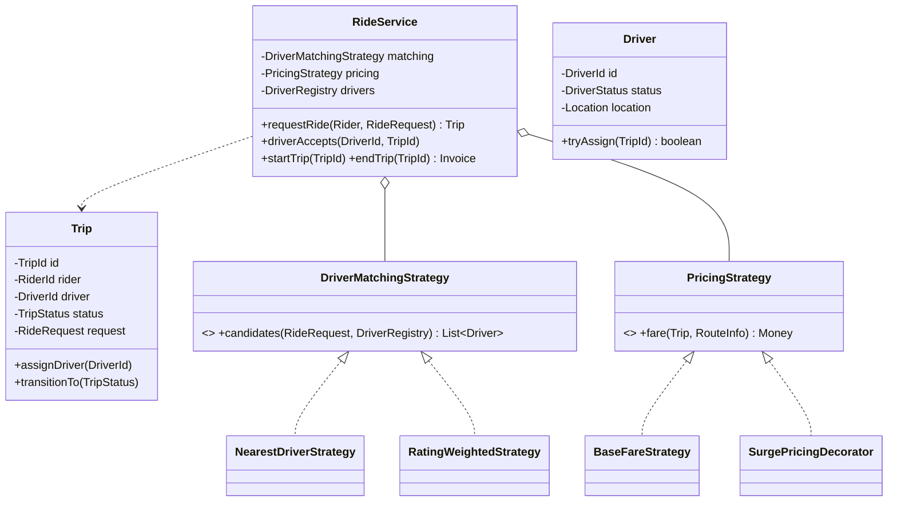
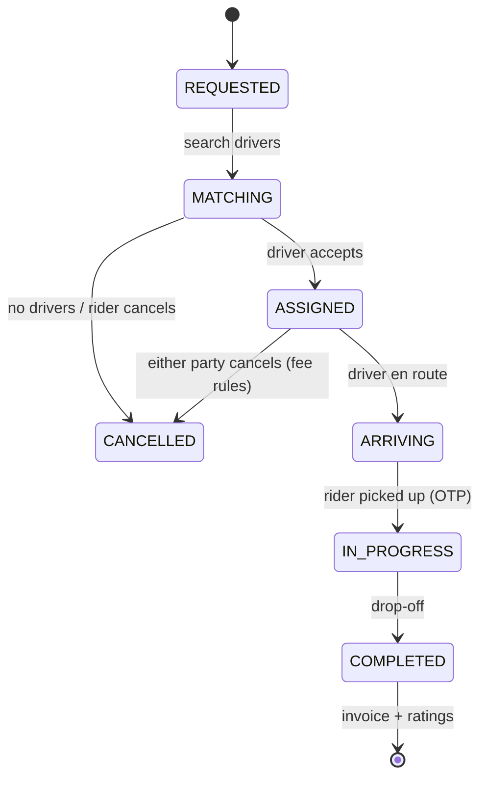

# 5.9 Design a Ride-Hailing Service (Uber/Ola)

> The strategy-and-state-machine buffet. In LLD form (vs the HLD version), the graded parts are: trip lifecycle as a state machine, driver matching as Strategy, pricing composition, and the driver-assignment race.

---

## Step 1 — Clarify requirements (3 min)

**Say:** *"Rider requests a ride (pickup, drop, cab type) → match a nearby driver → driver accepts → trip runs → fare → rating. LLD scope: the domain objects and flows in one service — I'll treat maps/ETA/geo-index as injected interfaces, not build them. Surge pricing and scheduled rides as extensions?"*

## Step 2 — Entities

`Rider`, `Driver` (entity: status, location, vehicle) · `RideRequest` (VO) · `Trip` (aggregate root: the state machine) · `DriverMatchingStrategy` · `PricingStrategy` · `LocationService` / `NotificationService` (interfaces — out of scope internals) · `TripRepository`.

## Step 3 — Class diagram & trip state machine





Encode legal transitions in the enum table (Ch 4.3) — "cancel after pickup" and "start before assignment" become impossible, not just unhandled.

## Step 4 — The matching flow & the assignment race

Multiple trips matching concurrently can pick the same driver — same shape as the parking spot race (Ch 5.1): **strategy proposes, entity disposes, loop retries.**

```java
public Trip requestRide(Rider rider, RideRequest req) {
    Trip trip = Trip.create(rider.id(), req);
    trips.save(trip);
    trip.transitionTo(TripStatus.MATCHING);

    for (Driver d : matching.candidates(req, drivers)) {       // ranked nearby drivers
        if (d.tryAssign(trip.id())) {                          // atomic: AVAILABLE → OFFERED
            notifier.offerRide(d, trip);                       // driver has T seconds to accept
            return trip;                                       // async continues via accept/decline
        }                                                      // taken by another trip → next candidate
    }
    trip.transitionTo(TripStatus.CANCELLED);
    throw new NoDriversAvailableException(req);
}

public class Driver {
    private final AtomicReference<DriverStatus> status = new AtomicReference<>(DriverStatus.AVAILABLE);
    public boolean tryAssign(TripId t) {
        return status.compareAndSet(DriverStatus.AVAILABLE, DriverStatus.OFFERED);  // CAS: one winner
    }
}
```

**Offer timeout:** driver doesn't respond in T seconds → CAS back OFFERED→AVAILABLE (guarded by tripId to avoid releasing a newer offer), move to next candidate — a `DelayQueue`/scheduler job, same expiry discipline as seat holds.

**Say:** *"Driver status is a single-field state machine → CAS beats a lock; the matching strategy stays pure and lock-free; races resolve by retrying down the ranked list."*

## Step 5 — Pricing: Strategy + Decorator composing

```java
public class BaseFareStrategy implements PricingStrategy {
    public Money fare(Trip t, RouteInfo r) {
        return base(t.cabType())
            .plus(perKm(t.cabType()).times(r.distanceKm()))
            .plus(perMin(t.cabType()).times(r.durationMin()));
    }
}
public class SurgePricingDecorator implements PricingStrategy {
    private final PricingStrategy inner;
    private final SurgeIndex surge;                            // zone → multiplier
    public Money fare(Trip t, RouteInfo r) {
        return inner.fare(t, r).times(surge.multiplierFor(t.pickupZone(), t.requestedAt()));
    }
}
// pricing = new PromoDecorator(new SurgePricingDecorator(new BaseFareStrategy(), surge), promos);
```

Decorators stack surge, promos, tolls, cancellation fees — each independently testable. **Fare lock-in rule to state:** quote at request time, persist the quote on the Trip, honor it at invoice (re-pricing at drop-off = support tickets).

## Step 6 — Ratings, cancellation, notifications

- **Rating:** `RatingService` keeps (sum, count) per user — running average, O(1) update; both sides rate; affects matching via `RatingWeightedStrategy`.
- **Cancellation:** policy strategy keyed by trip state + elapsed time (free in MATCHING; fee in ARRIVING after grace). The state machine supplies the context.
- **Notifications:** Observer on trip transitions (rider app, driver app, SMS) — decoupled, failure-isolated.

## Step 7 — Extensions

- **Scheduled rides:** `ScheduledRide` entity + scheduler that injects a RideRequest at T−lead-time — reuses the whole pipeline.
- **Pooling:** Trip → `PooledTrip` with multiple riders/stops; matching gains route-compatibility scoring — flag it as a big feature living behind the same strategy seam.
- **Geo at scale:** `DriverRegistry.nearby()` today = filter all drivers; the interface hides a geohash/quadtree index — "the seam where LLD meets the HLD geo-index conversation."

---

## ✅ Outcome — what a complete answer includes
Trip state machine with a legal-transition table → matching as ranked-candidates Strategy + CAS `tryAssign` + offer-timeout recycling → pricing as Strategy composed with Decorators + quote lock-in → cancellation policy driven by state × time → Observer notifications → scheduled/pooling/geo behind existing seams.

## 💡 Tips & Tricks
- The driver-assignment race is this problem's seat-booking moment — bring it up yourself with the CAS solution.
- "Strategy proposes, entity disposes" — reusing the phrase from parking lot shows you see the shared shape (interviewers *love* cross-problem structure).
- Persist the fare quote on the trip — a one-sentence decision that preempts the "surge changed mid-ride" trap.
- Do NOT design maps/ETA/geo-sharding — name the interface and move on; drifting into HLD burns the round.

## 🎯 Interview Q&A

**Q1. Why CAS on driver status instead of synchronized like your seat example?**
> The guarded state is a single enum field with simple transitions — exactly CAS's sweet spot: lock-free, no monitor overhead on the hot matching path, and failure (someone else took the driver) is a normal outcome I handle by trying the next candidate, not an error to block on. Seats needed synchronized because the hold writes three fields (state+holder+expiry) atomically. If Driver's assignment grew multi-field, I'd bundle it into an immutable record behind one AtomicReference — same CAS, wider payload — or fall back to a lock.

**Q2. A driver goes offline mid-MATCHING after tryAssign succeeded. What prevents a stuck trip?**
> The offer is leased, never granted forever: OFFERED carries a deadline; a scheduled expiry job (DelayQueue keyed by offer) CASes OFFERED→AVAILABLE if unanswered — and the trip's matcher then continues down the candidate list. Every intermediate state needs an exit timer — I'd generalize: MATCHING has a total budget (fail to CANCELLED with "no drivers"), ARRIVING has a no-show timeout. State machines without timeouts leak entities; that sentence is the design principle.

**Q3. How does surge pricing stay fair when it changes between request and drop-off?**
> Freeze at quote time: when the rider confirms, the composed pricing pipeline runs once and the resulting quote (with its surge multiplier and promo breakdown) is persisted on the Trip. The invoice at COMPLETED recomputes only *route-actuals* (distance/time) against the frozen rates — never re-reads the surge index. Disputes become auditable ("your quote captured 1.4× at 18:02"). The decorator design makes freezing natural: the pipeline output is a `FareQuote` value object, not a live calculation.

**Q4. Matching should prefer nearby drivers but avoid starving far ones / low-rated ones. Design the strategy.**
> A scoring strategy, not a filter: score = w₁·proximity + w₂·rating + w₃·acceptRate + w₄·idleTime (idleTime is the anti-starvation term — drivers waiting longer rank up). Candidates ranked by score; weights are config (A/B-testable). The structure matters more than the weights: because it's a `DriverMatchingStrategy` implementation, fairness policy changes are new strategies or new weights — no service edits. If asked about strict fairness, I'd mention a two-queue hybrid: mostly score-ranked, every k-th match from the longest-idle queue.

**Q5. Sketch the pooling variant's impact honestly.**
> Trip stops being rider-singular: `PooledTrip` holds ordered `Stop`s (pickups/drops per rider), and IN_PROGRESS becomes a per-rider sub-state (rider B is aboard, C not yet). Matching becomes route-compatibility: does adding rider C keep detour under X minutes for aboard riders — an insertion-cost computation against the current route, behind the same strategy interface but with real algorithmic meat (this is where I'd time-box in an interview). Pricing splits by rider with a pool discount decorator. The honest summary: state machine and seams survive, matching's internals are rewritten — and that's the correct place for the complexity to concentrate.
