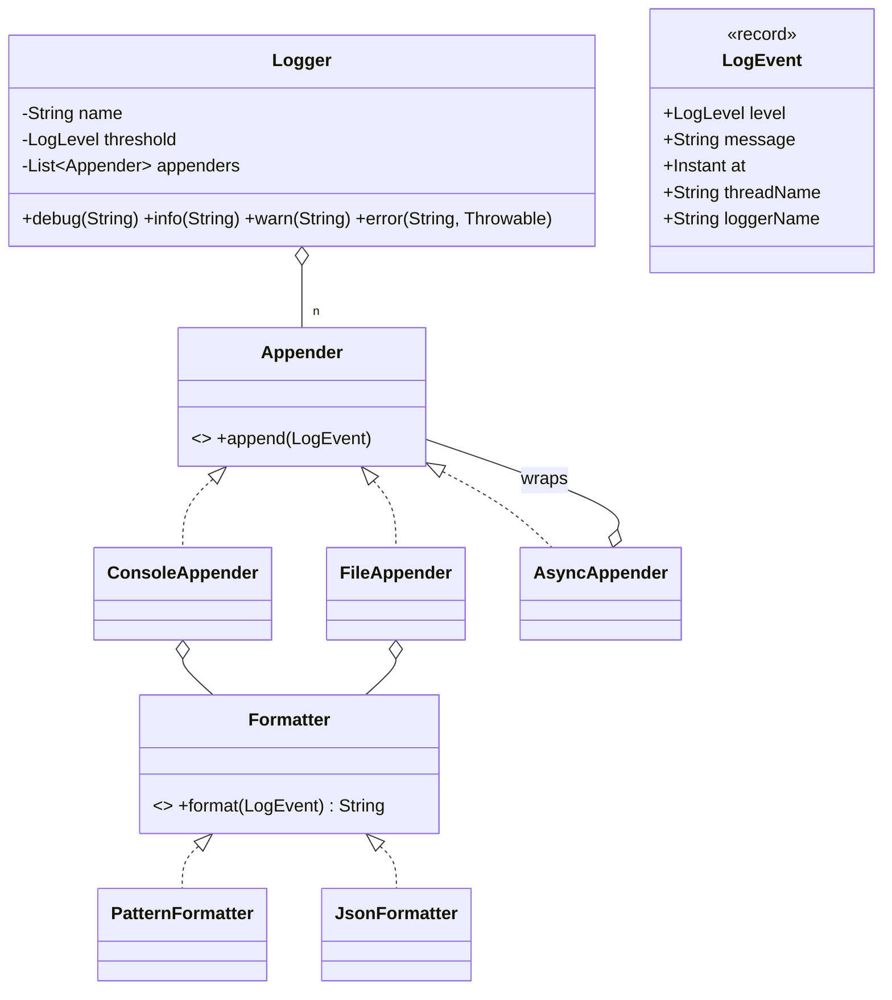

# 5.10 Design a Logging Framework

> The machine-coding favorite (Flipkart/Razorpay staple). Tests Chain of Responsibility *or* the appender model, Strategy for formatting, Singleton discipline, and one sharp concurrency question: **how do you log without slowing the app down?**

---

## Step 1 — Clarify requirements (3 min)

**Say:** *"A library like Log4j-lite: leveled logging (DEBUG<INFO<WARN<ERROR), multiple destinations — console, file, remote — with per-destination level thresholds, pluggable formats, and a global config. Should I optimize for the async/non-blocking discussion? That's usually where this goes. Rotation and per-package loggers as extensions?"*

## Step 2 — Model (the appender architecture — how real frameworks do it)

`Logger` (client API) · `LogEvent` (VO: level, message, timestamp, thread, loggerName, throwable) · `Appender` (interface: console/file/remote sinks) · `Formatter` (Strategy: text/JSON) · `LevelThreshold` (filter per appender + global) · `LoggerRegistry` (the singleton bit) · `AsyncAppender` (Decorator — the concurrency answer).



**On Chain of Responsibility:** many interview write-ups frame log levels as a CoR chain (DebugLogger → InfoLogger → …). Present it as an option, then say why the appender model wins: *"CoR couples level-filtering to a linked structure; real frameworks treat level as a simple comparison filter and destinations as an independent list — orthogonal concerns, orthogonal objects. I'll take the appender model and use CoR where it genuinely fits: a filter pipeline per appender (level filter, rate-limit filter, redaction filter)."* Knowing both and choosing with a reason beats reciting either.

## Step 3 — Core code

```java
public enum LogLevel { DEBUG, INFO, WARN, ERROR;               // ordinal = severity order
    public boolean allows(LogLevel msg) { return msg.ordinal() >= this.ordinal(); }
}

public class Logger {
    private final String name;
    private volatile LogLevel threshold;                        // hot-reloadable config
    private final List<Appender> appenders;                     // fixed after build (immutable list)

    public void log(LogLevel level, String msg, Throwable t) {
        if (!threshold.allows(level)) return;                   // cheap early exit — the hot path
        LogEvent e = new LogEvent(level, msg, Instant.now(),
                                  Thread.currentThread().getName(), name, t);
        for (Appender a : appenders) a.append(e);               // appenders filter further if needed
    }
    public void info(String msg) { log(LogLevel.INFO, msg, null); }
    public void error(String msg, Throwable t) { log(LogLevel.ERROR, msg, t); }
}

public class FileAppender implements Appender {
    private final Formatter formatter;
    private final BufferedWriter out;                           // opened once, flushed by policy
    private final LogLevel threshold;

    @Override public synchronized void append(LogEvent e) {     // file writes must serialize
        if (!threshold.allows(e.level())) return;
        try { out.write(formatter.format(e)); out.newLine(); }
        catch (IOException ex) { /* NEVER throw from a logger — fallback or drop, count it */ }
    }
}
```

Two rules stated aloud earn points: **the disabled-level path must be near-free** (threshold check before any formatting/allocation — mention `Supplier<String>` lazy messages: `log.debug(() -> expensive())`), and **a logger must never throw into the app** — swallow, count, and optionally fall back to console.

## Step 4 — The async answer (the differentiator)

Synchronous file/remote appends put I/O on the caller's thread. Wrap any appender:

```java
public class AsyncAppender implements Appender {
    private final Appender delegate;
    private final BlockingQueue<LogEvent> queue;                // BOUNDED — overflow policy is design
    private final Thread worker;

    public AsyncAppender(Appender delegate, int capacity, OverflowPolicy policy) {
        this.delegate = delegate;
        this.queue = new ArrayBlockingQueue<>(capacity);
        this.policy = policy;
        this.worker = new Thread(this::drain, "log-writer");
        worker.setDaemon(true);
        worker.start();
    }

    @Override public void append(LogEvent e) {
        if (!queue.offer(e)) policy.onOverflow(queue, e);       // DROP_OLDEST / DROP_NEW / BLOCK
    }
    private void drain() {
        try {
            while (true) delegate.append(queue.take());          // single writer: no file contention
        } catch (InterruptedException ie) { Thread.currentThread().interrupt(); }
    }
    public void shutdown() { /* drain remaining, flush, join with timeout */ }
}
```

**The trade to narrate:** producers never block on I/O; single consumer serializes file writes without locks on the hot path. Cost: crash can lose queued events (acceptable for logs — say it; unacceptable for an audit trail → sync fsync appender for that one). **Overflow policy is a real decision:** blocking preserves logs but can stall the app under I/O degradation — most frameworks drop and increment a dropped-counter.

## Step 5 — Config & registry

```java
public final class LogManager {                                 // the one Singleton
    private static final LogManager INSTANCE = new LogManager();
    private final ConcurrentHashMap<String, Logger> loggers = new ConcurrentHashMap<>();
    public static Logger getLogger(String name) {
        return INSTANCE.loggers.computeIfAbsent(name, INSTANCE::buildFromConfig);
    }
}
```

Hierarchical names (`com.app.payment` inherits `com.app` config) — resolve by walking name segments; `volatile` thresholds make runtime level changes safe. Config from a builder/file at bootstrap.

## Step 6 — Extensions
- **Rotation:** `RollingFileAppender` — size/time policy object decides rollover in `append`; rotation is a policy strategy, not a new appender per scheme.
- **MDC (request context):** `ThreadLocal<Map<String,String>>` merged into LogEvent — name it, note virtual-thread caveat (use scoped values on Loom).
- **Redaction/sampling:** filters in the per-appender CoR pipeline.
- **Remote appender:** batching + retry inside the appender behind the same interface — always wrapped async.

---

## ✅ Outcome — what a complete answer includes
Appender-list architecture (with CoR discussed and correctly placed as filter pipelines) → LogEvent as record → cheap disabled-path + lazy messages → never-throw appenders → AsyncAppender decorator with bounded queue + explicit overflow policy + daemon writer + shutdown drain → CHM registry with hierarchical config → rotation/MDC/redaction one-liners.

## 💡 Tips & Tricks
- Lead with the hot-path principle: "logging is called millions of times; the design optimizes the *disabled* and *enqueue* paths."
- The bounded-queue overflow policy question is where this interview is decided — bring the three options and pick with a reason.
- `AsyncAppender` as a Decorator (wraps any appender) rather than a parallel class hierarchy — structural elegance they notice.
- Mention shutdown flushing unprompted: lost final logs are the classic real-world logging bug.

## 🎯 Interview Q&A

**Q1. Why must the logger never throw, and how do you still learn about its failures?**
> A logger is invoked from every code path including error handlers — an exception from logging turns a minor incident into an app-wide failure loop (log the error → logging throws → log *that* error…). So appenders catch everything at the boundary. Failures stay observable via: an internal status channel (stderr fallback), a dropped/error counter exposed as metrics, and a last-resort periodic retry to reopen sinks. Fail-silent for the app, loud for operators.

**Q2. Compare your appender model with the CoR level-chain design.**
> The chain design (Debug→Info→Warn handlers) entangles two orthogonal axes: severity filtering and output destination — adding a destination means new links; per-destination thresholds contort the chain. The appender model keeps them orthogonal: level = a comparison filter (config), destination = a list entry; any combination composes. CoR still earns a place as the *filter pipeline* inside an appender (level → sampling → redaction) — ordered, independent, pluggable checks — which is where a pipeline pattern actually matches the problem shape.

**Q3. Two hundred threads log to one file. Walk through the synchronization story.**
> Without async: `FileAppender.append` is synchronized — correctness via one writer at a time, but the monitor + I/O serializes callers under load. With AsyncAppender: producers do `queue.offer` on an ArrayBlockingQueue (single brief internal lock, no I/O), and exactly one daemon worker performs writes — so the file needs no lock at all, batching becomes possible (drain N, write once, flush), and throughput scales with the queue, not the disk latency. Interleaving guarantee: events from one thread stay ordered (queue FIFO); cross-thread order is by enqueue time, which is what timestamps are for.

**Q4. Where does Singleton hurt here and how do you keep it testable?**
> `LogManager.getLogger` is a static global — convenient at call sites but hostile to tests (config bleeds between tests) and to multi-tenant embedding. Mitigations: the static facade delegates to an instance-based `LoggerContext` that owns registry+config — tests construct private contexts and never touch the static path; a reset/shutdown hook for the default context; and appenders/formatters always constructor-injected. That's the SLF4J/Log4j2 shape: static API for ergonomics, instance world behind it — I keep the singleton at the door, not in the architecture.

**Q5. How would you add structured logging without breaking the design?**
> LogEvent already carries structure; the mistake to avoid is pre-formatting into a String at the call site. Add key-value support at the API (`log.info("payment done", kv("orderId", id), kv("ms", t))`) storing pairs on the event; Formatter decides rendering — PatternFormatter interpolates, JsonFormatter emits fields (plus MDC context merged in). Because appenders take LogEvent, not String, the change is additive: one API overload, one formatter. The principle: **format at the edge, never at the source** — same reason the async queue carries events, not strings.
