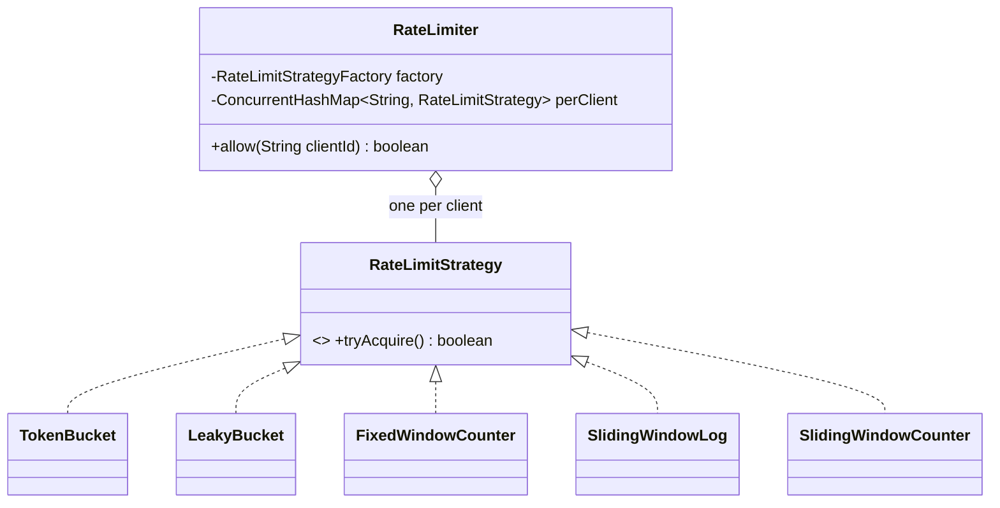

# 5.11 Design a Rate Limiter

> The algorithm-flavored LLD question — also an HLD staple, so it doubles your prep. Deliverables: the four algorithms with trade-offs, clean Strategy structure, per-client state management, and airtight thread-safety on the check-and-consume.

---

## Step 1 — Clarify requirements (2 min)

**Say:** *"Library-style limiter: `allow(clientId)` → boolean, N requests per window per client, pluggable algorithm. In-process first, then I'll cover the distributed story. Should rejected calls just return false, or do you want retry-after info?"*

## Step 2 — Structure: Strategy + per-client registry



```java
public class RateLimiter {
    private final ConcurrentHashMap<String, RateLimitStrategy> buckets = new ConcurrentHashMap<>();
    private final Supplier<RateLimitStrategy> factory;          // configured algorithm

    public boolean allow(String clientId) {
        return buckets.computeIfAbsent(clientId, id -> factory.get()).tryAcquire();
    }   // computeIfAbsent: per-client state created exactly once, race-free (Ch 3.2)
}
```

## Step 3 — Token Bucket (the default answer — implement fully)

Capacity = burst allowance; refill rate = sustained rate. **Lazy refill** (compute on access) beats a timer thread:

```java
public class TokenBucket implements RateLimitStrategy {
    private final long capacity;
    private final double refillPerNano;
    private double tokens;
    private long lastRefillNanos;
    private final Clock clock;                                  // injected → testable

    public TokenBucket(long capacity, long refillPerSecond, Clock clock) {
        this.capacity = capacity;
        this.refillPerNano = refillPerSecond / 1e9;
        this.tokens = capacity;                                 // start full: allow initial burst
        this.lastRefillNanos = clock.nanos();
        this.clock = clock;
    }

    @Override public synchronized boolean tryAcquire() {
        refill();
        if (tokens < 1) return false;
        tokens -= 1;                                            // check+consume atomic under the lock
        return true;
    }
    private void refill() {
        long now = clock.nanos();
        tokens = Math.min(capacity, tokens + (now - lastRefillNanos) * refillPerNano);
        lastRefillNanos = now;
    }
}
```

**Why it's the default:** allows bursts up to capacity while capping the sustained rate; O(1) memory per client; lazy refill = no background threads. (Guava `RateLimiter` is token-bucket-ish — name it.)

## Step 4 — The other three (compare, implement the one they pick)

**Fixed Window Counter** — `Map<windowStart, AtomicInteger>`; simplest, but the **boundary burst** flaw: 100/min allows 100 at 0:59 + 100 at 1:01 → 200 in 2 seconds. Always volunteer this flaw.

**Sliding Window Log** — `Deque<timestamp>` per client; evict entries older than window, allow if size < N. Exactly correct; O(N) memory per client — expensive at high limits.

**Sliding Window Counter** — the practical fix: weighted sum of current+previous fixed windows: `prevCount × overlap% + currCount < N`. O(1) memory, approximately correct (assumes uniform distribution in prev window) — the industry compromise (Cloudflare's published approach).

**Leaky Bucket** — queue draining at constant rate: perfectly smooth *output* (good for shaping calls to a fragile downstream), but no bursts and adds queueing latency; token bucket = burst-friendly *admission*, leaky = smoothed *processing*.

| Algorithm | Memory/client | Accuracy | Bursts | Verdict |
|---|---|---|---|---|
| Token bucket | O(1) | rate-exact | ✓ up to capacity | default |
| Fixed window | O(1) | boundary flaw ×2 | window-edge spikes | only with the caveat |
| Sliding log | O(N) | exact | within budget | when exactness is a requirement |
| Sliding counter | O(1) | ~approximate | smoothed | high-scale services |
| Leaky bucket | O(queue) | output-exact | ✗ | traffic shaping |

## Step 5 — Concurrency notes (they'll probe)

- `tryAcquire` is synchronized *per client bucket* — contention only within one client; different clients touch different objects (per-key locking for free via the registry).
- Lock-free alternative to mention: pack `(tokens, lastRefill)` into one `AtomicReference<State>` immutable record + CAS loop — faster under contention, more code; say when it's worth it (a hot shared bucket, e.g., global limit).
- **Cleanup:** idle clients leak registry entries → expire buckets untouched for k windows (scheduled sweep, or LRU-bounded registry — reuse Ch 5.4!).

## Step 6 — Where it sits & distributed reality

- Placement: a servlet filter / gateway middleware — `allow()` before the handler; on reject return HTTP 429 + `Retry-After` (expose `nextAvailableAt()` from the strategy).
- Multi-server: per-node limiters multiply the budget (N nodes × limit). Fixes: sticky routing by client; or centralize state in Redis — token bucket as a **Lua script** (atomic read-refill-consume server-side; the script is your `synchronized`), tolerating Redis latency/failure with a local fallback limiter and a fail-open-vs-fail-closed decision (rate limiting usually fails open; auth throttling fails closed — *say the distinction*).

---

## ✅ Outcome — what a complete answer includes
Strategy interface + per-client `computeIfAbsent` registry → token bucket with lazy refill and atomic check-consume → four-algorithm comparison with the fixed-window boundary flaw and sliding-counter compromise → per-client lock scoping + CAS upgrade path → idle-bucket cleanup → 429/Retry-After integration → distributed story (Redis Lua, fail-open choice).

## 💡 Tips & Tricks
- Injected Clock isn't optional here — the *entire* test suite is time manipulation (burst, wait, refill, boundary).
- "Start the bucket full" and "cap at capacity during refill" are the two small bugs graders look for.
- The boundary-burst example (100 at 0:59 + 100 at 1:01) is your comparison anchor — one concrete number beats abstract accuracy talk.
- If the interviewer says "rate limit outgoing calls to a payment API" — that's leaky bucket / smoothing territory; direction of protection changes the algorithm.

## 🎯 Interview Q&A

**Q1. Why is lazy refill better than a scheduled refill thread?**
> A timer per bucket (or one timer scanning all buckets) costs threads, wakeups, and a scan proportional to client count — for state that nobody may be reading. Lazy refill computes tokens from `(now − lastRefill) × rate` at access time: mathematically identical, zero background work, and naturally consistent under the same lock as consumption. Timers reappear only for *cleanup* of idle buckets — a rare sweep, not a hot path.

**Q2. Two threads call tryAcquire with one token left. Why exactly one succeeds — and what breaks if you used AtomicInteger naively?**
> Under synchronized: thread A refills, sees 1 ≥ 1, decrements to 0, true; B enters after, refill adds ~nothing, sees 0 < 1, false. Check and consume share one critical section. Naive atomic version — `if (tokens.get() >= 1) tokens.decrementAndGet()` — is check-then-act across two atomics: both threads pass the check, tokens go to −1, both admitted. Correct lock-free needs the check and decrement in *one* CAS: loop on `compareAndSet(state, state.consume())` over an immutable (tokens, timestamp) snapshot.

**Q3. A client with limit 100/min sends 100 requests at 12:00:59 and 100 at 12:01:01. Which algorithms admit what?**
> Fixed window: all 200 (each window under its own count) — the flaw in one sentence. Sliding log: 100 total in any rolling 60s — second burst rejected until entries age out. Sliding counter at 12:01:01: ~97% overlap × 100 + current → over budget, rejected (approximately right). Token bucket (capacity 100, ~1.67/s refill): first 100 drain the bucket; two seconds later ~3 tokens exist → 3 admitted. Each algorithm's number *is* its trade-off — this example is the whole comparison compressed.

**Q4. How do you rate-limit by multiple dimensions — per-user AND per-IP AND global?**
> Compose limiters: each dimension keeps its own registry (keyed by its extractor), and a request must pass all — evaluate cheapest/most-selective first, and **only consume when all admit** (two-phase: tryAcquire with rollback, or check-all-then-consume-all under ordered per-bucket locks) — otherwise a request rejected by the global bucket still burned the user's tokens. In practice most systems accept the token-burn (simpler, slightly conservative) — I'd name both and pick the simple one unless fairness is a stated requirement.

**Q5. Your Redis is down. What does the limiter do?**
> Decided policy, not accident. Fail-open with a local fallback: each node falls back to an in-process token bucket at `limit/N` (approximate but bounded), logs the degradation, and a circuit breaker retries Redis — protects availability, tolerates temporary over-admission. Fail-closed (reject when the source of truth is gone) is right when the limiter *is* the security control — login attempts, OTP requests. The senior answer is naming the two modes, tying the choice to what's being protected, and making the fallback limiter the same Strategy interface so it's config, not code.
