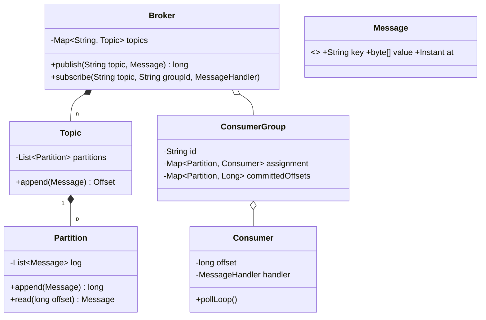

# 5.12 Design an In-Memory Pub-Sub / Message Queue (Kafka-lite)

> The concurrency capstone (Flipkart machine-coding classic: "build an in-memory Kafka"). Tests: topic/partition/offset modeling, producer-consumer threading, consumer groups, and delivery-semantics vocabulary. Everything from Part 3 shows up here.

---

## Step 1 — Clarify requirements (3 min)

**Say:** *"Topics; producers publish; consumers subscribe and process at their own pace. Two big models — fan-out pub-sub (every subscriber gets every message) vs consumer groups (messages divided among group members). I'll build log-based storage with offsets, which gives both. In scope: ordering, retries, at-least-once semantics. Out: persistence to disk, network."*

## Step 2 — The central design choice: log + offsets (say why)

Naive pub-sub pushes each message into every subscriber's queue (copies × subscribers, no replay, slow consumer = memory bomb *in the broker*). **Log model (Kafka's insight):** topic = append-only list; each consumer just moves a cursor (offset). One copy, replay for free, per-consumer pace isolation.



## Step 3 — Core code: partition log + thread-safe append/read

```java
public class Partition {
    private final List<Message> log = new ArrayList<>();
    private final Object appendLock = new Object();

    public long append(Message m) {
        synchronized (appendLock) {                     // writers serialize per partition
            log.add(m);
            return log.size() - 1;                      // offset = index
        }
    }
    public Optional<Message> read(long offset) {
        synchronized (appendLock) {                     // simple + correct; see Q&A for lock-free read
            return offset < log.size() ? Optional.of(log.get((int) offset)) : Optional.empty();
        }
    }
}

public class Topic {
    private final List<Partition> partitions;
    public long append(Message m) {
        int p = m.key() == null
              ? ThreadLocalRandom.current().nextInt(partitions.size())     // no key: spray
              : Math.floorMod(m.key().hashCode(), partitions.size());      // key: sticky partition
        return partitions.get(p).append(m);
    }
}
```

**The ordering sentence (mandatory):** *"Ordering is guaranteed per partition, and same-key messages hash to the same partition — so per-key order (all events of order #123) holds, while global order across partitions is deliberately not promised. That's the scalability trade Kafka made."*

## Step 4 — Consumers: pull loop, groups, commits

```java
public class Consumer implements Runnable {
    private final Partition partition;
    private final MessageHandler handler;
    private final OffsetStore offsets;                    // committed progress per (group, partition)
    private volatile boolean running = true;

    @Override public void run() {
        long offset = offsets.committed();                 // resume from last commit
        while (running) {
            Optional<Message> msg = partition.read(offset);
            if (msg.isEmpty()) { parkBriefly(); continue; }        // or wait/notify on append
            try {
                handler.handle(msg.get());
                offsets.commit(++offset);                  // commit AFTER processing → at-least-once
            } catch (Exception e) {
                if (!retryPolicy.retry(msg.get())) {       // bounded retries w/ backoff
                    deadLetters.publish(partition.topic(), msg.get());   // DLQ, then move on
                    offsets.commit(++offset);
                }
            }
        }
    }
}
```

**Consumer groups:** group = one logical subscriber scaled out; each partition is owned by exactly one consumer in the group (assignment map). Two different groups each get all messages (fan-out); within a group, messages divide (work-sharing). Max useful parallelism per group = partition count — say it. Rebalancing on join/leave = reassign partitions (implement round-robin assignment; name the real-world hard parts: pauses, duplicate window during handoff).

## Step 5 — Delivery semantics (the vocabulary section — rehearse verbatim)

- **At-most-once:** commit *before* processing → crash between commit and process loses the message. Fast, lossy.
- **At-least-once:** commit *after* processing (code above) → crash after process, before commit ⇒ redelivery. **Duplicates are therefore a consumer problem → handlers must be idempotent** (dedupe by message id / idempotency key).
- **Exactly-once:** not achievable by delivery alone across process boundaries — achieved as *effectively-once* via idempotent processing or atomic process+commit (transactional outbox / Kafka transactions). Saying "exactly-once is idempotency wearing a suit" lands well.

## Step 6 — Backpressure & slow consumers

Log model already isolates pace (slow consumer only grows its *lag*, not broker queues). Remaining issues to name: unbounded log growth → **retention** (drop entries older than T / beyond size; consumers falling behind retention lose data — surface lag as a metric); blocking `read` when caught-up → wait/notify on append instead of spin (Condition per partition); publisher flood → bounded log + publish-side policy if memory-capped.

## Step 7 — Extensions
- **Delayed messages:** `DelayQueue` staging area → append on due-time.
- **Priorities:** priority = separate topics consumed preferentially (per-message priority breaks log ordering — say why).
- **Persistence:** Partition behind a `Log` interface → memory-mapped/file impl; offsets already externalized.
- **Filters (message selectors):** predicate per subscription applied at poll — cheap because reads don't mutate.

---

## ✅ Outcome — what a complete answer includes
Log+offset model with the why (vs per-subscriber queues) → key→partition hashing with the per-key ordering guarantee → per-partition append lock, pull-based consumers → consumer groups with partition ownership and parallelism ceiling → commit-after-processing ⇒ at-least-once ⇒ idempotent handlers + DLQ with bounded retries → retention/lag for backpressure → delayed/priority/persistence seams.

## 💡 Tips & Tricks
- Draw the log-with-cursors picture first — every later question (replay, lag, groups) is answered by pointing at it.
- "Commit after processing" + "handlers must be idempotent" is a paired statement — never say one without the other.
- The DLQ with bounded retries is the difference between a toy and a system — include it even in a 60-minute build.
- If asked to demo: two groups on one topic (fan-out proof) + two consumers in one group (sharing proof) + kill-and-resume (offset proof). Three tiny scenarios, whole design proven.

## 🎯 Interview Q&A

**Q1. Why pull-based consumers instead of the broker pushing?**
> Pull puts flow control where capacity is known — the consumer: it takes the next message exactly when ready, so a slow handler self-throttles with zero broker bookkeeping; batch size is consumer-chosen; replay is trivial (set your own cursor). Push needs per-subscriber buffers, overflow policy, and backpressure signaling in the broker — all the problems the log model deleted. Cost of pull: caught-up consumers must wait efficiently (Condition-on-append, or long-poll) instead of busy-spinning — a small, local problem versus push's global one.

**Q2. A consumer crashes after processing offset 41 but before committing. What happens and what must be true for correctness?**
> On restart (or rebalance to a peer), reading resumes from committed offset 41 → message 41 is processed *again* — at-least-once redelivery, by design. Correctness therefore requires idempotent handling: dedupe on a stable message id (processed-ids set / unique DB constraint), or naturally idempotent operations (set-status vs increment). The alternative — commit-then-process — silently drops 41 on the same crash. I choose duplicates over loss and make the handler contract explicit: "must tolerate redelivery."

**Q3. How do two subscribers both receive every message while three workers share one subscription?**
> Same mechanism, different group ids. Groups A and B each maintain independent committed offsets per partition — both cursors sweep the whole log: fan-out. Within group B, its three workers each *own* a disjoint subset of partitions (assignment), so each message (living in exactly one partition) is processed by exactly one worker: work-sharing. Corollary I'd volunteer: with 2 partitions and 3 workers, one worker idles — partition count bounds group parallelism, so partitioning is a capacity decision, not an implementation detail.

**Q4. Reads take the same lock as appends — a hot topic with 50 consumers contends. Improve it.**
> Exploit immutability: appended messages never change, so reads only need a safe view of "how long is the log." Replace the ArrayList with a structure allowing lock-free reads: an atomic `size` published *after* the element write (happens-before via the volatile write), consumers read indices < size without locking — single-writer-per-partition makes this sound; or segment the log into immutable chunks (only the tail segment is active). This mirrors real Kafka: one writer per partition, many lock-free readers of immutable segments. Appends keep their lock — it was never the bottleneck; reader-vs-writer contention was.

**Q5. Where would ordering break if you added per-message priority, and what's the accepted alternative?**
> Priority means the consumer takes "most important next," not "next in log" — the offset cursor becomes a scatter of consumed/unconsumed holes: commit semantics collapse (committed offset no longer means "everything before is done"), replay and lag lose meaning, and per-key ordering is violated when a high-priority message overtakes its predecessor key-mate. Accepted alternative: priority *lanes* — separate topics (orders-high, orders-low) with consumers polling high first (or weighted) — each lane keeps clean log semantics, and starvation is handled by weighting. Priority is routing, not reordering — that's the design principle.
