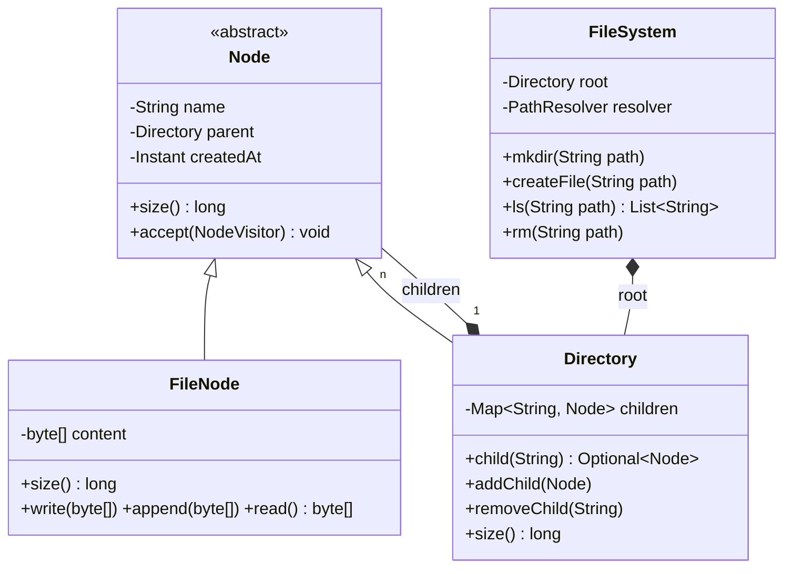

# 5.13 Design an In-Memory File System

> The Composite pattern's home turf (Google/Uber/Amazon ask it; LeetCode 588 is its DSA cousin). Tests: tree modeling, path resolution, uniform file/directory handling, and permissions/links as extension pressure.

---

## Step 1 — Clarify requirements (2 min)

**Say:** *"Unix-flavored API: `mkdir -p`, `createFile`, `write/append`, `read`, `ls`, `rm -r`, `find`. Absolute paths with `/`. Should I include size accounting, permissions, or symlinks? I'll design so they slot in. Concurrency at the end as usual?"*

## Step 2 — Model: Composite, with the add/remove trade-off stated



Decisions to narrate: children as `Map<String, Node>` (O(1) lookup, name-uniqueness enforced by the map — a `List` is the rookie choice); `addChild/removeChild` on **Directory only**, not Node — type safety over uniform mutation (the Composite trade-off from Ch 2.2, cited); parent pointer for path reconstruction & `mv`.

## Step 3 — Path resolution (the algorithmic core — one place, used by everything)

```java
public class PathResolver {
    private final Directory root;

    /** /a/b/c → walk children maps; O(depth). */
    public Optional<Node> resolve(String path) {
        if (path.equals("/")) return Optional.of(root);
        Node cur = root;
        for (String part : split(path)) {                       // split, ignoring blanks
            if (!(cur instanceof Directory d)) return Optional.empty();   // /file/x is invalid
            Optional<Node> next = d.child(part);
            if (next.isEmpty()) return Optional.empty();
            cur = next.get();
        }
        return Optional.of(cur);
    }

    public Directory resolveParentOf(String path) {             // for create/delete: parent must exist
        return resolve(parentPath(path))
            .filter(Directory.class::isInstance).map(Directory.class::cast)
            .orElseThrow(() -> new PathNotFoundException(parentPath(path)));
    }
}
```

**Every operation = resolve + one local action.** That framing keeps the whole design small:

```java
public void mkdir(String path) {                                // -p semantics: create as you walk
    Node cur = root;
    for (String part : split(path)) {
        Directory d = asDirectoryOrThrow(cur, path);
        cur = d.child(part).orElseGet(() -> {
            Directory fresh = new Directory(part, d);
            d.addChild(fresh);
            return fresh;
        });
    }
}

public List<String> ls(String path) {
    Node n = resolver.resolve(path).orElseThrow(() -> new PathNotFoundException(path));
    return switch (n) {
        case FileNode f -> List.of(f.name());                   // ls on a file → the file (Unix-like)
        case Directory d -> d.childNames().stream().sorted().toList();
    };
}
```

## Step 4 — Composite pays off: recursive operations

```java
// size(): the Composite classic — one polymorphic call, recursion hidden
public long size() { return children.values().stream().mapToLong(Node::size).sum(); }  // Directory
public long size() { return content.length; }                                          // FileNode

// rm -r: detach the subtree — O(1) structural delete (GC reclaims); guard the root!
public void rm(String path) {
    if (path.equals("/")) throw new CannotDeleteRootException();
    Node n = resolver.resolve(path).orElseThrow(() -> new PathNotFoundException(path));
    n.parent().removeChild(n.name());
}

// find / du / tree-print: Visitor over the composite (or a DFS with a Consumer<Node>)
public void walk(Node start, Consumer<Node> visit) {
    visit.accept(start);
    if (start instanceof Directory d) d.children().forEach(c -> walk(c, visit));
}
```

Mention the O(n) `size()` upgrade: cache sizes on directories, invalidate up the parent chain on writes (`+delta` propagation) — trade write cost for O(1) reads; choose by read/write ratio.

## Step 5 — Concurrency (say the layered answer)

1. **Coarse:** one `ReadWriteLock` on the FileSystem — `ls/read/find` share read lock; `mkdir/write/rm` take write lock. Correct, simple, fine for an interview library. *Start here and say so.*
2. **Finer:** lock per directory for structural ops (create/delete lock the parent), per-file locks for content; cross-directory ops (`mv`) lock both parents in canonical (path) order — deadlock discipline from Ch 3.3.
3. Name the hazard fine-graining introduces: resolve walks the tree while another thread deletes an ancestor → resolved node may be detached; fix by validating parent chain under the op's lock or tolerating detached-node ops (Unix semantics: open file handles survive unlink — a delightful aside).

## Step 6 — Extensions
- **Permissions:** `Permissions(owner, mode)` on Node; checks in resolver (execute-on-directories to traverse) — a `PermissionPolicy` seam keeps Unix/ACL swappable.
- **Symlinks:** `SymlinkNode(targetPath)` — resolver follows with a hop-limit (cycle guard: `/a → /b → /a`); this is why resolution lives in one class.
- **Watches (inotify):** Observer on Directory mutation events.
- **Quotas:** size-cache propagation + limit check on write path.
- **Persistence/journaling:** operations as Commands → write-ahead log → replay on start (event sourcing in miniature).

---

## ✅ Outcome — what a complete answer includes
Composite with Map-children and mutation-on-Directory (trade-off cited) → single PathResolver, every op = resolve + local action → `mkdir -p` walk-and-create → recursive size/rm/find via polymorphism or Visitor → RW-lock baseline with per-directory upgrade + mv lock ordering → symlink cycle guard + permissions + watch seams.

## 💡 Tips & Tricks
- `Map<String, Node>` children is the single highest-signal choice — it encodes name uniqueness and O(1) lookup silently.
- "Every operation is resolve + one local step" — say it; it's the sentence that makes your design look inevitable.
- Guard the root, reject `/file/x` traversal, and reject creating over an existing name — the three edge cases graders check first.
- LeetCode-588 experience helps but LLD wants classes and seams, not a nested HashMap in one function — mention the difference if relevant.

## 🎯 Interview Q&A

**Q1. Why put addChild on Directory instead of Node (uniform Composite)?**
> Uniform Composite forces FileNode to implement addChild — throwing UnsupportedOperationException, an LSP violation: code holding a Node can't trust the interface. Putting mutation on Directory makes "files can't contain things" a compile-time fact; the cost is an instanceof/pattern-match at mutation sites — but those sites already resolved a *parent directory*, so in practice the cast lives in one place (resolveParentOf). Read operations (size, name, accept) stay uniform on Node — I keep uniformity exactly where it's true.

**Q2. How does your design handle `mv /a/b /c/d` atomically?**
> Resolve source node and both parent directories; validate d doesn't exist under /c (or overwrite policy); then under locks on both parents taken in canonical path order (deadlock discipline): remove from old parent's map, rename, add to new parent's map, update parent pointer. The two-map mutation is the atomicity concern — with per-directory locking, holding both parent locks makes the move invisible in any intermediate state. Also guard the classic corruption: moving a directory *into its own subtree* (/a into /a/b) — check ancestry before mutating.

**Q3. Implement `find(path, predicate)` — where does Visitor genuinely help over a simple DFS?**
> For one predicate, a DFS with `Consumer<Node>` is simpler and I'd write that. Visitor earns its ceremony when operations multiply *and* need type dispatch: `find` matching on file attributes vs directory attributes, `du` formatting differently per type, permission-audit, serialization — each becomes a NodeVisitor with visit(FileNode)/visit(Directory), no instanceof ladders, added without touching Node classes. Fixed hierarchy (File/Directory/Symlink — stable) + growing operations = exactly Visitor's precondition from Ch 2.4; I'd also mention sealed interfaces + pattern-matching switch as the modern equivalent.

**Q4. A write is happening to /a/f while another thread does rm -r /a. What should happen?**
> Depends on the granularity I chose — and I must be consistent. Coarse RW-lock: impossible interleaving — rm waits for the write lock; done. Per-node locks: the write holds f's lock but rm detaches /a from its parent without touching f — the writer completes against a detached subtree, its data GC'd after. That's actually coherent (Unix unlink semantics: existing handles keep working), and I'd document it as the contract: *deletion detaches; in-flight operations on the subtree complete harmlessly*. What's unacceptable is a third behavior appearing by accident — the answer is choosing semantics, stating them, and testing them.

**Q5. Symlinks introduce cycles. Show the resolution algorithm's guard.**
> Follow-with-budget: resolution walks components; on hitting a SymlinkNode, splice the target path into the remaining components and decrement a hop counter (start ~40, like Linux's ELOOP limit); zero → throw TooManyLinksException. The budget handles both direct cycles (/a→/a) and long chains uniformly, without tracking a visited-set (which would miss cycles through *different* paths to the same node less cheaply). Guard placement matters: inside PathResolver — the single chokepoint — so every operation (ls, write, rm) inherits cycle safety with zero duplication. That's the payoff of centralizing resolution from the start.
