# 6.1 The LLD Interview Framework — A 45-Minute Script

> Interviewers grade *process* as much as design. This is the repeatable script: what to say, in what order, with time stamps. It works for whiteboard LLD rounds; the machine-coding variant is Ch 4.1.

---

## The 5-phase script

```mermaid
gantt
    dateFormat mm
    axisFormat %M
    section 45-min LLD round
    1. Requirements & scope        :00, 5m
    2. Entities & relationships    :05, 7m
    3. Class diagram + patterns    :12, 10m
    4. Core code (1-2 flows)       :22, 15m
    5. Concurrency & extensions    :37, 8m
```

### Phase 1 — Requirements & scope (5 min)

Open with the same four moves every time:

1. **Restate the problem** in one sentence: *"So: a system where users X and the system does Y."*
2. **Enumerate core use cases** (3–5 max): *"I see: park/unpark/fee. Am I missing a must-have?"*
3. **Cut scope explicitly:** *"I'll leave payments-gateway internals and persistence out, behind interfaces — OK?"*
4. **Fish for the hidden axis:** *"Which parts do you expect to vary — pricing rules? vehicle types?"* (Their answer tells you where the Strategy seams go — they're literally handing you the rubric.)

**Red flag avoided:** starting to draw classes 30 seconds in.

### Phase 2 — Entities & relationships (7 min)

Run the Ch 4.3 method aloud: nouns → entity / value object / plain field; verbs → methods on the object whose data they use; find the aggregate root; state lifecycles ("Ticket: ACTIVE→PAID — I'll enforce transitions").
**Checkpoint sentence:** *"Core model: ParkingLot as the root, Spots as entities with state, Money/SpotId as immutable values, Ticket as its own aggregate. Sound right before I diagram?"* — invite correction *early*, when it's cheap.

### Phase 3 — Class diagram + pattern seams (10 min)

Draw boxes with only decision-relevant members; arrows with the 5 relationships (Ch 1.4). As you place each interface, use the 4-beat pattern rhythm (Ch 2.5): **recognize → justify → seam → cost**.
*"Fee rules vary → FeePolicy interface → new rules become new classes → costs an interface, worth it per your requirement."*
**Checkpoint:** walk one end-to-end flow across the diagram as a sequence ("car arrives → gate asks lot → strategy finds spot → ticket issued"). If an arrow is awkward, fix the design now — cheapest moment.

### Phase 4 — Core code (15 min)

Rules of engagement:
- **Ask what they want coded:** *"Shall I code the park/unpark flow with fee calculation, and stub the rest?"* — coding the wrong thing is the biggest time-loss.
- Write **entity invariants and the interesting method** (tryAssign, addExpense, makeMove) — not getters, not constructors-by-the-dozen.
- Narrate while typing: name the invariant each guard protects.
- Use the polish signals from Ch 4.2: final fields, domain exceptions, Optional returns, injected Clock.

### Phase 5 — Concurrency & extensions (8 min)

**Bring up concurrency yourself** — it's the phase most candidates wait to be pushed into:
*"Concurrency: the shared mutable state is spot status. Lock lives on the Spot; the check-and-assign is one critical section; different spots don't contend. Multi-JVM would move this invariant to the DB — out of today's scope."* (The Ch 3.3 triage: what's shared → what's the invariant → smallest scope.)

Then volunteer two extensions with one-liners: *"EV spots = new SpotType + fits(); dynamic pricing = new FeePolicy."* Extensions you *predicted* prove the seams were right.

---

## The phrase bank (memorize these — they carry the round)

| Moment | Say |
|---|---|
| Scoping | "I'll build X and Y fully; Z stays behind an interface — tell me if you'd rather see Z." |
| Choosing a pattern | "This varies per your requirements, so it goes behind an interface — new variants become new classes." |
| Rejecting a pattern | "Only two fixed variants, so an if is honest; I'll extract Strategy when a third appears." |
| Concurrency | "The invariant is ___; the smallest lock that protects it is on ___; contention scope is per-___." |
| Trade-off | "I'm trading ___ for ___ here because the requirement says ___." |
| A mistake you catch | "Actually, this belongs on the entity, not the service — moving it. The invariant should live with the data." |
| Unknown question | "I haven't built that; reasoning from first principles: ___. Correct me if the standard approach differs." |
| Interviewer pushes back | "You're right / interesting — let me follow that: ___" (never dig in ego-first) |

## Calibration by seniority (what they expect from you)

- **SDE-1:** correct model, working code, basic patterns applied when pointed at. Follows the script.
- **SDE-2:** everything above, unprompted — plus concurrency raised proactively, trade-offs stated, extension seams pre-planned. **Owns the script.**
- **Senior/Staff:** everything above, plus calibration — knows what *not* to build, negotiates scope, connects LLD choices to system context ("this in-JVM lock becomes a DB constraint at scale"), and teaches while designing. **Bends the script to the conversation.**

## The failure modes (ranked by frequency)

1. **Coding immediately** — no requirements, no model → mid-round rewrites.
2. **Over-engineering** — 6 patterns for a Tic-Tac-Toe; abstraction with one implementation and no stated axis.
3. **Anemic model** — all logic in a Service class, entities as field bags; the #1 *design* fail.
4. **Silent designing** — perfect diagram, zero narration; the interviewer grades what they hear.
5. **Ignoring hints** — interviewer says "what if fees change?" and you don't build the seam. Hints are the rubric leaking; **always take the hint.**
6. **No concurrency story** in a problem that screams for it (booking, inventory, parking).

---

## ✅ Key Takeaways
- 5 phases: scope → entities → diagram+seams → code the interesting 20% → concurrency+extensions. Timestamps keep you honest.
- Checkpoint after every phase — early correction is cheap, late correction is a rewrite.
- The phrase bank turns good design into *visible* good design.
- Interviewer hints = the rubric leaking. Take every hint, build every hinted seam.

## 💡 Tips & Tricks
- Practice the script on all 13 case studies until phase transitions are automatic — the content changes, the skeleton never does.
- If you blank, return to nouns-and-verbs — it restarts the engine every time.
- Watch the clock at phase boundaries, not continuously; announce budget honestly: "10 minutes left — I'll finish this flow and talk extensions."
- Record yourself doing one mock: silent stretches and missing narration are invisible from the inside.

## 🎯 Interview Q&A

**Q1. The interviewer gives a problem you've literally memorized (parking lot). Play it safe or show off?**
> Run the script *genuinely* — ask the scoping questions even though you know the usual answers, because their variant may differ (EV-only lot, valet flow), and mechanical recitation of a memorized design is visible and discounted. Where preparation legitimately shows: speed and depth — you reach concurrency and extensions with 15 minutes to spare, and spend them on the follow-ups where the real evaluation happens. Memorized structure + live adaptation is the winning combination.

**Q2. You realize at minute 25 that your model is wrong. What's the recovery?**
> Say it immediately and specifically: "This is wrong — Booking shouldn't own Seats; Show should, or two shows share seat state incorrectly. Let me fix the boundary." Then do surgical repair, not a restart: move the relationship, patch the affected methods, re-walk the core flow to confirm. A caught-and-fixed modeling error with clear reasoning often scores *higher* than a lucky first draft — it demonstrates the review instinct they actually hire for. What kills you is defending the broken model or silently rewriting everything.

**Q3. How do you handle "why not just use a database/Spring/library X for this?"**
> Agree with reality, then re-anchor scope: "In production, absolutely — this uniqueness check is a DB constraint and the singleton is a Spring bean. The exercise is the design underneath: if the interfaces are right, the library slots into the seam — this repository becomes JPA, this lock becomes SELECT FOR UPDATE." Then offer to map any part onto the real stack. This shows you're simplifying deliberately, not from ignorance — the exact opposite of the candidate who *only* knows the framework.

**Q4. What do you do in the last 2 minutes?**
> Deliver the closing summary unprompted: requirements covered vs stubbed, the two or three design decisions that matter ("per-seat locking, immutable ledger, strategy-based pricing"), and the named debts ("with more time: percent-split rounding tests, hold-expiry sweeper"). Thirty seconds, rehearsed shape. It converts a fading session into a strong last impression, and the debts list preempts the interviewer's private criticisms by making them your own observations.

**Q5. The interviewer stays silent the whole round — no hints, no reactions. How do you adapt?**
> Keep the checkpoints but convert questions to statements-with-pauses: "I'm treating fee rules as the variation axis — designing for that" (pause; silence = proceed). Self-generate the pressure the interviewer isn't providing: raise the concurrency scenario, the edge cases, and one what-if per phase yourself. The script is designed to be self-driving — silent interviewers are testing exactly whether you have an internal process or need to be steered. End with the same closing summary; it gives a silent room something concrete to score.
